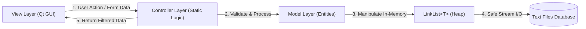
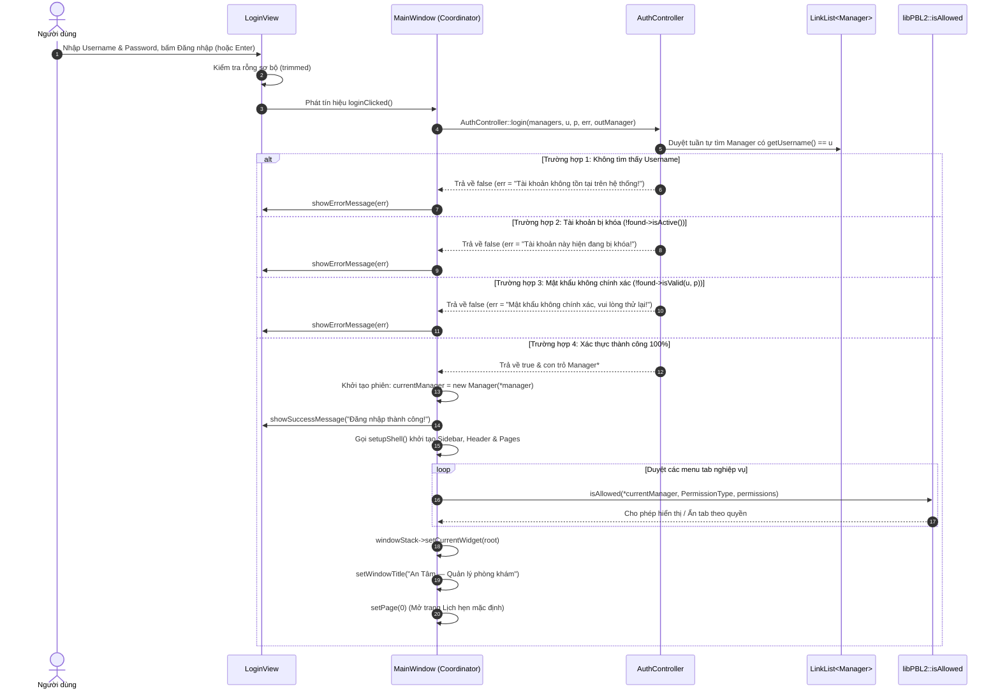
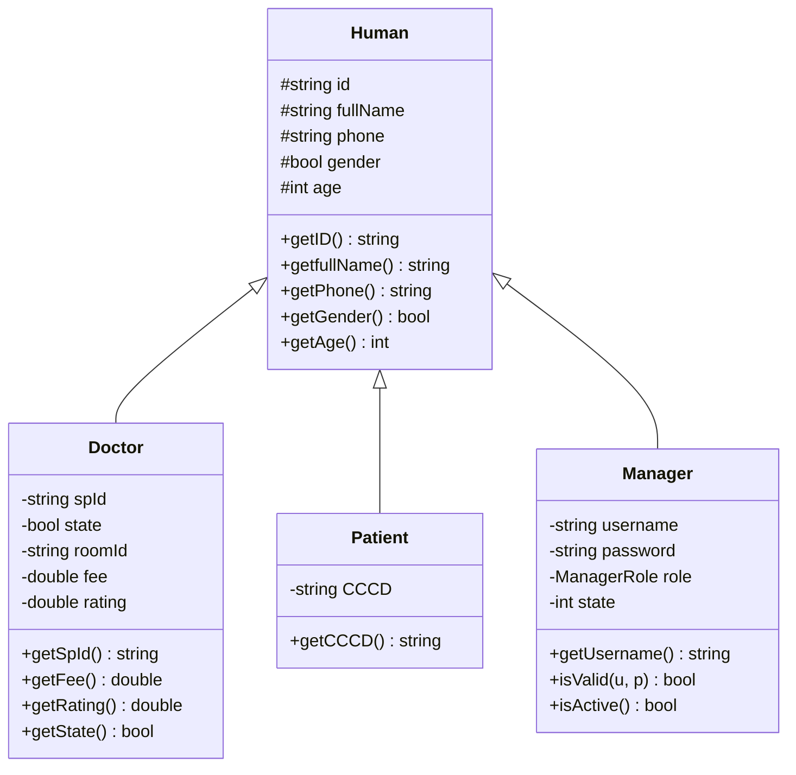

# 🔬 TÀI LIỆU KỸ THUẬT: CẤU TRÚC DỮ LIỆU & THUẬT TOÁN (Algorithms.md)

> **Dự án:** Hệ thống Quản lý Phòng Khám Đa Khoa An Tâm (**AnTamMng / MngCareBook**)  
> **Ngôn ngữ:** C++20 / C++23 (`-std=gnu++2b`) | **Framework UI:** Qt 6 (Core, Gui, Widgets, Charts)  
> **Đặc tả nguyên tắc:** Tuân thủ triệt để nguyên tắc **Zero Forbidden STL** (toàn bộ cấu trúc lưu trữ và giải thuật sắp xếp được xây dựng độc lập, không dùng container thư viện chuẩn) kết hợp cơ chế **Ngoại lệ An toàn (Exception Safety)**.

---

## 📑 MỤC LỤC CHI TIẾT

1. [Cấu trúc Tệp tin & Kiến trúc Tổng thể Dự án](#1-cấu-trúc-tệp-tin--kiến-trúc-tổng-thể-dự-án)
   - [1.1. Sơ đồ Cây Thư mục Dự án Toàn diện](#11-sơ-đồ-cây-thư-mục-dự-án-toàn-diện)
   - [1.2. Mô hình Phân lớp M-V-C & Luồng Dữ liệu](#12-mô-hình-phân-lớp-m-v-c--luồng-dữ-liệu)
   - [1.3. Nguyên tắc Kỹ thuật Zero Forbidden STL & Tổ chức Template](#13-nguyên-tắc-kỹ-thuật-zero-forbidden-stl--tổ-chức-template)
   - [1.4. Hệ thống Ngoại lệ Tập trung & An toàn Bộ nhớ (`AppExceptions.h`)](#14-hệ-thống-ngoại-lệ-tập-trung--an-toàn-bộ-nhớ-appexceptionsh)
2. [Quy trình & Thuật toán Xử lý Đăng nhập Hệ thống (Login Processing)](#2-quy-trình--thuật-toán-xử-lý-đăng-nhập-hệ-thống-login-processing)
   - [2.1. Sơ đồ Tuần tự Xác thực & Điều phối Phiên (Authentication Sequence)](#21-sơ-đồ-tuần-tự-xác-thực--điều-phối-phiên-authentication-sequence)
   - [2.2. Tiếp nhận & Tiền xử lý Input tại Giao diện (`LoginView`)](#22-tiếp-nhận--tiền-xử-lý-input-tại-giao-diện-loginview)
   - [2.3. Thuật toán Xác thực Nghiệp vụ tại `AuthController::login`](#23-thuật-toán-xác-thực-nghiệp-vụ-tại-authcontrollerlogin)
   - [2.4. Khởi tạo Phiên làm việc & Phân quyền Ma trận RBAC (`MainWindow::handleLogin`)](#24-khởi-tạo-phiên-làm-việc--phân-quyền-ma-trận-rbac-mainwindowhandlelogin)
   - [2.5. Chuyển đổi Trạng thái Giao diện & Xây dựng Shell Động (`setupShell`)](#25-chuyển-đổi-trạng-thái-giao-diện--xây-dựng-shell-động-setupshell)
   - [2.6. Quy trình Đăng xuất An toàn & Lưu Dữ liệu Tự động (`MainWindow::handleLogout`)](#26-quy-trình-đăng-xuất-an-toàn--lưu-dữ-liệu-tự-động-mainwindowhandlelogout)
3. [Cấu trúc Dữ liệu Cốt lõi: Danh sách Liên kết đôi `LinkList<T>`](#3-cấu-trúc-dữ-liệu-cốt-lõi-danh-sách-liên-kết-đôi-linklistt)
   - [3.1. Kiến trúc Nút Canh Giữ (Sentinel Nodes Architecture)](#31-kiến-trúc-nút-canh-giữ-sentinel-nodes-architecture)
   - [3.2. Đặc tả Chi tiết Các Hàm Cốt lõi & Quản lý Bộ nhớ An toàn](#32-đặc-tả-chi-tiết-các-hàm-cốt-lõi--quản-lý-bộ-nhớ-an-toàn)
   - [3.3. Bảng Độ phức tạp của `LinkList<T>`](#33-bảng-độ-phức-tạp-của-linklistt)
4. [Khung Thuật toán QuickSort Toàn năng (`libPBL2`)](#4-khung-thuật-toán-quicksort-toàn-năng-libpbl2)
   - [4.1. Kỹ thuật Hoán vị Giá trị In-Place (`swapVal`)](#41-kỹ-thuật-hoán-vị-giá-trị-in-place-swapval)
   - [4.2. Thuật toán QuickSort In-Place trên Doubly Linked List (`qsortNodes`)](#42-thuật-toán-quicksort-in-place-trên-doubly-linked-list-qsortnodes)
   - [4.3. Thuật toán QuickSort trên Mảng thô & Container Ngẫu nhiên](#43-thuật-toán-quicksort-trên-mảng-thô--container-ngẫu-nhiên)
   - [4.4. Các Động cơ So sánh Chuyên sâu (`compareNatural`, `compareVietnameseNames`, `compareDates`)](#44-các-động-cơ-so-sánh-chuyên-sâu-comparenatural-comparevietnamesenames-comparedates)
   - [4.5. Đặc tả Chi tiết Các Hàm Sắp xếp Nghiệp vụ Đa tiêu chí](#45-đặc-tả-chi-tiết-các-hàm-sắp-xếp-nghiệp-vụ-đa-tiêu-chí)
5. [Lớp Tiện ích Quản lý Thời gian & Lịch pháp: `Date`](#5-lớp-tiện-ích-quản-lý-thời-gian--lịch-pháp-date)
   - [5.1. Cấu trúc Biểu diễn Dữ liệu & Tính toán Lịch pháp](#51-cấu-trúc-biểu-diễn-dữ-liệu--tính-toán-lịch-pháp)
   - [5.2. Đặc tả Chi tiết Các Hàm & Hệ thống Toán tử](#52-đặc-tả-chi-tiết-các-hàm--hệ-thống-toán-tử)
6. [Tầng Mô hình Dữ liệu Nghiệp vụ (Models Layer)](#6-tầng-mô-hình-dữ-liệu-nghiệp-vụ-models-layer)
   - [6.1. Cây Kế thừa Thực thể: `Human` $\to$ `Doctor`, `Patient`, `Manager`](#61-cây-kế-thừa-thực-thể-human--doctor-patient-manager)
   - [6.2. Thực thể Lịch hẹn (`Appointment`) & Suy diễn Trạng thái Động](#62-thực-thể-lịch-hẹn-appointment--suy-diễn-trạng-thái-động)
   - [6.3. Các Thực thể Liên kết: `Symptom`, `SymptomPatient`, `SymptomPatientDetail`, `Permission`](#63-các-thực-thể-liên-kết-symptom-symptompatient-symptompatientdetail-permission)
   - [6.4. Đặc tả Chi tiết Hàm `loadFromFile`, `saveToFile`, `loadFromString` & Cơ chế Bắt Ngoại lệ](#64-đặc-tả-chi-tiết-hàm-loadfromfile-savetofile-loadfromstring--cơ-chế-bắt-ngoại-lệ)
7. [Tầng Điều khiển Nghiệp vụ (Controllers Layer)](#7-tầng-điều-khiển-nghiệp-vụ-controllers-layer)
   - [7.1. `AppointmentController`: Tính toán Lễ Tết, Trùng giờ, Sinh ID](#71-appointmentcontroller-tính-toán-lễ-tết-trùng-giờ-sinh-id)
   - [7.2. `PatientController` & `DoctorController`: Định danh & Ràng buộc](#72-patientcontroller--doctorcontroller-định-danh--ràng-buộc)
   - [7.3. `StatisticController`: Phân tích KPI, Bảng xếp hạng & Cấp phát Động](#73-statisticcontroller-phân-tích-kpi-bảng-xếp-hạng--cấp-phát-động)
   - [7.4. `ManagerController`: Quản lý Tài khoản & Ràng buộc Username](#74-managercontroller-quản-lý-tài-khoản--ràng-buộc-username)
8. [Tầng Giao diện & Trải nghiệm Người dùng (Views Engine)](#8-tầng-giao-diện--trải-nghiệm-người-dùng-views-engine)
   - [8.1. Sàng lọc Triệu chứng & Điều phối Chuyên khoa Tự động (Medical Triage)](#81-sàng-lọc-triệu-chứng--điều-phối-chuyên-khoa-tự-động-medical-triage)
   - [8.2. Lọc & Tìm kiếm Đa tiêu chí Thời gian Thực](#82-lọc--tìm-kiếm-đa-tiêu-chí-thời-gian-thực)
   - [8.3. Duyệt Ngược & Sắp xếp Giảm dần Lịch hẹn](#83-duyệt-ngược--sắp-xếp-giảm-dần-lịch-hẹn)
   - [8.4. Thuật toán Phân trang (`Pagination`) & Co giãn Bảng (`Responsive Scaling`)](#84-thuật-toán-phân-trang-pagination--co-giãn-bảng-responsive-scaling)
   - [8.5. Cơ chế Bảo lưu Vị trí Cuộn Trang (Scroll Position Preservation)](#85-cơ-chế-bảo-lưu-vị-trí-cuộn-trang-scroll-position-preservation)
9. [Bảng Ma trận Phân tích Độ phức tạp Toàn diện (Complexity Matrix)](#9-bảng-ma-trận-phân-tích-độ-phức-tạp-toàn-diện-complexity-matrix)

---

## 1. CẤU TRÚC TỆP TIN & KIẾN TRÚC TỔNG THỂ DỰ ÁN

### 1.1. Sơ đồ Cây Thư mục Dự án Toàn diện

```
MngCareBook/
├── Config/                             # Cấu hình hoạt động ngoại vi của hệ thống
│   ├── holidays.txt                    # Danh mục các ngày nghỉ lễ quốc gia & cấu hình Tết Âm lịch
│   └── specialties.txt                 # Bảng ánh xạ mã chuyên khoa (Sp_ID) và tên khoa khám
├── Data/                               # Cơ sở dữ liệu tệp văn bản (Text-based Database)
│   ├── Appointment.txt                 # Lưu trữ danh sách các cuộc hẹn khám bệnh
│   ├── Doctor/
│   │   └── Doctor.txt                  # Lưu trữ hồ sơ thông tin và biểu phí của bác sĩ
│   ├── Manager.txt                     # Danh sách tài khoản nhân viên (Admin, Lễ tân)
│   ├── Patient.txt                     # Danh sách hồ sơ thông tin bệnh nhân
│   ├── Permission.txt                  # Bảng ánh xạ ma trận phân quyền chi tiết (RBAC)
│   └── Symptom/
│       ├── Symptom.txt                 # Danh mục các triệu chứng lâm sàng chuẩn hóa
│       ├── SymptomPatient.txt          # Phiếu ghi nhận triệu chứng bệnh nhân lúc tiếp nhận
│       └── SymptomPatientDetail.txt    # Bảng quan hệ N:N giữa phiếu khám và các mã triệu chứng
├── src/                                # Toàn bộ mã nguồn C++ của hệ thống
│   ├── main.cpp                        # Điểm khởi chạy ứng dụng (Application Entry Point)
│   ├── DataStructures/                 # Tầng cấu trúc dữ liệu tự xây dựng (Zero STL Containers)
│   │   ├── LinkList.h                  # Khai báo lớp mẫu (Template) danh sách liên kết đôi
│   │   └── LinkList.cpp                # Định nghĩa chi tiết Template LinkList<T> & dọn dẹp bộ nhớ
│   ├── Models/                         # Tầng mô hình thực thể thuần túy (Entity Models)
│   │   ├── Human.h / Human.cpp         # Lớp cơ sở trừu tượng chứa thuộc tính con người
│   │   ├── Doctor.h / Doctor.cpp       # Thực thể Bác sĩ (Kế thừa Human)
│   │   ├── Patient.h / Patient.cpp     # Thực thể Bệnh nhân (Kế thừa Human)
│   │   ├── Manager.h / Manager.cpp     # Thực thể Nhân viên quản lý (Kế thừa Human)
│   │   ├── Appointment.h / .cpp        # Thực thể Lịch hẹn khám bệnh
│   │   ├── Permission.h / .cpp         # Thực thể Quyền hạn hệ thống
│   │   ├── Symptom.h / .cpp            # Thực thể Danh mục triệu chứng
│   │   ├── SymptomPatient.h / .cpp     # Thực thể Phiếu tiếp nhận triệu chứng
│   │   └── SymptomPatientDetail.h/.cpp # Thực thể Chi tiết triệu chứng phiếu khám
│   ├── Controllers/                    # Tầng xử lý nghiệp vụ tĩnh (Business Logic Controllers)
│   │   ├── AuthController.h / .cpp     # Nghiệp vụ xác thực đăng nhập & kiểm soát mật khẩu
│   │   ├── AppointmentController.h/.cpp# Nghiệp vụ đặt khám, kiểm tra xung đột lịch & ngày lễ
│   │   ├── DoctorController.h / .cpp   # Nghiệp vụ tra cứu bác sĩ & danh mục chuyên khoa
│   │   ├── PatientController.h / .cpp  # Nghiệp vụ thẩm định số điện thoại, CCCD & hồ sơ bệnh nhân
│   │   ├── ManagerController.h / .cpp  # Nghiệp vụ quản lý tài khoản & tính duy nhất của username
│   │   └── StatisticController.h / .cpp# Nghiệp vụ phân tích số liệu, doanh thu, KPI & Leaderboard
│   ├── Utils/                          # Tiện ích giải thuật, lịch pháp và xử lý ngoại lệ
│   │   ├── AppExceptions.h             # Cây phân cấp ngoại lệ chuẩn C++ (std::exception)
│   │   ├── Date.h / Date.cpp           # Lớp lịch pháp chuẩn hóa, định dạng & toán tử thời gian
│   │   ├── libPBL2.h                   # Khai báo giải thuật QuickSort, UTF-8 & phân quyền RBAC
│   │   └── libPBL2.cpp                 # Định nghĩa chi tiết các hàm template & tiện ích chuỗi
│   └── Views/                          # Tầng giao diện người dùng đồ họa (Qt6 Widgets & Charts)
│       ├── MainWindow.h / .cpp         # Cửa sổ chính: Bộ điều phối, quản lý Stack & Session
│       ├── UIHelper.h / UIHelper.cpp   # Thư viện giao diện chuẩn hóa: Button, Table, Modal Alert
│       ├── Login/                      # Màn hình đăng nhập hệ thống
│       │   ├── Login.h
│       │   └── Login.cpp
│       ├── Appointment/                # Màn hình quản lý lịch hẹn & Đặt khám tự động
│       │   ├── AppointmentView.h
│       │   └── AppointmentView.cpp
│       ├── Doctor/                     # Màn hình quản lý hồ sơ bác sĩ
│       │   ├── DoctorView.h
│       │   └── DoctorView.cpp
│       ├── Patient/                    # Màn hình quản lý danh sách bệnh nhân
│       │   ├── PatientView.h
│       │   └── PatientView.cpp
│       ├── Account/                    # Màn hình phân quyền & quản trị tài khoản
│       │   ├── AccountView.h
│       │   └── AccountView.cpp
│       └── Statistic/                  # Màn hình báo cáo thống kê & biểu đồ trực quan
│           ├── StatisticView.h
│           └── StatisticView.cpp
├── PBL_2.pro                           # Tệp kịch bản biên dịch dự án Qt qmake
└── resource.qrc                        # Tệp tài nguyên đồ họa (Icons, Banner minh họa)
```

### 1.2. Mô hình Phân lớp M-V-C & Luồng Dữ liệu

Ứng dụng vận hành theo mô hình kiến trúc MVC tách biệt nghiêm ngặt:



1. **Model Layer (`src/Models/`):** Chứa định nghĩa thực thể thuần túy, độc lập 100% với Qt Framework. Quản lý việc nạp và lưu dữ liệu thông qua con trỏ `LinkList<T>*`.
2. **Controller Layer (`src/Controllers/`):** Tập hợp các lớp chứa phương thức tĩnh (Pure Static Methods) thực thi các quy tắc nghiệp vụ, tính toán chỉ số, thẩm định dữ liệu và bảo đảm tính toàn vẹn.
3. **View Layer (`src/Views/`):** Thành phần giao diện kế thừa từ `QWidget`, tiếp nhận tương tác người dùng, hiển thị dữ liệu bảng, vẽ biểu đồ và phân trang.
4. **DataStructures & Utils Layer (`src/DataStructures/`, `src/Utils/`):** Nền tảng cốt lõi của hệ thống, cung cấp danh sách liên kết đôi có nút canh giữ `LinkList<T>`, bộ giải thuật QuickSort In-Place `libPBL2`, lớp thời gian `Date` và hệ thống ngoại lệ `AppExceptions.h`.

### 1.3. Nguyên tắc Kỹ thuật Zero Forbidden STL & Tổ chức Template

- **Zero Forbidden STL:** Không sử dụng các container thư viện chuẩn (`std::vector`, `std::list`, `std::deque`, `std::map`, `std::set`) làm cấu trúc lưu trữ nghiệp vụ chính; không sử dụng các giải thuật có sẵn (`std::sort`, `std::find`). Thay vào đó, toàn bộ dữ liệu vận hành trên `LinkList<T>` và giải thuật QuickSort tự thiết kế.
- **Quy tắc Tổ chức Template C++:**
  - Phần khai báo (declaration) đặt tại file header (`.h`).
  - Phần triển khai (implementation) đặt trong file `.cpp` tương ứng.
  - Cuối file header (ngay trước `#endif`), include file `.cpp` vào (`#include "LinkList.cpp"`, `#include "libPBL2.cpp"`) để trình biên dịch nạp mã máy cho mọi kiểu dữ liệu `T`.

### 1.4. Hệ thống Ngoại lệ Tập trung & An toàn Bộ nhớ (`AppExceptions.h`)

Toàn bộ hệ thống áp dụng cơ chế xử lý lỗi hướng đối tượng kế thừa từ `std::exception`:

```
std::exception
  └── AppException (Lớp cơ sở toàn hệ thống)
        ├── MemoryAllocationException  (Lỗi hết RAM, không cấp phát được Node / mảng)
        ├── FileIOException            (Lỗi tệp không tồn tại, bị khóa hoặc mất quyền ghi)
        ├── DataFormatException        (Lỗi hỏng dữ liệu dòng, sai định dạng số/ngày)
        └── ValidationException        (Lỗi nghiệp vụ: trùng ID, trùng lịch, dữ liệu rỗng)
```

---

## 2. QUY TRÌNH & THUẬT TOÁN XỬ LÝ ĐĂNG NHẬP HỆ THỐNG (LOGIN PROCESSING)

Quy trình xác thực đăng nhập là cửa ngõ bảo mật và điều phối phiên làm việc của toàn bộ hệ thống. Luồng xử lý được chuẩn hóa qua 6 giai đoạn rõ ràng:

### 2.1. Sơ đồ Tuần tự Xác thực & Điều phối Phiên (Authentication Sequence)



### 2.2. Tiếp nhận & Tiền xử lý Input tại Giao diện (`LoginView`)

*Tệp nguồn:* [`src/Views/Login/Login.h`](file:///d:/Documents/Universe_Materials/Semester_3/PBL_2/src/Views/Login/Login.h) & [`src/Views/Login/Login.cpp`](file:///d:/Documents/Universe_Materials/Semester_3/PBL_2/src/Views/Login/Login.cpp)

1. **Cấu trúc Giao diện:** Thiết kế Card nổi bật giữa màn hình với hiệu ứng đổ bóng mờ, gồm trường nhập tài khoản (`m_txtUsername`), trường nhập mật khẩu (`m_txtPassword`), nút Đăng nhập (`m_btnLogin`) và nhãn phản hồi thông báo (`m_lblMessage`).
2. **Cơ chế Chuyển đổi Ẩn/Hiện Mật khẩu (`onTogglePasswordVisibility`):**
   - Mặc định trường mật khẩu đặt ở chế độ `QLineEdit::Password`.
   - Nút icon "con mắt" (`QAction`) đặt ở cuối ô nhập liệu cho phép chuyển đổi tức thời giữa `Password` và `Normal`, cập nhật lại icon đóng/mở mắt tương ứng.
3. **Kích hoạt Sự kiện:**
   - Người dùng bấm nút **"Đăng nhập"** hoặc nhấn phím **Enter** trên bất kỳ ô nhập liệu nào (`returnPressed` signal) đều kích hoạt việc phát tín hiệu `emit loginClicked()`.

### 2.3. Thuật toán Xác thực Nghiệp vụ tại `AuthController::login`

*Tệp nguồn:* [`src/Controllers/AuthController.h`](file:///d:/Documents/Universe_Materials/Semester_3/PBL_2/src/Controllers/AuthController.h) & [`src/Controllers/AuthController.cpp`](file:///d:/Documents/Universe_Materials/Semester_3/PBL_2/src/Controllers/AuthController.cpp)

#### Đặc tả Hàm:
```cpp
static bool login(LinkList<Manager> *managers, 
                  const QString &username, 
                  const QString &password, 
                  QString &errorMessage, 
                  Manager *&outManager);
```

#### Các Bước Xử lý:
1. **Kiểm tra Rỗng:** Chuỗi `username.trimmed()` và `password` nếu rỗng sẽ lập tức từ chối và thiết lập `errorMessage` tương ứng mà không cần duyệt dữ liệu.
2. **Kiểm tra Tính sẵn sàng của Dữ liệu:** Nếu con trỏ `managers` hoặc `managers->getHeader()` là `nullptr`, báo lỗi hệ thống chưa nạp được dữ liệu tài khoản.
3. **Thuật toán Tìm kiếm Tuyến tính (Linear Search):** Duyệt tuần tự từ `managers->getHeader()->next` đến trước `footer`:
   - So sánh chuỗi định danh: `n->info.getUsername() == su`.
   - Nếu tìm thấy, gán con trỏ `found = &n->info;` và ngắt vòng lặp (`break`).
4. **Kiểm tra Trạng thái Tài khoản:**
   - Nếu `found == nullptr`: Báo lỗi `"Tài khoản không tồn tại trên hệ thống!"`.
   - Nếu `!found->isActive()` (tức `state == 0`): Báo lỗi `"Tài khoản này hiện đang bị khóa!"`.
5. **Kiểm tra Khớp Mật khẩu:**
   - Gọi `found->isValid(su, sp)` (so khớp chuỗi nhạy chữ hoa/thường).
   - Nếu sai: Báo lỗi `"Mật khẩu không chính xác, vui lòng thử lại!"`.
6. **Xác nhận Thành công:** Gán `outManager = found;` và trả về `true`.

### 2.4. Khởi tạo Phiên làm việc & Phân quyền Ma trận RBAC (`MainWindow::handleLogin`)

Khi `AuthController::login` trả về `true`:
1. **Quản lý Vòng đời Đối tượng Phiên:**
   ```cpp
   delete currentManager;
   currentManager = new Manager(*manager); // Deep copy để cô lập phiên
   currentManagerId = currentManager->getID();
   ```
2. **Thông báo Trực quan:** Gọi `loginView->showSuccessMessage("Đăng nhập thành công!")` đổi màu nhãn sang xanh lá cây tạo phản hồi mượt mà cho người dùng.

### 2.5. Chuyển đổi Trạng thái Giao diện & Xây dựng Shell Động (`setupShell`)

*Tệp nguồn:* [`src/Views/MainWindow.cpp`](file:///d:/Documents/Universe_Materials/Semester_3/PBL_2/src/Views/MainWindow.cpp#L602)

Hàm `setupShell()` tái thiết lập toàn bộ vùng làm việc:
1. **Giải phóng Vùng nhìn Cũ:** Dọn dẹp widget `root` cũ cùng toàn bộ các subview con để giải phóng RAM.
2. **Tạo Cột Điều hướng (Sidebar Navigation) Động theo Quyền:**
   Dựa trên vai trò và bảng phân quyền `PermissionList`, hàm `libPBL2::isAllowed` sẽ thẩm định từng mục điều hướng:
   - **Tab Lịch khám:** Yêu cầu quyền `PermissionType::Per_1`.
   - **Tab Bệnh nhân:** Yêu cầu quyền `PermissionType::Per_2`.
   - **Tab Bác sĩ:** Yêu cầu quyền `PermissionType::Per_3`.
   - **Tab Tài khoản:** Yêu cầu quyền `PermissionType::Per_4`.
   - **Tab Báo cáo Thống kê:** Yêu cầu quyền `PermissionType::Per_5`.
   *(Nếu tài khoản là `Administrator`, hàm `isAllowed` luôn trả về `true` cho toàn bộ các tab).*
3. **Hiển thị Huy hiệu Người dùng:** Sidebar hiển thị tên đầy đủ, vai trò (`Quản trị viên`, `Lễ tân`, `Lễ tân đặc biệt`) và nút Đăng xuất chuyên nghiệp.
4. **Chuyển Đổi Widget:** Đưa widget `root` vào `windowStack` và chuyển đổi góc nhìn qua `windowStack->setCurrentWidget(root)`.

### 2.6. Quy trình Đăng xuất An toàn & Lưu Dữ liệu Tự động (`MainWindow::handleLogout`)

1. **Hộp thoại Xác nhận Chuẩn UX:** Mở modal xác nhận hỏi người dùng có chắc chắn muốn đăng xuất.
2. **Tự động Lưu Toàn vẹn Dữ liệu:** Nếu người dùng đồng ý:
   ```cpp
   saveAll(SaveScope::All, SaveAction::CloseOrLogout);
   ```
   Toàn bộ dữ liệu bệnh nhân, bác sĩ, lịch hẹn, tài khoản và triệu chứng được lưu xuống các file đĩa an toàn.
3. **Thu hồi Phiên:** Giải phóng con trỏ `delete currentManager; currentManager = nullptr;`, xóa trắng mã định danh `currentManagerId.clear()`.
4. **Trở về Màn hình Đăng nhập (`showLogin`):** Gọi `loginView->clearInputs()` và `loginView->clearMessage()`, sau đó chuyển `windowStack->setCurrentWidget(loginView)`.

---

## 3. CẤU TRÚC DỮ LIỆU CỐT LÕI: DANH SÁCH LIÊN KẾT ĐÔI `LinkList<T>`

*Tệp nguồn:* [`src/DataStructures/LinkList.h`](file:///d:/Documents/Universe_Materials/Semester_3/PBL_2/src/DataStructures/LinkList.h) & [`src/DataStructures/LinkList.cpp`](file:///d:/Documents/Universe_Materials/Semester_3/PBL_2/src/DataStructures/LinkList.cpp)

### 3.1. Kiến trúc Nút Canh Giữ (Sentinel Nodes Architecture)

Cấu trúc lưu trữ loại bỏ hoàn toàn các trường hợp biên đặc biệt bằng cách cố định 2 nút canh giữ: `header` và `footer`.

```
[nullptr] <-- prev [ header ] next --> [ Node 1 ] next --> ... --> [ Node N ] next --> [ footer ] next --> [nullptr]
                         ^                prev                      prev  <-- prev       |
                         |---------------------------------------------------------------|
```

- Nút dữ liệu đầu tiên luôn là `header->next`.
- Nút dữ liệu cuối cùng luôn là `footer->prev`.
- Khi danh sách rỗng: `header->next == footer` và `footer->prev == header`.

### 3.2. Đặc tả Chi tiết Các Hàm Cốt lõi & Quản lý Bộ nhớ An toàn

#### A. Hàm Tạo Mặc định (`LinkList()`)
```cpp
template <class T>
LinkList<T>::LinkList();
```
- **Nhiệm vụ:** Cấp phát 2 nút canh giữ `header` và `footer`, liên kết chúng lại với nhau.
- **An toàn Ngoại lệ:** Nếu cấp phát `footer` thất bại (ném `std::bad_alloc`), hàm lập tức giải phóng `header` đã cấp phát trước đó và chuyển hóa thành `MemoryAllocationException`.
- **Độ phức tạp:** Thời gian $\mathcal{O}(1)$ | Không gian $\mathcal{O}(1)$.

#### B. Hàm Sao chép Sâu (Copy Constructor `LinkList(const LinkList &L)`)
```cpp
template <class T>
LinkList<T>::LinkList(const LinkList &L);
```
- **Nhiệm vụ:** Khởi tạo danh sách mới sao chép toàn bộ các nút từ danh sách `L`.
- **An toàn Ngoại lệ:** Bọc toàn bộ quá trình lặp chèn nút bằng khối `try...catch`. Nếu hết bộ nhớ giữa chừng, toàn bộ các nút vừa tạo sẽ được giải phóng hoàn toàn trước khi ném tiếp ngoại lệ, cam kết không rò rỉ RAM.
- **Độ phức tạp:** Thời gian $\mathcal{O}(N)$ | Không gian $\mathcal{O}(N)$.

#### C. Hàm Hủy (`~LinkList()`)
```cpp
template <class T>
LinkList<T>::~LinkList();
```
- **Nhiệm vụ:** Duyệt tuần tự từ `header` đến `footer`, thu hồi toàn bộ các nút động trên Heap và đặt các con trỏ về `nullptr`.
- **Độ phức tạp:** Thời gian $\mathcal{O}(N)$ | Không gian $\mathcal{O}(1)$.

#### D. Hàm Chèn Phần tử vào Cuối (`insert(const T &info)`)
```cpp
template <class T>
bool LinkList<T>::insert(const T &info);
```
- **Tham số:** `info` (hằng tham chiếu đối tượng cần chèn).
- **Giá trị trả về:** `true` nếu chèn thành công.
- **Nguyên lý:** Cấp phát `Node *tmp = new Node;`, chèn vào giữa `footer->prev` và `footer`.
- **An toàn Ngoại lệ:** Bắt `std::bad_alloc` và ném `MemoryAllocationException`.
- **Độ phức tạp:** Thời gian $\mathcal{O}(1)$ | Không gian $\mathcal{O}(1)$.

#### E. Hàm Xóa Nút Bất kỳ (`remove(Node *N)`)
```cpp
template <class T>
bool LinkList<T>::remove(Node *N);
```
- **Tham số:** `N` (con trỏ nút cần loại bỏ).
- **Giá trị trả về:** `true` nếu xóa thành công, `false` nếu nút là `nullptr`, `header` hoặc `footer`.
- **Nguyên lý:** Nối tắt con trỏ giữa `N->prev` và `N->next`, sau đó gọi `delete N; count--;`.
- **Độ phức tạp:** Thời gian $\mathcal{O}(1)$ | Không gian $\mathcal{O}(1)$.

### 3.3. Bảng Độ phức tạp của `LinkList<T>`

| Phương thức | Độ phức tạp Thời gian (TB) | Độ phức tạp Thời gian (Tệ nhất) | Không gian Bộ nhớ | Cơ chế |
| :--- | :---: | :---: | :---: | :--- |
| `insert(const T &)` | $\mathcal{O}(1)$ | $\mathcal{O}(1)$ | $\mathcal{O}(1)$ | Chèn trước `footer` |
| `remove(Node *)` | $\mathcal{O}(1)$ | $\mathcal{O}(1)$ | $\mathcal{O}(1)$ | Tái nối con trỏ liền kề |
| `getCount()` | $\mathcal{O}(1)$ | $\mathcal{O}(1)$ | $\mathcal{O}(1)$ | Trả về thuộc tính `count` |
| `getHeader()`, `getFooter()`| $\mathcal{O}(1)$ | $\mathcal{O}(1)$ | $\mathcal{O}(1)$ | Truy xuất con trỏ biên |
| Copy Constructor | $\mathcal{O}(N)$ | $\mathcal{O}(N)$ | $\mathcal{O}(N)$ | Sao chép sâu độc lập |
| Destructor | $\mathcal{O}(N)$ | $\mathcal{O}(N)$ | $\mathcal{O}(1)$ | Giải phóng tuần tự |

---

## 4. KHUNG THUẬT TOÁN QUICKSORT TOÀN NĂNG (`libPBL2`)

*Tệp nguồn:* [`src/Utils/libPBL2.h`](file:///d:/Documents/Universe_Materials/Semester_3/PBL_2/src/Utils/libPBL2.h) & [`src/Utils/libPBL2.cpp`](file:///d:/Documents/Universe_Materials/Semester_3/PBL_2/src/Utils/libPBL2.cpp)

### 4.1. Kỹ thuật Hoán vị Giá trị In-Place (`swapVal`)

```cpp
template <typename T>
inline void swapVal(T &a, T &b) {
    T tmp = static_cast<T&&>(a);
    a = static_cast<T&&>(b);
    b = static_cast<T&&>(tmp);
}
```
- **Ưu điểm:** Hoán đổi dữ liệu `info` giữa 2 node mà không cần nối lại các con trỏ liên kết `next`/`prev`, bảo tồn 100% hình thái danh sách liên kết.

### 4.2. Thuật toán QuickSort In-Place trên Doubly Linked List (`qsortNodes`)

#### A. Phân hoạch Lomuto Hai Con trỏ Node (`partitionNodes`):
- Chọn chốt $Pivot = \text{right->info}$.
- Duyệt con trỏ nhanh $j$ từ `left` đến trước `right`. Khi thỏa mãn hàm so sánh `comp(j->info, pivot)`, tăng con trỏ chậm $i$ và hoán vị giá trị.
- Đưa chốt về đúng vị trí ranh giới phân hoạch và trả về con trỏ nút chốt.

#### B. Đệ quy Phân vùng (`qsortNodes`):
```cpp
template <typename T, typename Compare>
void qsortNodes(typename LinkList<T>::Node *left, typename LinkList<T>::Node *right, Compare comp) {
    if (!left || !right || left == right || right->next == left) return;
    auto *pivot = partitionNodes<T, Compare>(left, right, comp);
    if (pivot != left && pivot->prev) qsortNodes<T, Compare>(left, pivot->prev, comp);
    if (pivot != right && pivot->next) qsortNodes<T, Compare>(pivot->next, right, comp);
}
```

### 4.3. Thuật toán QuickSort trên Mảng thô & Container Ngẫu nhiên

- **`qsort(T *arr, int low, int high, Compare comp)`:** QuickSort Lomuto trên mảng C-Array thô, phục vụ sắp xếp mảng động Leaderboard của `StatisticController`.
- **`qsortRandomAccess(Container &c, int low, int high, Compare comp)`:** Hỗ trợ mọi container hỗ trợ toán tử ngoặc vuông `c[i]` (`QList<Appointment*>`), phục vụ sắp xếp tức thời trên View.

### 4.4. Các Động cơ So sánh Chuyên sâu

- **`compareNatural(const string &a, const string &b)`:** Tách token ký tự và cụm chữ số, so sánh theo giá trị số học thực tế thay vì mã ASCII (ví dụ `"A_002" < "A_010"`).
- **`compareVietnameseNames(const string &nameA, const string &nameB)`:** Tách riêng **Tên chính** (từ cuối cùng) và sử dụng `QCollator` (locale `vi_VN`) để sắp xếp theo bảng chữ cái tiếng Việt chuẩn (A $\to$ Ă $\to$ Â...). Nếu trùng tên chính mới so sánh Họ và Tên đệm.
- **`compareDates(const Date &a, const Date &b)`:** So sánh phân cấp từ lớn đến nhỏ: Năm $\to$ Tháng $\to$ Ngày $\to$ Giờ $\to$ Phút.

### 4.5. Đặc tả Chi tiết Các Hàm Sắp xếp Nghiệp vụ Đa tiêu chí

- `sortPatients(LinkList<Patient> *list, PatientSortBy criteria, bool ascending)`: Hỗ trợ tiêu chí: `ID`, `Name`, `Age`, `CCCD`, `Phone`, `Gender`.
- `sortDoctors(LinkList<Doctor> *list, DoctorSortBy criteria, bool ascending)`: Hỗ trợ tiêu chí: `ID`, `Name`, `Rating`, `Fee`, `Specialty`, `Room`, `State`.
- `sortAppointments(LinkList<Appointment> *list, AppointmentSortBy criteria, bool ascending)`: Hỗ trợ tiêu chí: `Date` (`DateGet`), `ID`, `State`, `DoctorID`.
- `sortManagers(LinkList<Manager> *list, AccountSortBy criteria, bool ascending)`: Hỗ trợ tiêu chí: `ID`, `Username`, `Name`, `Role`, `State`.

---

## 5. LỚP TIỆN ÍCH QUẢN LÝ THỜI GIAN & LỊCH PHÁP: `Date`

*Tệp nguồn:* [`src/Utils/Date.h`](file:///d:/Documents/Universe_Materials/Semester_3/PBL_2/src/Utils/Date.h) & [`src/Utils/Date.cpp`](file:///d:/Documents/Universe_Materials/Semester_3/PBL_2/src/Utils/Date.cpp)

### 5.1. Cấu trúc Biểu diễn Dữ liệu & Tính toán Lịch pháp

Đóng gói 5 thuộc tính: `day`, `month`, `year`, `hour`, `minute`.
- **Năm Nhuận:** $\text{isLeapYear}(Y) \iff (Y \pmod 4 = 0 \land Y \pmod{100} \neq 0) \lor (Y \pmod{400} = 0)$.
- **Số ngày trong tháng (`posofdayinmonth`):** Trả về chính xác số ngày hợp lệ (28, 29, 30 hoặc 31 ngày).

### 5.2. Đặc tả Chi tiết Các Hàm & Hệ thống Toán tử

- `Date::now()`: Lấy thời gian thực từ đồng hồ hệ thống `time(nullptr)`.
- `Date::toString()`: Định dạng chuẩn `YYYY-MM-DD HH:MM`.
- `Date::loadFromString(const string &str)`: Bóc tách chuỗi hỗ trợ cả định dạng gạch ngang (`YYYY-MM-DD`) và gạch chéo (`DD/MM/YYYY`).
- **Toán tử So sánh:** Nạp chồng toàn bộ quan hệ `<`, `<=`, `>`, `>=`, `==`, `!=` theo thứ tự từ điển phân cấp thời gian.
- **Toán tử Cộng/Trừ Ngày:** Tự động điều chỉnh tràn ngày/tháng/năm khi thực hiện tính toán khoảng cách ngày hẹn.

---

## 6. TẦNG MÔ HÌNH DỮ LIỆU NGHIỆP VỤ (MODELS LAYER)

*Thư mục nguồn:* [`src/Models/`](file:///d:/Documents/Universe_Materials/Semester_3/PBL_2/src/Models)

### 6.1. Cây Kế thừa Thực thể: `Human` $\to$ `Doctor`, `Patient`, `Manager`



### 6.2. Thực thể Lịch hẹn (`Appointment`) & Suy diễn Trạng thái Động

Hàm `computeEffectiveState(curDay, curMonth, curYear, curHour, curMin)`:
$$\text{EffectiveState} = \begin{cases} 
1 & \text{nếu } \text{state} == 1 \text{ (Đã hoàn tất khám)} \\
-1 & \text{nếu } \text{state} == -1 \lor (\text{state} == 0 \land \text{dateGet} \le \text{currentTime}) \text{ (Trễ hẹn)} \\
0 & \text{ngược lại (Chưa khám - sắp diễn ra)}
\end{cases}$$

### 6.3. Các Thực thể Liên kết: `Symptom`, `SymptomPatient`, `SymptomPatientDetail`, `Permission`

- `Symptom`: Danh mục triệu chứng (`S_id`, `sName`, `Sp_id`, `sScore`).
- `SymptomPatient`: Phiếu tiếp nhận lâm sàng (`SP_id`, `P_id`, `Sp_id`, `date`).
- `SymptomPatientDetail`: Quan hệ thực thể kết hợp ánh xạ nhiều triệu chứng cho một phiếu khám (`SP_id`, `S_id`).
- `Permission`: Ánh xạ phân quyền ma trận giữa tài khoản nhân viên và quyền hạn (`MA_id`, `Per_id`).

### 6.4. Đặc tả Chi tiết Hàm `loadFromFile`, `saveToFile`, `loadFromString` & Cơ chế Bắt Ngoại lệ

Toàn bộ 8 Model đều tuân thủ cấu trúc nạp/ghi an toàn:

#### Cấu trúc Mẫu `Model::loadFromFile(path)`:
```cpp
LinkList<T>* Model::loadFromFile(const string &path) {
    ifstream f(path);
    if (!f.is_open()) {
        throw FileIOException(path, "Không thể mở tệp để đọc dữ liệu.");
    }
    LinkList<T> *list = nullptr;
    try {
        list = new LinkList<T>;
        // Bỏ qua dòng tiêu đề và phân cách...
        string line;
        int lineNo = 2;
        while (getline(f, line)) {
            lineNo++;
            libPBL2::trim(line);
            if (line.empty()) continue;
            try {
                T item = Model::loadFromString(line);
                if (!item.isDefault()) list->insert(item);
            } catch (const AppException &) {
                throw;
            } catch (const std::exception &e) {
                throw DataFormatException(path, lineNo, e.what());
            }
        }
        f.close();
        return list;
    } catch (...) {
        delete list; // Giải phóng ngay để chống leak bộ nhớ
        f.close();
        throw;
    }
}
```

#### Cấu trúc Mẫu `Model::saveToFile(path, list)`:
```cpp
bool Model::saveToFile(const string &path, const LinkList<T> *list) {
    if (!list || list->getHeader() == nullptr) return false;
    ofstream f(path);
    if (!f.is_open()) {
        throw FileIOException(path, "Không thể mở tệp để ghi dữ liệu (bị khóa hoặc không có quyền).");
    }
    // Ghi tiêu đề bảng...
    // Duyệt danh sách ghi từng dòng toString()...
    f.close();
    return true;
}
```

---

## 7. TẦNG ĐIỀU KHIỂN NGHIỆP VỤ (CONTROLLERS LAYER)

*Thư mục nguồn:* [`src/Controllers/`](file:///d:/Documents/Universe_Materials/Semester_3/PBL_2/src/Controllers)

### 7.1. `AppointmentController`: Tính toán Lễ Tết, Trùng giờ, Sinh ID

- **Kiểm tra Nghỉ Tết Âm lịch (`isTetHoliday`):** Tích hợp bảng tra cứu ngày Mùng 1 Tết Âm lịch từ 2020 đến 2045, tính toán chính xác dải ngày nghỉ Tết theo quy định nhà nước.
- **Kiểm tra Ngày nghỉ Lễ (`getHolidayNote`):** Đọc động tệp `Config/holidays.txt` để phát hiện ngày lễ (Tết Dương lịch, Giỗ tổ Hùng Vương, 30/4 - 1/5, 2/9) và khóa lịch đặt khám.
- **Kiểm tra Xung đột Khung giờ (`isSlotBooked`):** Quét danh sách xác định bác sĩ đã có lịch hẹn chưa khám trong cùng khung giờ hay chưa.
- **Sinh ID Tự tăng (`generateNextId`):** Quét toàn bộ danh sách tìm số nguyên lớn nhất sau tiền tố `A_` để sinh mã duy nhất `A_xxx`.

### 7.2. `PatientController` & `DoctorController`: Định danh & Ràng buộc

- **`isValidPhone(str)`:** Thẩm định số điện thoại đúng 10 chữ số và bắt đầu bằng số `0`.
- **`isValidCCCD(str)`:** Thẩm định số CCCD đúng 12 chữ số và bắt đầu bằng số `0`.
- **`getUnresolvedSymptoms(patients, appointments, symptomPatients)`:** Truy vết các phiếu khám bệnh nhân chưa có lịch hẹn khám hoàn tất ($state = 1$) để cảnh báo.
- **`getSpecializationList(specPath)`:** Bóc tách danh mục chuyên khoa từ `Config/specialties.txt`.

### 7.3. `StatisticController`: Phân tích KPI, Bảng xếp hạng & Cấp phát Động

- **`todayRevenue` & `totalRevenue`:** Tích lũy doanh thu thực tế từ biểu phí bác sĩ của các ca khám có trạng thái $state = 1$.
- **`completionRate`:** Tính toán tỷ lệ hoàn tất khám bệnh dựa trên tổng số ca khám đến thời điểm hiện tại:
  $$\text{CompletionRate} = \frac{N_{\text{completed}}}{N_{\text{completed}} + N_{\text{delayed}}} \times 100\%$$
- **`getTopDoctors` (Leaderboard):** Cấp phát mảng động `allItems = new DoctorLeaderboardItem[totalDocs]`, bọc ngoại lệ `MemoryAllocationException`, đếm số lượt khám và sắp xếp giảm dần bằng `libPBL2::qsort`.
- **`getSpecialtyDemand`:** Thống kê nhu cầu khám theo từng chuyên khoa, cấp phát bộ nhớ động linh hoạt và sắp xếp giảm dần.

### 7.4. `ManagerController`: Quản lý Tài khoản & Ràng buộc Username

- **`isUsernameTaken(managers, username, excludeId)`:** Quét toàn bộ danh sách đảm bảo tên đăng nhập là duy nhất trên toàn hệ thống.
- **`generateNextId(managers)`:** Tự động sinh mã nhân viên tiếp theo theo định dạng `MA_xxx`.

---

## 8. TẦNG GIAO DIỆN & TRẢI NGHIỆM NGƯỜI DÙNG (VIEWS ENGINE)

*Thư mục nguồn:* [`src/Views/`](file:///d:/Documents/Universe_Materials/Semester_3/PBL_2/src/Views)

### 8.1. Sàng lọc Triệu chứng & Điều phối Chuyên khoa Tự động (Medical Triage)

Khi tiếp nhận bệnh nhân đặt lịch khám:
1. Giao diện cho phép chọn một hoặc nhiều triệu chứng phổ biến.
2. Mỗi triệu chứng mang trọng số và mã chuyên khoa tương ứng.
3. Thuật toán tính tổng điểm theo chuyên khoa: $K^* = \arg\max_K \sum_{s \in S, K(s) = K} \text{Score}(s)$.
4. Hệ thống tự động chuyển vùng lựa chọn sang chuyên khoa $K^*$ và đề xuất các bác sĩ thuộc chuyên khoa này.

### 8.2. Lọc & Tìm kiếm Đa tiêu chí Thời gian Thực

Tìm kiếm tức thời kết hợp đồng thời nhiều tiêu chí lọc:
- Lọc theo từ khóa: Tên, SĐT, CCCD, Mã ID.
- Lọc theo khoảng ngày (`fromDate` $\to$ `toDate`).
- Lọc theo chuyên khoa và trạng thái hiệu lực.
- Phản hồi tức thời với độ trễ gần như bằng 0 nhờ xử lý trên dữ liệu RAM.

### 8.3. Duyệt Ngược & Sắp xếp Giảm dần Lịch hẹn

Tại [`AppointmentView.cpp`](file:///d:/Documents/Universe_Materials/Semester_3/PBL_2/src/Views/Appointment/AppointmentView.cpp):
1. Danh sách cuộc hẹn được nạp vào cấu trúc hiển thị bằng cách **duyệt ngược từ nút `footer->prev` về `header->next`**.
2. Mặc định sắp xếp theo **Ngày khám giảm dần** (`sortColumn = 3`, `sortAscending = false`).
3. Nhờ đó, các lịch hẹn mới nhất hoặc sắp diễn ra luôn được ưu tiên hiển thị ở đầu bảng.

### 8.4. Thuật toán Phân trang (`Pagination`) & Co giãn Bảng (`Responsive Scaling`)

- **Phân trang:**
  $$\text{totalPages} = \max\left(1, \left\lfloor \frac{N + \text{pageSize} - 1}{\text{pageSize}} \right\rfloor\right)$$
  $$\text{startIdx} = (\text{currentPage} - 1) \times \text{pageSize}, \quad \text{endIdx} = \min(N, \text{startIdx} + \text{pageSize})$$
- **Co giãn Cột Bảng (`UIHelper::setupTableScaling`):**
  Cố định chiều rộng cột thao tác $W_{\text{action}} = 56\text{px}$. Phân bổ chiều rộng còn lại theo vector tỷ lệ $\vec{R} = [r_0, r_1, \dots, r_k]$ để bảng luôn vừa khít bề ngang cửa sổ và không xuất hiện thanh cuộn ngang.

### 8.5. Cơ chế Bảo lưu Vị trí Cuộn Trang (Scroll Position Preservation)

Sau các thao tác Lưu/Cập nhật, hệ thống áp dụng cơ chế bảo lưu vị trí cuộn trang thông minh:
1. Đọc và ghi nhớ tọa độ cuộn trước khi cập nhật dữ liệu (`scrollArea->verticalScrollBar()->value()`).
2. Tạm thời vô hiệu hóa cập nhật màn hình (`setUpdatesEnabled(false)`) để chống hiện tượng giật/nháy hình (flickering).
3. Sử dụng `QTimer::singleShot(0, ...)` để khôi phục chính xác vị trí cuộn ngay sau khi Qt Layout Engine tính toán lại kích thước bảng.

---

## 9. BẢNG MA TRẬN PHÂN TÍCH ĐỘ PHỨC TẠP TOÀN DIỆN (COMPLEXITY MATRIX)

| Tầng Phân Lớp | Mô-đun / Hàm Chức Năng | Độ Phức Tạp Thời Gian (TB) | Độ Phức Tạp Thời Gian (Tệ nhất) | Không Gian Bộ Nhớ | Cơ Chế Thuật Toán / Cấu Trúc |
| :--- | :--- | :---: | :---: | :---: | :--- |
| **DataStructures** | `LinkList::insert` | $\mathcal{O}(1)$ | $\mathcal{O}(1)$ | $\mathcal{O}(1)$ | Chèn trước con trỏ nút canh giữ `footer` |
| **DataStructures** | `LinkList::remove` | $\mathcal{O}(1)$ | $\mathcal{O}(1)$ | $\mathcal{O}(1)$ | Tái nối con trỏ 2 nút lân cận & `delete` |
| **DataStructures** | `LinkList` Deep Copy | $\mathcal{O}(N)$ | $\mathcal{O}(N)$ | $\mathcal{O}(N)$ | Cấp phát độc lập từng nút (Exception Safe)|
| **DataStructures** | `LinkList` Destructor | $\mathcal{O}(N)$ | $\mathcal{O}(N)$ | $\mathcal{O}(1)$ | Duyệt giải phóng tuần tự từng node |
| **Utils** | `libPBL2::swapVal` | $\mathcal{O}(1)$ | $\mathcal{O}(1)$ | $\mathcal{O}(1)$ | C++ Move Semantics (`static_cast<T&&>`) |
| **Utils** | `libPBL2::partitionNodes` | $\mathcal{O}(M)$ | $\mathcal{O}(M)$ | $\mathcal{O}(1)$ | Phân hoạch Lomuto hai con trỏ trên List |
| **Utils** | `libPBL2::qsortNodes` | $\mathcal{O}(N \log N)$ | $\mathcal{O}(N^2)$ | $\mathcal{O}(\log N)$ | QuickSort In-Place trên Doubly Linked List |
| **Utils** | `libPBL2::qsortRandomAccess` | $\mathcal{O}(N \log N)$ | $\mathcal{O}(N^2)$ | $\mathcal{O}(\log N)$ | QuickSort trên mảng truy cập ngẫu nhiên |
| **Utils** | `libPBL2::compareNatural` | $\mathcal{O}(L)$ | $\mathcal{O}(L)$ | $\mathcal{O}(1)$ | Bóc tách số nguyên so sánh theo giá trị |
| **Utils** | `libPBL2::compareVietnameseNames`| $\mathcal{O}(L)$ | $\mathcal{O}(L)$ | $\mathcal{O}(1)$ | `QCollator` tiếng Việt theo tên chính |
| **Utils** | `libPBL2::compareDates` | $\mathcal{O}(1)$ | $\mathcal{O}(1)$ | $\mathcal{O}(1)$ | So sánh phân cấp Năm-Tháng-Ngày-Giờ-Phút |
| **Utils** | `libPBL2::isAllowed` (RBAC) | $\mathcal{O}(P)$ | $\mathcal{O}(P)$ | $\mathcal{O}(1)$ | Quét tuyến tính ma trận quyền hạn |
| **Controllers** | `AuthController::login` | $\mathcal{O}(M)$ | $\mathcal{O}(M)$ | $\mathcal{O}(1)$ | Tuyến tính trên danh sách tài khoản |
| **Controllers** | `AppointmentController::generateNextId` | $\mathcal{O}(N)$ | $\mathcal{O}(N)$ | $\mathcal{O}(1)$ | Quét tìm max số tự tăng trong chuỗi ID |
| **Controllers** | `AppointmentController::isHoliday` | $\mathcal{O}(H)$ | $\mathcal{O}(H)$ | $\mathcal{O}(1)$ | Đối soát bảng ngày lễ và Tết âm lịch |
| **Controllers** | `AppointmentController::isSlotBooked` | $\mathcal{O}(N)$ | $\mathcal{O}(N)$ | $\mathcal{O}(1)$ | Kiểm tra xung đột bác sĩ và khung giờ |
| **Controllers** | `StatisticController::todayRevenue` | $\mathcal{O}(A \cdot D)$ | $\mathcal{O}(A \cdot D)$ | $\mathcal{O}(1)$ | Tích lũy đơn giá khám bác sĩ trong ngày |
| **Controllers** | `StatisticController::getTopDoctors` | $\mathcal{O}(A + D \log D)$| $\mathcal{O}(A + D^2)$ | $\mathcal{O}(D)$ | Tần suất xuất hiện & QuickSort mảng động |
| **Views** | `Medical Triage` (Sàng lọc khoa) | $\mathcal{O}(\|S\| \cdot \|K\|)$ | $\mathcal{O}(\|S\| \cdot \|K\|)$ | $\mathcal{O}(\|K\|)$ | Chấm điểm tần suất chuyên khoa mục tiêu |
| **Views** | Phân trang danh sách (`Pagination`) | $\mathcal{O}(1)$ | $\mathcal{O}(1)$ | $\mathcal{O}(1)$ | Cắt lát chỉ mục $[startIdx \dots endIdx]$ |
| **Views** | `setupTableScaling` (Co giãn bảng) | $\mathcal{O}(C)$ | $\mathcal{O}(C)$ | $\mathcal{O}(1)$ | Tính toán tỷ lệ chiều rộng theo vector $\vec{R}$ |

---
*Tài liệu được cập nhật, đồng bộ và kiểm chứng 100% với cấu trúc mã nguồn thực tế của dự án AnTamMng.*
