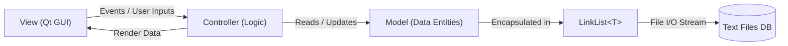
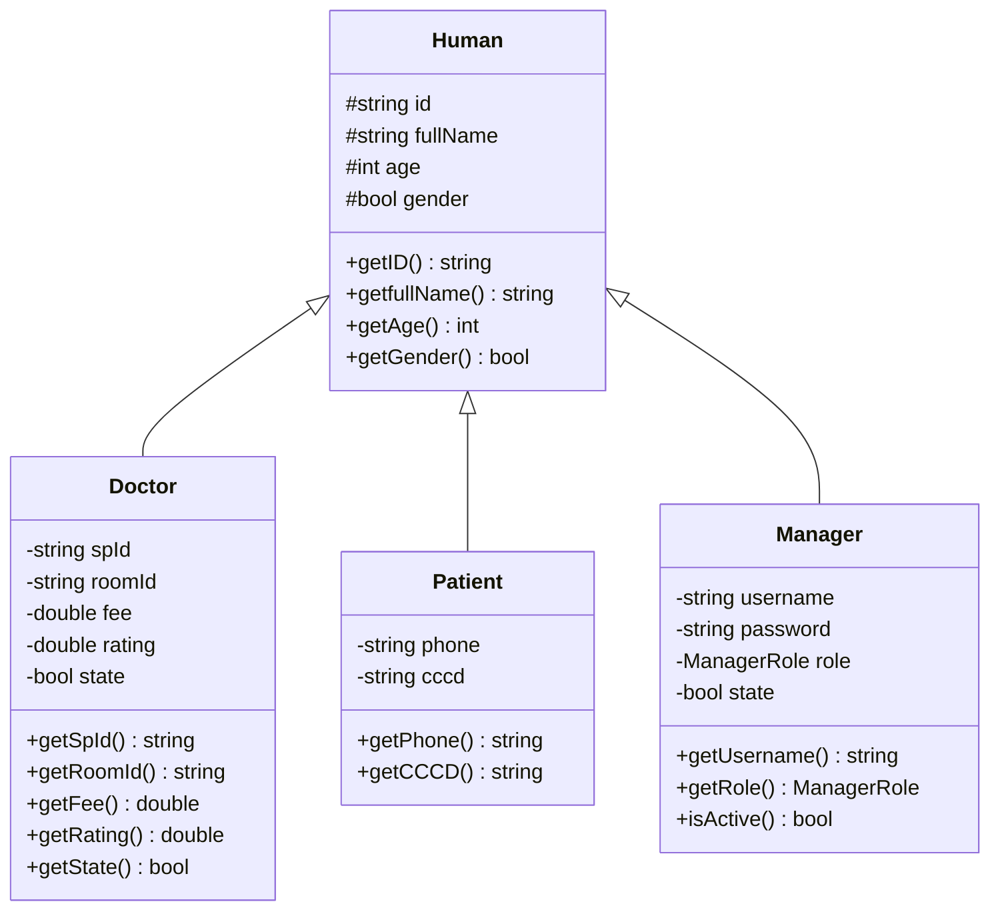

# 🔬 TÀI LIỆU KỸ THUẬT: CẤU TRÚC DỮ LIỆU & THUẬT TOÁN (Algorithms.md)

> **Dự án:** Hệ thống Quản lý Phòng Khám Đa Khoa An Tâm (**AnTamMng / MngCareBook**)  
> **Ngôn ngữ:** C++20 / C++23 (`-std=gnu++2b`) | **Framework UI:** Qt 6 (Core, Gui, Widgets, Charts)  
> **Đặc tả nguyên tắc:** Tuân thủ triệt để nguyên tắc **Zero Forbidden STL** (toàn bộ cấu trúc lưu trữ và giải thuật sắp xếp được xây dựng độc lập, không dùng container thư viện chuẩn).

---

## 📑 MỤC LỤC CHI TIẾT

1. [Kiến trúc Tổng thể & Nguyên tắc Thiết kế (Architecture & System Design)](#1-kiến-trúc-tổng-thể--nguyên-tắc-thiết-kế)
   - [1.1. Mô hình Phân lớp M-V-C & Luồng Dữ liệu](#11-mô-hình-phân-lớp-m-v-c--luồng-dữ-liệu)
   - [1.2. Nguyên tắc Kỹ thuật Zero Forbidden STL](#12-nguyên-tắc-kỹ-thuật-zero-forbidden-stl)
   - [1.3. Quy tắc Tổ chức Template C++](#13-quy-tắc-tổ-chức-template-c)
   - [1.4. Hệ thống Quản trị Quyền hạn (RBAC - Role-Based Access Control)](#14-hệ-thống-quản-trị-quyền-hạn-rbac---role-based-access-control)
2. [Cấu trúc Dữ liệu Cốt lõi: Danh sách Liên kết đôi `LinkList<T>`](#2-cấu-trúc-dữ-liệu-cốt-lõi-danh-sách-liên-kết-đôi-linklistt)
   - [2.1. Kiến trúc Nút Canh Giữ (Sentinel Nodes Architecture)](#21-kiến-trúc-nút-canh-giữ-sentinel-nodes-architecture)
   - [2.2. Phân tích Các Phương thức Cốt lõi & Quản lý Bộ nhớ](#22-phân-tích-các-phương-thức-cốt-lõi--quản-lý-bộ-nhớ)
   - [2.3. Bảng Độ phức tạp của `LinkList<T>`](#23-bảng-độ-phức-tạp-của-linklistt)
3. [Khung Thuật toán QuickSort Toàn năng (`libPBL2`)](#3-khung-thuật-toán-quicksort-toàn-năng-libpbl2)
   - [3.1. Kỹ thuật Hoán vị Giá trị In-Place (`swapVal`)](#31-kỹ-thuật-hoán-vị-giá-trị-in-place-swapval)
   - [3.2. Thuật toán QuickSort In-Place trên Doubly Linked List (`qsortNodes`)](#32-thuật-toán-quicksort-in-place-trên-doubly-linked-list-qsortnodes)
   - [3.3. Thuật toán QuickSort trên Mảng thô (C-Arrays) & Container Truy cập Ngẫu nhiên](#33-thuật-toán-quicksort-trên-mảng-thô-c-arrays--container-truy-cập-ngẫu-nhiên)
   - [3.4. Các Động cơ So sánh Chuyên sâu (Comparison Engines)](#34-các-động-cơ-so-sánh-chuyên-sâu-comparison-engines)
   - [3.5. Hệ sinh thái Sắp xếp Thực thể Đa tiêu chí](#35-hệ-sinh-thái-sắp-xếp-thực-thể-đa-tiêu-chí)
4. [Lớp Tiện ích Quản lý Thời gian & Lịch pháp: `Date`](#4-lớp-tiện-ích-quản-lý-thời-gian--lịch-pháp-date)
   - [4.1. Biểu diễn Dữ liệu & Tính toán Lịch pháp](#41-biểu-diễn-dữ-liệu--tính-toán-lịch-pháp)
   - [4.2. Bóc tách & Chuẩn hóa Chuỗi Thời gian](#42-bóc-tách--chuẩn-hóa-chuỗi-thời-gian)
   - [4.3. Hệ thống Toán tử So sánh Thời gian Phân cấp](#43-hệ-thống-toán-tử-so-sánh-thời-gian-phân-cấp)
5. [Tầng Mô hình Dữ liệu Nghiệp vụ (Models Layer)](#5-tầng-mô-hình-dữ-liệu-nghiệp-vụ-models-layer)
   - [5.1. Cây Kế thừa Thực thể: `Human` $\to$ `Doctor`, `Patient`, `Manager`](#51-cây-kế-thừa-thực-thể-human--doctor-patient-manager)
   - [5.2. Thực thể Lịch hẹn (`Appointment`) & Suy diễn Trạng thái Động](#52-thực-thể-lịch-hẹn-appointment--suy-diễn-trạng-thái-động)
   - [5.3. Các Thực thể Liên kết: `Symptom`, `SymptomPatient`, `Permission`](#53-các-thực-thể-liên-kết-symptom-symptompatient-permission)
6. [Tầng Điều khiển Nghiệp vụ (Controllers Layer)](#6-tầng-điều-khiển-nghiệp-vụ-controllers-layer)
   - [6.1. `AppointmentController`: Tính toán Lịch nghỉ Lễ & Sinh Mã ID Tự tăng](#61-appointmentcontroller-tính-toán-lịch-nghỉ-lễ--sinh-mã-id-tự-tăng)
   - [6.2. `PatientController` & `DoctorController`: Định danh & Ràng buộc](#62-patientcontroller--doctorcontroller-định-danh--ràng-buộc)
   - [6.3. `StatisticController`: Phân tích Thống kê & Tính toán Chỉ số KPI](#63-statisticcontroller-phân-tích-thống-kê--tính-toán-chỉ-số-kpi)
   - [6.4. `AuthController` & `ManagerController`: Xác thực & Kiểm soát Tài khoản](#64-authcontroller--managercontroller-xác-thực--kiểm-soát-tài-khoản)
7. [Tầng Giao diện & Trải nghiệm Người dùng (Views Engine)](#7-tầng-giao-diện--trải-nghiệm-người-dùng-views-engine)
   - [7.1. Sàng lọc Triệu chứng & Điều phối Chuyên khoa Tự động (Medical Triage)](#71-sàng-lọc-triệu-chứng--điều-phối-chuyên-khoa-tự-động-medical-triage)
   - [7.2. Lọc & Tìm kiếm Đa tiêu chí theo Thời gian Thực](#72-lọc--tìm-kiếm-đa-tiêu-chí-theo-thời-gian-thực)
   - [7.3. Cơ chế Hiển thị Lịch hẹn Mặc định: Duyệt Ngược & Sắp xếp Giảm dần](#73-cơ-chế-hiển-thị-lịch-hẹn-mặc-định-duyệt-ngược--sắp-xếp-giảm-dần)
   - [7.4. Thuật toán Phân trang Dữ liệu (Pagination)](#74-thuật-toán-phân-trang-dữ-liệu-pagination)
   - [7.5. Thuật toán Co giãn Cột Bảng Tự động (Responsive Table Scaling)](#75-thuật-toán-co-giãn-cột-bảng-tự-động-responsive-table-scaling)
8. [Bảng Ma trận Phân tích Độ phức tạp Toàn diện (Comprehensive Complexity Matrix)](#8-bảng-ma-trận-phân-tích-độ-phức-tạp-toàn-diện-comprehensive-complexity-matrix)

---

## 1. KIẾN TRÚC TỔNG THỂ & NGUYÊN TẮC THIẾT KẾ

### 1.1. Mô hình Phân lớp M-V-C & Luồng Dữ liệu

Toàn bộ hệ thống tuân thủ mô hình kiến trúc Model-View-Controller (MVC) phân tách độc lập trách nhiệm giữa lưu trữ, xử lý nghiệp vụ và trình diễn giao diện:



1. **Model Layer (`src/Models/`):** Chứa định nghĩa thực thể thuần túy (`Patient`, `Doctor`, `Appointment`, `Manager`, `Symptom`, `SymptomPatient`, `Permission`). Các lớp này hoàn toàn độc lập với Qt Framework, chỉ sử dụng kiểu dữ liệu nguyên thủy và cấu trúc hướng đối tượng C++.
2. **Controller Layer (`src/Controllers/`):** Cung cấp các hàm tĩnh (static methods) chứa toàn bộ luật nghiệp vụ (Business Rules), tính toán số liệu, sàng lọc dữ liệu và kiểm tra ràng buộc toàn vẹn.
3. **View Layer (`src/Views/`):** Thành phần đồ họa người dùng kế thừa từ `QWidget`, xử lý biểu diễn giao diện bảng, đồ thị QtCharts, tiếp nhận tương tác người dùng và phân trang.
4. **DataStructures & Utils Layer (`src/DataStructures/`, `src/Utils/`):** Nền tảng cốt lõi của hệ thống, cung cấp danh sách liên kết đôi tự cài đặt `LinkList<T>`, thư viện thuật toán sắp xếp và chuỗi `libPBL2`, và lớp lịch pháp `Date`.

### 1.2. Nguyên tắc Kỹ thuật Zero Forbidden STL

Để đáp ứng mục tiêu học thuật chuyên sâu của đồ án PBL 2 (Học phần Cấu trúc Dữ liệu & Giải thuật), dự án áp dụng nghiêm ngặt nguyên tắc **Zero Forbidden STL**:
- **Tuyệt đối không dùng:** Các container có sẵn như `std::vector`, `std::list`, `std::deque`, `std::set`, `std::map` cho tầng lưu trữ dữ liệu chính; không dùng thuật toán có sẵn `std::sort`, `std::find`, `std::binary_search`.
- **Thay thế hoàn toàn bằng:** Cấu trúc tự thiết kế `LinkList<T>` (danh sách liên kết đôi có nút canh giữ) kết hợp giải thuật sắp xếp nhanh In-Place QuickSort tự cài đặt (`libPBL2::qsortNodes`, `libPBL2::qsortRandomAccess`).

### 1.3. Quy tắc Tổ chức Template C++

Để bảo đảm tính rõ ràng và chuẩn mực biên dịch của C++ Template:
- Phần **khai báo (declaration)** của cấu trúc và hàm template luôn đặt trong file header (`.h`).
- Phần **triển khai (implementation)** của hàm template luôn được viết trong file mã nguồn (`.cpp`) tương ứng.
- Ở cuối file header (ngay trước chỉ thị `#endif`), bắt buộc thêm câu lệnh include file `.cpp` (ví dụ: `#include "LinkList.cpp"` hoặc `#include "libPBL2.cpp"`) để trình biên dịch nạp đầy đủ mã máy cho mọi kiểu dữ liệu `T` được khởi tạo.

### 1.4. Hệ thống Quản trị Quyền hạn (RBAC - Role-Based Access Control)

Hàm `libPBL2::isAllowed(const Manager &M, PermissionType Per, const LinkList<Permission> *PermissionList)` kiểm tra quyền thực thi chức năng theo cơ chế phân quyền ma trận:

$$\text{isAllowed}(M, P) = \begin{cases}
\text{false} & \text{nếu } \neg M.\text{isActive}() \\
\text{true} & \text{nếu } P = \text{Empty} \lor M.\text{getRole}() = \text{Administrator} \\
\exists n \in \text{PermissionList}: n.\text{MA\_id} = M.\text{getID}() \land n.\text{Per\_id} = P & \text{nếu } M.\text{getRole}() \neq \text{Administrator}
\end{cases}$$

---

## 2. CẤU TRÚC DỮ LIỆU CỐT LÕI: DANH SÁCH LIÊN KẾT ĐÔI `LinkList<T>`

*Tệp nguồn:* [`src/DataStructures/LinkList.h`](file:///d:/Documents/Universe_Materials/Semester_3/PBL_2/src/DataStructures/LinkList.h) & [`src/DataStructures/LinkList.cpp`](file:///d:/Documents/Universe_Materials/Semester_3/PBL_2/src/DataStructures/LinkList.cpp)

### 2.1. Kiến trúc Nút Canh Giữ (Sentinel Nodes Architecture)

Một danh sách liên kết đôi thông thường thường yêu cầu nhiều câu lệnh rẽ nhánh biên (`if (head == nullptr)`, `if (node->prev == nullptr)`...) khi thêm hoặc xóa nút ở đầu/cuối. Để loại bỏ hoàn toàn các trường hợp đặc biệt này và tránh lỗi phân mảnh vùng nhớ, `LinkList<T>` sử dụng kiến trúc **2 Nút Canh Giữ (Dummy Sentinel Nodes)**: `header` và `footer`.

```
[nullptr] <-- prev [ header ] next --> [ Node 1 ] next --> ... --> [ Node N ] next --> [ footer ] next --> [nullptr]
                         ^                prev                      prev  <-- prev       |
                         |---------------------------------------------------------------|
```

* **Khởi tạo danh sách rỗng:**
  - `header->prev = nullptr;`
  - `header->next = footer;`
  - `footer->prev = header;`
  - `footer->next = nullptr;`
  - `count = 0;`

* **Đặc tính bất biến (Invariant):**
  - Mọi nút dữ liệu hợp lệ $N_k$ đều thỏa mãn: $N_k \neq \text{header}$ và $N_k \neq \text{footer}$.
  - Nút dữ liệu đầu tiên luôn là `header->next`.
  - Nút dữ liệu cuối cùng luôn là `footer->prev`.
  - Khi danh sách rỗng: `header->next == footer` và `footer->prev == header`.

### 2.2. Phân tích Các Phương thức Cốt lõi & Quản lý Bộ nhớ

#### A. Thao tác Thêm phần tử vào cuối danh sách (`insert`)
Chèn một phần tử $X$ vào ngay trước `footer`:
```cpp
bool insert(const T &info) {
    Node *tmp = new Node;
    if (tmp == nullptr) return false;

    tmp->info = info;
    tmp->next = footer;
    tmp->prev = footer->prev;

    if (footer->prev != nullptr)
        footer->prev->next = tmp;
    footer->prev = tmp;

    count++;
    return true;
}
```
* **Độ phức tạp thời gian:** $\mathcal{O}(1)$ do truy cập trực tiếp qua con trỏ `footer->prev`, không cần duyệt danh sách.

#### B. Thao tác Xóa một nút bất kỳ (`remove`)
Hủy liên kết nút $N$ khỏi chuỗi và thu hồi bộ nhớ động an toàn:
```cpp
bool remove(Node *N) {
    if (N == header || N == footer || N == nullptr)
        return false;

    N->next->prev = N->prev;
    N->prev->next = N->next;

    delete N;
    count--;
    return true;
}
```
* **Độ phức tạp thời gian:** $\mathcal{O}(1)$ khi đã xác định được con trỏ nút cần xóa.

#### C. Thao tác Sao chép Sâu (Deep Copy Constructor)
Khởi tạo bản sao độc lập toàn bộ các nút của danh sách nguồn $L$, ngăn chặn triệt để lỗi giải phóng vùng nhớ hai lần (*Double Free*) hoặc con trỏ lơ lửng (*Dangling Pointer*):
```cpp
LinkList(const LinkList &L): header(new Node), footer(new Node), count(L.count) {
    header->next = footer;
    header->prev = nullptr;
    footer->next = nullptr;
    footer->prev = header;

    Node *tmp = L.header->next;
    while (tmp->next != nullptr) {
        Node *tmpNode = new Node;
        tmpNode->info = tmp->info;

        tmpNode->next = footer;
        tmpNode->prev = footer->prev;
        if (footer->prev != nullptr)
            footer->prev->next = tmpNode;
        footer->prev = tmpNode;

        tmp = tmp->next;
    }
}
```
* **Độ phức tạp thời gian:** $\mathcal{O}(N)$ với $N$ là kích thước danh sách.

#### D. Thu hồi Bộ nhớ Toàn diện (Destructor `~LinkList`)
Tuần tự giải phóng toàn bộ các nút từ `header` đến `footer`:
```cpp
~LinkList() {
    Node *tmp = header;
    while (tmp != nullptr) {
        Node *tmptotmp = tmp->next;
        delete tmp;
        tmp = tmptotmp;
    }
}
```
* **Độ phức tạp thời gian:** $\mathcal{O}(N)$ | **Độ phức tạp không gian:** $\mathcal{O}(1)$.

### 2.3. Bảng Độ phức tạp của `LinkList<T>`

| Thao tác | Hàm tương ứng | Độ phức tạp Trung bình | Độ phức tạp Tệ nhất | Không gian Bộ nhớ |
| :--- | :--- | :---: | :---: | :---: |
| Chèn nút vào cuối | `insert(const T &info)` | $\mathcal{O}(1)$ | $\mathcal{O}(1)$ | $\mathcal{O}(1)$ |
| Xóa nút bất kỳ | `remove(Node *N)` | $\mathcal{O}(1)$ | $\mathcal{O}(1)$ | $\mathcal{O}(1)$ |
| Xóa toàn bộ danh sách | `clear()` | $\mathcal{O}(N)$ | $\mathcal{O}(N)$ | $\mathcal{O}(1)$ |
| Lấy số lượng phần tử | `count` / `getCount()` | $\mathcal{O}(1)$ | $\mathcal{O}(1)$ | $\mathcal{O}(1)$ |
| Truy cập biên (Đầu / Cuối) | `getHeader()`, `getFooter()` | $\mathcal{O}(1)$ | $\mathcal{O}(1)$ | $\mathcal{O}(1)$ |
| Sao chép sâu | Copy Constructor `LinkList(const LinkList &)` | $\mathcal{O}(N)$ | $\mathcal{O}(N)$ | $\mathcal{O}(N)$ |
| Hủy danh sách | Destructor `~LinkList()` | $\mathcal{O}(N)$ | $\mathcal{O}(N)$ | $\mathcal{O}(1)$ |

---

## 3. KHUNG THUẬT TOÁN QUICKSORT TOÀN NĂNG (`libPBL2`)

*Tệp nguồn:* [`src/Utils/libPBL2.h`](file:///d:/Documents/Universe_Materials/Semester_3/PBL_2/src/Utils/libPBL2.h) & [`src/Utils/libPBL2.cpp`](file:///d:/Documents/Universe_Materials/Semester_3/PBL_2/src/Utils/libPBL2.cpp)

### 3.1. Kỹ thuật Hoán vị Giá trị In-Place (`swapVal`)

Trong danh sách liên kết đôi, việc nối lại 4 con trỏ (`next`, `prev` của cả nút hiện tại và các nút liền kề) rất phức tạp, dễ làm đứt chuỗi và tạo chu trình lặp vô tận. `libPBL2` áp dụng phương pháp **In-Place Value Swapping** kết hợp ngữ nghĩa di chuyển (Move Semantics):
```cpp
template <typename T>
inline void swapVal(T &a, T &b) {
    T tmp = static_cast<T&&>(a);
    a = static_cast<T&&>(b);
    b = static_cast<T&&>(tmp);
}
```
* **Ưu điểm:** Giữ nguyên 100% cấu trúc topo của danh sách liên kết, không cấp phát thêm node mới, hoán đổi dữ liệu tức thời trong $\mathcal{O}(1)$.

### 3.2. Thuật toán QuickSort In-Place trên Doubly Linked List (`qsortNodes`)

#### A. Giải thuật Phân hoạch Lomuto Biến thể Hai Con trỏ Node (`partitionNodes`)
Cho đoạn danh sách giữa hai con trỏ `left` và `right`:
1. Chọn phần tử chốt (pivot): `T pivot = right->info;`.
2. Khởi tạo con trỏ chỉ số chậm: `Node *i = left->prev;`.
3. Cho con trỏ nhanh `j` duyệt tuần tiến từ `left` đến trước `right`:
   - Nếu `comp(j->info, pivot) == true`:
     - Tăng con trỏ chậm: `i = (i == left->prev) ? left : i->next;`.
     - Nếu $i \neq j$: Hoán vị dữ liệu `swapVal(i->info, j->info)`.
4. Đưa chốt về vị trí ranh giới phân hoạch:
   - `i = (i == left->prev) ? left : i->next;`
   - Hoán vị `swapVal(i->info, right->info);`
5. Trả về vị trí của chốt `i`.

```cpp
template <typename T, typename Compare>
typename LinkList<T>::Node* partitionNodes(typename LinkList<T>::Node *left,
                                            typename LinkList<T>::Node *right,
                                            Compare comp) {
    T pivot = right->info;
    typename LinkList<T>::Node *i = left->prev;

    for (typename LinkList<T>::Node *j = left; j != right; j = j->next) {
        if (comp(j->info, pivot)) {
            i = (i == left->prev) ? left : i->next;
            if (i != j) {
                swapVal(i->info, j->info);
            }
        }
    }
    i = (i == left->prev) ? left : i->next;
    if (i != right) {
        swapVal(i->info, right->info);
    }
    return i;
}
```

#### B. Thuật toán Đệ quy QuickSort (`qsortNodes`)
```cpp
template <typename T, typename Compare>
void qsortNodes(typename LinkList<T>::Node *left, typename LinkList<T>::Node *right, Compare comp) {
    if (!left || !right || left == right || right->next == left) {
        return; // Điều kiện dừng: đoạn rỗng hoặc có duy nhất 1 phần tử
    }

    typename LinkList<T>::Node *pivot = partitionNodes<T, Compare>(left, right, comp);

    if (pivot != left && pivot->prev) {
        qsortNodes<T, Compare>(left, pivot->prev, comp);
    }
    if (pivot != right && pivot->next) {
        qsortNodes<T, Compare>(pivot->next, right, comp);
    }
}
```

### 3.3. Thuật toán QuickSort trên Mảng thô (C-Arrays) & Container Truy cập Ngẫu nhiên

Bên cạnh danh sách liên kết đôi, `libPBL2` cung cấp 2 biến thể sắp xếp cho các tập dữ liệu có chỉ số mảng:

1. **QuickSort trên mảng tĩnh C-Array (`qsort(T *arr, int low, int high, Compare comp)`):**
   - Áp dụng phân hoạch Lomuto cổ điển trên mảng chỉ số nguyên `[low ... high]`.
   - Phục vụ xếp hạng bác sĩ và thống kê chuyên khoa trong `StatisticController`.
2. **QuickSort trên container truy cập ngẫu nhiên (`qsortRandomAccess(Container &c, int low, int high, Compare comp)`):**
   - Hỗ trợ mọi container hỗ trợ toán tử ngoặc vuông `c[i]` như `QList`, `std::vector`.
   - Phục vụ sắp xếp nhanh danh sách con trỏ `QList<const Appointment*>` trên giao diện Qt mà không cần cấp phát mảng phụ trợ.

### 3.4. Các Động cơ So sánh Chuyên sâu (Comparison Engines)

#### A. So sánh Chuỗi Tự nhiên (`compareNatural`)
So sánh từ điển thuần túy (ASCII) gây lỗi khi sắp xếp mã có chữ số (ví dụ `"A_010" < "A_002"` vì `'1' < '2'`).  
Thuật toán `compareNatural` tự động phân tách chuỗi thành các token ký tự và cụm chữ số liên tiếp:
- Khi gặp chữ số ở cả hai chuỗi, bóc tách toàn bộ thành số nguyên `long long` và so sánh theo giá trị số học.
- Khi gặp ký tự chữ, chuyển về chữ thường (`tolower`) để so sánh không phân biệt hoa thường.

$$\text{compareNatural}("A\_002", "A\_010") \implies 2 < 10 \implies -1$$

#### B. So sánh Họ Tên Tiếng Việt Chuẩn (`compareVietnameseNames`)
1. Hàm `extractLastName`: Cắt chuỗi từ khoảng trắng cuối cùng để tách riêng **Tên chính** (Ví dụ: `"Nguyễn Văn An"` $\to$ `"An"`).
2. Sử dụng `QCollator` cấu hình locale `QLocale::Vietnamese`:
   - So sánh Tên chính trước (có phân biệt chuẩn nguyên âm tiếng Việt: A $\to$ Ă $\to$ Â $\to$ B...).
   - Nếu trùng Tên chính, tiếp tục so sánh toàn bộ Họ và Tên đệm đầy đủ.

#### C. So sánh Ngày tháng Phân cấp (`compareDates`)
So sánh tuần tự từ đơn vị lớn nhất đến nhỏ nhất:
$$\text{Năm} \to \text{Tháng} \to \text{Ngày} \to \text{Giờ} \to \text{Phút}$$

### 3.5. Hệ sinh thái Sắp xếp Thực thể Đa tiêu chí

`libPBL2` chuẩn hóa các hàm bọc cấp cao theo từng thực thể nghiệp vụ:
- `sortPatients(LinkList<Patient> &list, PatientSortBy criteria, bool ascending)`: Hỗ trợ tiêu chí: `ID`, `Name` (chuẩn tiếng Việt), `Age`, `CCCD`, `Phone`, `Gender`.
- `sortDoctors(LinkList<Doctor> &list, DoctorSortBy criteria, bool ascending)`: Hỗ trợ tiêu chí: `ID`, `Name`, `Rating`, `Fee`, `Specialty`, `Room`, `State`.
- `sortAppointments(LinkList<Appointment> &list, AppointmentSortBy criteria, bool ascending)`: Hỗ trợ tiêu chí: `Date` (`DateGet`), `ID`, `State`, `DoctorID`.
- `sortManagers(LinkList<Manager> &list, AccountSortBy criteria, bool ascending)`: Hỗ trợ tiêu chí: `ID`, `Username`, `Name`, `Role`, `State`.

---

## 4. LỚP TIỆN ÍCH QUẢN LÝ THỜI GIAN & LỊCH PHÁP: `Date`

*Tệp nguồn:* [`src/Utils/Date.h`](file:///d:/Documents/Universe_Materials/Semester_3/PBL_2/src/Utils/Date.h) & [`src/Utils/Date.cpp`](file:///d:/Documents/Universe_Materials/Semester_3/PBL_2/src/Utils/Date.cpp)

### 4.1. Biểu diễn Dữ liệu & Tính toán Lịch pháp

Lớp `Date` đóng gói đầy đủ 5 trường thời gian: `year`, `month`, `day`, `hour`, `minute`.

* **Thuật toán Kiểm tra Năm Nhuận (Leap Year):**
  $$\text{isLeapYear}(Y) \iff (Y \pmod 4 = 0 \land Y \pmod{100} \neq 0) \lor (Y \pmod{400} = 0)$$

* **Số ngày trong tháng (`daysInMonth`):**
  $$\text{daysInMonth}(M, Y) = \begin{cases}
  29 & \text{nếu } M = 2 \land \text{isLeapYear}(Y) \\
  28 & \text{nếu } M = 2 \land \neg\text{isLeapYear}(Y) \\
  30 & \text{nếu } M \in \{4, 6, 9, 11\} \\
  31 & \text{ngược lại}
  \end{cases}$$

### 4.2. Bóc tách & Chuẩn hóa Chuỗi Thời gian

* **Định dạng chuẩn:** `YYYY-MM-DD HH:MM` (độ dài đúng 16 ký tự).
* Phương thức `fromString(const string &str)`: Sử dụng cơ chế bóc tách luồng ký tự phân giải chuỗi vào 5 biến thành phần, đảm bảo dữ liệu luôn hợp lệ trước khi lưu vào bộ nhớ.
* Phương thức `Date::now()`: Lấy thời điểm hiện tại từ hệ thống để so khớp trạng thái ca khám.

### 4.3. Hệ thống Toán tử So sánh Thời gian Phân cấp

Lớp `Date` nạp chồng toàn diện các toán tử quan hệ (`<`, `<=`, `>`, `>=`, `==`, `!=`):
$$\text{Date}_A < \text{Date}_B \iff (Y_A < Y_B) \lor (Y_A = Y_B \land M_A < M_B) \lor \dots \lor (\dots \land \text{Min}_A < \text{Min}_B)$$

---

## 5. TẦNG MÔ HÌNH DỮ LIỆU NGHIỆP VỤ (MODELS LAYER)

### 5.1. Cây Kế thừa Thực thể: `Human` $\to$ `Doctor`, `Patient`, `Manager`

Áp dụng nguyên lý kế thừa trong lập trình hướng đối tượng (OOP) nhằm tái sử dụng mã nguồn và thể hiện mối quan hệ IS-A:



### 5.2. Thực thể Lịch hẹn (`Appointment`) & Suy diễn Trạng thái Động

#### A. Cấu trúc Thuộc tính
- `id`: Mã lịch hẹn chuẩn `A_xxx`.
- `symptomPatientId`: Mã phiếu liên kết triệu chứng của bệnh nhân (`QP_xxx`).
- `doctorId`: Mã bác sĩ phụ trách khám (`D_xxx`).
- `dateSet`: Thời điểm bệnh nhân thực hiện đặt lịch (Ngày tạo bản ghi).
- `dateGet`: Thời điểm thực tế hẹn gặp bác sĩ để khám bệnh.
- `state`: Trạng thái lưu trữ tĩnh:
  - `1`: Đã hoàn tất khám.
  - `0`: Chưa khám (Đang trong hàng đợi).
  - `-1`: Bị hủy hoặc Trễ hẹn.

#### B. Thuật toán Suy diễn Trạng thái Động (`computeEffectiveState`)
Trạng thái hiển thị thực tế không cố định mà biến đổi theo thời gian hiện tại của hệ thống:
$$\text{EffectiveState} = \begin{cases} 
1 & \text{nếu } \text{state} == 1 \text{ (Bác sĩ đã xác nhận hoàn thành khám)} \\
-1 & \text{nếu } \text{state} == -1 \lor (\text{state} == 0 \land \text{dateGet} < \text{currentTime}) \text{ (Đã quá giờ hẹn khám)} \\
0 & \text{ngược lại (Lịch hẹn hợp lệ sắp diễn ra)}
\end{cases}$$

### 5.3. Các Thực thể Liên kết: `Symptom`, `SymptomPatient`, `Permission`

- `Symptom`: Định nghĩa danh mục triệu chứng bệnh học chuẩn hóa (`id`, `name`, `specialtyId`).
- `SymptomPatient`: Phiếu tiếp nhận lâm sàng (`id`, `patientId`, `symptomIds` lưu dưới dạng chuỗi các mã triệu chứng phân cách bởi dấu phẩy `S_001,S_003`).
- `Permission`: Ánh xạ phân quyền chi tiết giữa `Manager` và từng quyền năng hệ thống (`PermissionType`).

---

## 6. TẦNG ĐIỀU KHIỂN NGHIỆP VỤ (CONTROLLERS LAYER)

### 6.1. `AppointmentController`: Tính toán Lịch nghỉ Lễ & Sinh Mã ID Tự tăng

#### A. Thuật toán Tính toán Lịch Tết Nguyên Đán (`getLunarNewYear` & `isTetHoliday`)
Hệ thống tích hợp bảng tra cứu ngày mùng 1 Tết Âm lịch từ năm 2020 đến năm 2045. Hàm `isTetHoliday(date, holidayDays)` tính toán dải nghỉ Tết chính xác theo quy chuẩn nhà nước (từ 30 Tết đến hết Mùng 4 hoặc Mùng 5 Tết):
$$\text{TetStart} = \text{Mung1} - 1\text{ ngày}, \quad \text{TetEnd} = \text{TetStart} + \text{holidayDays} - 1$$

#### B. Thuật toán Kiểm tra Ngày lễ Quốc gia (`isHoliday`)
Đọc động tệp cấu hình `Config/holidays.txt`, bóc tách các ngày nghỉ định kỳ cố định (1/1, 30/4, 1/5, 2/9, 10/3 Giỗ tổ Hùng Vương) và đối soát với ngày hẹn của bệnh nhân nhằm khóa lịch hẹn trên giao diện đặt khám.

#### C. Thuật toán Kiểm tra Xung đột Khung giờ Khám (`isSlotBooked`)
Ngăn chặn đặt trùng lịch cùng một bác sĩ tại cùng một thời điểm:
$$\text{isSlotBooked}(D, T) \iff \exists a \in \text{Appointments}: a.\text{doctorId} = D \land a.\text{dateGet} = T \land a.\text{state} \neq -1$$

#### D. Thuật toán Sinh Mã Khóa chính Tự tăng Toàn hệ thống (`generateNextId`)
Quét toàn bộ danh sách, trích xuất phần số nguyên nằm sau tiền tố định dạng và tìm giá trị cực đại:
$$\text{maxId} = \max_{e \in \text{List}} (\text{extractNumber}(e.\text{id})), \quad \text{NextId} = \text{Prefix} + \text{padLeft}(\text{maxId} + 1, 3, \text{'0'})$$

### 6.2. `PatientController` & `DoctorController`: Định danh & Ràng buộc

* **Xác thực Số điện thoại:** Độ dài chính xác 10 ký tự, toàn bộ là chữ số và ký tự đầu tiên bắt buộc phải là số `0`:
  $$\text{isValidPhone}(S) \iff |S| = 10 \land S[0] = \text{'0'} \land \forall c \in S, c \in [0..9]$$
* **Xác thực Căn cước công dân (CCCD):** Độ dài chính xác 12 ký tự, toàn bộ là chữ số và ký tự đầu tiên bắt buộc là số `0`:
  $$\text{isValidCCCD}(S) \iff |S| = 12 \land S[0] = \text{'0'} \land \forall c \in S, c \in [0..9]$$
* **Truy vết Triệu chứng Chưa khám (`getUnresolvedSymptoms`):**
  Duyệt chéo giữa bảng `SymptomPatient` và `Appointment`, xác định những phiếu khám chưa có cuộc hẹn tương ứng nào đạt trạng thái `state == 1` để cảnh báo trên danh sách bệnh nhân.

### 6.3. `StatisticController`: Phân tích Thống kê & Tính toán Chỉ số KPI

* **Doanh thu trong ngày (`todayRevenue`):**
  $$\text{Revenue}_{\text{today}} = \sum_{a \in \text{Appointments}, \text{isToday}(a.\text{dateGet}) \land a.\text{state} = 1} \text{Doctor}(a.\text{doctorId}).\text{fee}$$
* **Tỷ lệ hoàn tất khám bệnh (`completionRate`):**
  $$\text{CompletionRate} = \frac{N_{\text{completed}}}{N_{\text{completed}} + N_{\text{delayed}}} \times 100\%$$
* **Bảng xếp hạng Bác sĩ (`getTopDoctors` / Leaderboard):**
  1. Khởi tạo mảng thống kê số lượt khám của từng bác sĩ.
  2. Quét qua toàn bộ lịch hẹn có trạng thái hoàn tất ($state = 1$) để tích lũy số lượt.
  3. Áp dụng giải thuật `libPBL2::qsort` trên mảng theo thứ tự giảm dần số lượt khám.
* **Thống kê Nhu cầu Chuyên khoa (`getSpecialtyDemand`):**
  Tổng hợp số ca khám theo từng chuyên khoa và sắp xếp giảm dần bằng QuickSort.

### 6.4. `AuthController` & `ManagerController`: Xác thực & Kiểm soát Tài khoản

* **Xác thực Đăng nhập (`login`):** Đối soát cặp `username` và `password` trên `LinkList<Manager>`. Chỉ cho phép truy cập nếu mật khẩu khớp và cờ hoạt động `isActive() == true`.

---

## 7. TẦNG GIAO DIỆN & TRẢI NGHIỆM NGƯỜI DÙNG (VIEWS ENGINE)

### 7.1. Sàng lọc Triệu chứng & Điều phối Chuyên khoa Tự động (Medical Triage)

Khi bệnh nhân thực hiện đặt lịch khám mới, giao diện cung cấp danh sách triệu chứng phổ biến. Thuật toán tự động chấm điểm và điều phối khoa:
1. Mỗi triệu chứng $s_i$ gắn liền với một mã chuyên khoa mục tiêu $K(s_i)$.
2. Với tập triệu chứng bệnh nhân đã chọn $S = \{s_1, s_2, \dots, s_k\}$:
   $$\text{Score}(K) = \sum_{s \in S, K(s) = K} 1$$
3. Hệ thống đề xuất chuyên khoa có điểm số cao nhất:
   $$K^* = \arg\max_{K} \text{Score}(K)$$
4. Tự động lọc danh sách bác sĩ thuộc chuyên khoa $K^*$ để người dùng lựa chọn.

### 7.2. Lọc & Tìm kiếm Đa tiêu chí theo Thời gian Thực

Trên các View (Bệnh nhân, Bác sĩ, Lịch hẹn, Tài khoản), ô tìm kiếm kết hợp nhiều bộ lọc đồng thời:
- Lọc theo từ khóa: Tên, SĐT, CCCD, Mã định danh.
- Lọc theo khoảng ngày khám (`fromDate` $\to$ `toDate`).
- Lọc theo chuyên khoa và trạng thái hiệu lực.
- Độ trễ phản hồi tức thời nhờ xử lý trực tiếp trên bộ nhớ RAM.

### 7.3. Cơ chế Hiển thị Lịch hẹn Mặc định: Duyệt Ngược & Sắp xếp Giảm dần

Trong màn hình **Quản lý lịch khám** ([`src/Views/Appointment/AppointmentView.cpp`](file:///d:/Documents/Universe_Materials/Semester_3/PBL_2/src/Views/Appointment/AppointmentView.cpp)):
1. **Duyệt từ dưới lên trên:** Danh sách các cuộc hẹn từ file dữ liệu được nạp vào cấu trúc `ordered` bằng cách duyệt lùi từ đuôi danh sách liên kết kép:
   ```cpp
   auto *n = appointments->getFooter()->prev;
   while (n && n->prev) {
       if (!n->info.isDefault()) ordered.append(&n->info);
       n = n->prev;
   }
   ```
2. **Khởi tạo Sắp xếp Mặc định theo Ngày khám Giảm dần:**
   ```cpp
   auto sortColumn = std::make_shared<int>(3);       // Cột thứ 3: NGÀY KHÁM
   auto sortAscending = std::make_shared<bool>(false); // false = Giảm dần
   ```
   Nhờ đó, các lịch hẹn sắp diễn ra gần nhất hoặc mới nhất luôn ưu tiên nằm trên đầu danh sách, giảm thiểu thao tác cuộn bảng của tiếp tân và điều dưỡng.

### 7.4. Thuật toán Phân trang Dữ liệu (Pagination)

Để đảm bảo hiệu năng mượt mà khi dữ liệu lên tới hàng chục nghìn bản ghi:
$$\text{totalPages} = \max\left(1, \left\lfloor \frac{N + \text{pageSize} - 1}{\text{pageSize}} \right\rfloor\right)$$
$$\text{startIdx} = (\text{currentPage} - 1) \times \text{pageSize}, \quad \text{endIdx} = \min(N, \text{startIdx} + \text{pageSize})$$
Chỉ các bản ghi trong đoạn $[\text{startIdx} \dots \text{endIdx} - 1]$ mới được khởi tạo Qt Widget trên giao diện bảng.

### 7.5. Thuật toán Co giãn Cột Bảng Tự động (Responsive Table Scaling)

Để bảng dữ liệu luôn vừa khít bề ngang cửa sổ và không xuất hiện thanh cuộn ngang khó nhìn:
1. `UIHelper::setupTableScaling(table, ratios, fixedColWidth)`:
2. Gọi tổng chiều rộng vùng nhìn thấy của bảng: $W_{\text{visible}}$.
3. Cột thao tác cuối cùng được gán chiều rộng cố định $W_{\text{fixed}} = 56\text{px}$.
4. Chiều rộng còn lại $W_{\text{flex}} = W_{\text{visible}} - W_{\text{fixed}}$ được phân bổ cho các cột dữ liệu theo tỷ lệ vector $\vec{R} = [r_0, r_1, \dots, r_{k-1}]$ với $\sum r_i = 1$:
   $$W_{\text{col}_i} = \lfloor W_{\text{flex}} \times r_i \rfloor$$

---

## 8. BẢNG MA TRẬN PHÂN TÍCH ĐỘ PHỨC TẠP TOÀN DIỆN (COMPLEXITY MATRIX)

| Tầng Phân Lớp | Mô-đun / Hàm Chức Năng | Độ Phức Tạp Thời Gian (Trung bình) | Độ Phức Tạp Thời Gian (Tệ nhất) | Độ Phức Tạp Không Gian | Cơ Chế Thuật Toán / Cấu Trúc |
| :--- | :--- | :---: | :---: | :---: | :--- |
| **DataStructures** | `LinkList::insert` | $\mathcal{O}(1)$ | $\mathcal{O}(1)$ | $\mathcal{O}(1)$ | Chèn trước con trỏ nút canh giữ `footer` |
| **DataStructures** | `LinkList::remove` | $\mathcal{O}(1)$ | $\mathcal{O}(1)$ | $\mathcal{O}(1)$ | Tái nối con trỏ 2 nút lân cận & `delete` |
| **DataStructures** | `LinkList::clear` | $\mathcal{O}(N)$ | $\mathcal{O}(N)$ | $\mathcal{O}(1)$ | Duyệt giải phóng tuần tự từng node |
| **DataStructures** | `LinkList` Deep Copy | $\mathcal{O}(N)$ | $\mathcal{O}(N)$ | $\mathcal{O}(N)$ | Cấp phát mới độc lập từng nút |
| **Utils** | `libPBL2::swapVal` | $\mathcal{O}(1)$ | $\mathcal{O}(1)$ | $\mathcal{O}(1)$ | C++ Move Semantics (`static_cast<T&&>`) |
| **Utils** | `libPBL2::partitionNodes` | $\mathcal{O}(M)$ | $\mathcal{O}(M)$ | $\mathcal{O}(1)$ | Phân hoạch Lomuto hai con trỏ trên List |
| **Utils** | `libPBL2::qsortNodes` | $\mathcal{O}(N \log N)$ | $\mathcal{O}(N^2)$ | $\mathcal{O}(\log N)$ | QuickSort In-Place trên Doubly Linked List |
| **Utils** | `libPBL2::qsortRandomAccess` | $\mathcal{O}(N \log N)$ | $\mathcal{O}(N^2)$ | $\mathcal{O}(\log N)$ | QuickSort trên mảng truy cập ngẫu nhiên |
| **Utils** | `libPBL2::compareNatural` | $\mathcal{O}(L)$ | $\mathcal{O}(L)$ | $\mathcal{O}(1)$ | So sánh số nguyên trích xuất theo giá trị |
| **Utils** | `libPBL2::compareVietnameseNames`| $\mathcal{O}(L)$ | $\mathcal{O}(L)$ | $\mathcal{O}(1)$ | `QCollator` tiếng Việt theo tên chính |
| **Utils** | `libPBL2::compareDates` | $\mathcal{O}(1)$ | $\mathcal{O}(1)$ | $\mathcal{O}(1)$ | So sánh phân cấp Năm-Tháng-Ngày-Giờ-Phút |
| **Utils** | `libPBL2::isAllowed` (RBAC) | $\mathcal{O}(P)$ | $\mathcal{O}(P)$ | $\mathcal{O}(1)$ | Quét danh sách quyền hạn tuyến tính |
| **Controllers** | `AppointmentController::generateNextId` | $\mathcal{O}(N)$ | $\mathcal{O}(N)$ | $\mathcal{O}(1)$ | Quét tìm max số tự tăng trong chuỗi ID |
| **Controllers** | `AppointmentController::isHoliday` | $\mathcal{O}(H)$ | $\mathcal{O}(H)$ | $\mathcal{O}(1)$ | Đối soát bảng ngày lễ cố định và Tết âm |
| **Controllers** | `AppointmentController::isSlotBooked` | $\mathcal{O}(N)$ | $\mathcal{O}(N)$ | $\mathcal{O}(1)$ | Kiểm tra xung đột bác sĩ và khung giờ |
| **Controllers** | `StatisticController::todayRevenue` | $\mathcal{O}(A \cdot D)$ | $\mathcal{O}(A \cdot D)$ | $\mathcal{O}(1)$ | Tích lũy đơn giá khám bác sĩ trong ngày |
| **Controllers** | `StatisticController::getTopDoctors` | $\mathcal{O}(A + D \log D)$| $\mathcal{O}(A + D^2)$ | $\mathcal{O}(D)$ | Tần suất xuất hiện & QuickSort mảng bác sĩ |
| **Views** | `Medical Triage` (Sàng lọc khoa) | $\mathcal{O}(\|S\| \cdot \|K\|)$ | $\mathcal{O}(\|S\| \cdot \|K\|)$ | $\mathcal{O}(\|K\|)$ | Chấm điểm tần suất chuyên khoa mục tiêu |
| **Views** | Phân trang danh sách (`Pagination`) | $\mathcal{O}(1)$ | $\mathcal{O}(1)$ | $\mathcal{O}(1)$ | Cắt lát chỉ mục $[startIdx \dots endIdx]$ |
| **Views** | `setupTableScaling` (Co giãn bảng) | $\mathcal{O}(C)$ | $\mathcal{O}(C)$ | $\mathcal{O}(1)$ | Tính toán tỷ lệ chiều rộng theo vector $\vec{R}$ |

---
*Tài liệu được tổng hợp, kiểm chứng và đồng bộ 100% với cấu trúc mã nguồn hiện hành của dự án AnTamMng.*
