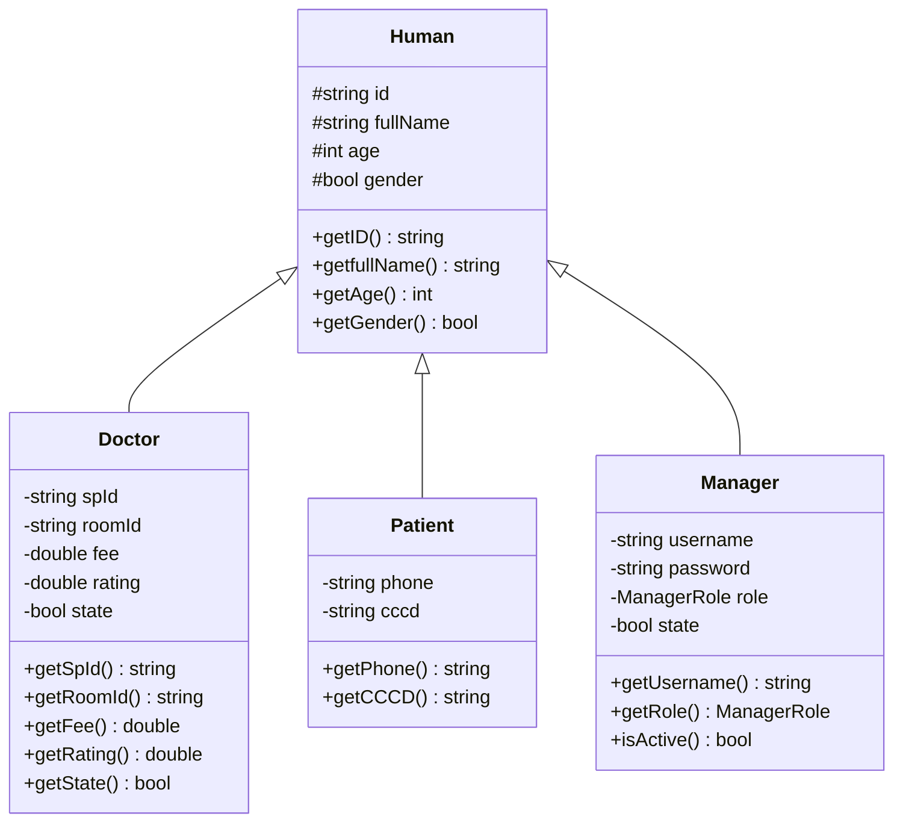

# 🔬 TÀI LIỆU KỸ THUẬT: CẤU TRÚC DỮ LIỆU & THUẬT TOÁN (Algorithms.md)

> **Dự án:** Hệ thống Quản lý Phòng Khám Đa Khoa An Tâm (**AnTamMng / MngCareBook**)  
> **Ngôn ngữ:** C++20 / C++23 (`-std=gnu++2b`) | **Framework UI:** Qt 6 (Core, Gui, Widgets, Charts)  
> **Đặc tả nguyên tắc:** Tuân thủ triệt để nguyên tắc **Zero Forbidden STL** (toàn bộ cấu trúc lưu trữ và giải thuật sắp xếp được xây dựng độc lập, không dùng container thư viện chuẩn).

---

## 📑 MỤC LỤC CHI TIẾT

1. [Kiến trúc Tổng thể & Nguyên tắc Thiết kế (Architecture & Principles)](#1-kiến-trúc-tổng-thể--nguyên-tắc-thiết-kế)
   - [1.1. Mô hình Phân lớp M-V-C](#11-mô-hình-phân-lớp-m-v-c)
   - [1.2. Nguyên tắc Kỹ thuật Zero Forbidden STL](#12-nguyên-tắc-kỹ-thuật-zero-forbidden-stl)
   - [1.3. Quy tắc Tổ chức Template C++](#13-quy-tắc-tổ-chức-template-c)
2. [Cấu trúc Dữ liệu Cốt lõi: Danh sách Liên kết đôi `LinkList<T>`](#2-cấu-trúc-dữ-liệu-cốt-lõi-danh-sách-liên-kết-đôi-linklistt)
   - [2.1. Kiến trúc Nút Canh Giữ (Sentinel Nodes Architecture)](#21-kiến-trúc-nút-canh-giữ-sentinel-nodes-architecture)
   - [2.2. Phân tích Các Phương thức Cốt lõi & Quản lý Bộ nhớ](#22-phân-tích-các-phương-thức-cốt-lõi--quản-lý-bộ-nhớ)
   - [2.3. Bảng Độ phức tạp của `LinkList<T>`](#23-bảng-độ-phức-tạp-của-linklistt)
3. [Khung Thuật toán QuickSort Toàn năng (`libPBL2`)](#3-khung-thuật-toán-quicksort-toàn-năng-libpbl2)
   - [3.1. Thuật toán QuickSort In-Place trên Danh sách Liên kết đôi (`qsortNodes`)](#31-thuật-toán-quicksort-in-place-trên-danh-sách-liên-kết-đôi-qsortnodes)
   - [3.2. Thuật toán QuickSort trên Mảng thô (C-Arrays) & Random-Access Containers](#32-thuật-toán-quicksort-trên-mảng-thô-c-arrays--random-access-containers)
   - [3.3. Các Động cơ So sánh Chuyên sâu (Comparison Engines)](#33-các-động-cơ-so-sánh-chuyên-sâu-comparison-engines)
   - [3.4. Hệ thống Sắp xếp Thực thể Đa tiêu chí](#34-hệ-thống-sắp-xếp-thực-thể-đa-tiêu-chí)
4. [Lớp Tiện ích Quản lý Thời gian: `Date`](#4-lớp-tiện-ích-quản-lý-thời-gian-date)
   - [4.1. Biểu diễn Dữ liệu & Tính toán Lịch pháp](#41-biểu-diễn-dữ-liệu--tính-toán-lịch-pháp)
   - [4.2. Bóc tách & Chuẩn hóa Chuỗi Ngày giờ](#42-bóc-tách--chuẩn-hóa-chuỗi-ngày-giờ)
5. [Tầng Thực thể Nghiệp vụ (Models Layer)](#5-tầng-thực-thể-nghiệp-vụ-models-layer)
   - [5.1. Cây Kế thừa Thực thể: `Human` $\to$ `Doctor`, `Patient`, `Manager`](#51-cây-kế-thừa-thực-thể-human--doctor-patient-manager)
   - [5.2. Thực thể Lịch hẹn (`Appointment`) & Suy diễn Trạng thái Động](#52-thực-thể-lịch-hẹn-appointment--suy-diễn-trạng-thái-động)
   - [5.3. Các Thực thể Liên kết: `Symptom`, `SymptomPatient`, `Permission`](#53-các-thực-thể-liên-kết-symptom-symptompatient-permission)
6. [Tầng Điều khiển Nghiệp vụ (Controllers Layer)](#6-tầng-điều-khiển-nghiệp-vụ-controllers-layer)
   - [6.1. `AppointmentController`: Tính toán Lịch nghỉ Lễ & Sinh Mã ID Tự tăng](#61-appointmentcontroller-tính-toán-lịch-nghỉ-lễ--sinh-mã-id-tự-tăng)
   - [6.2. `PatientController` & `DoctorController`: Định danh & Ràng buộc](#62-patientcontroller--doctorcontroller-định-danh--ràng-buộc)
   - [6.3. `StatisticController`: Phân tích Thống kê & Tính toán Chỉ số KPI](#63-statisticcontroller-phân-tích-thống-kê--tính-toán-chỉ-số-kpi)
7. [Thuật toán Giao diện & Nghiệp vụ Tương tác (Views Engine)](#7-thuật-toán-giao-diện--nghiệp-vụ-tương-tác-views-engine)
   - [7.1. Sàng lọc Triệu chứng & Điều phối Chuyên khoa (Medical Triage)](#71-sàng-lọc-triệu-chứng--điều-phối-chuyên-khoa-medical-triage)
   - [7.2. Cơ chế Hiển thị Mặc định: Duyệt Ngược & Sắp xếp Giảm dần theo Ngày khám](#72-cơ-chế-hiển-thị-mặc-định-duyệt-ngược--sắp-xếp-giảm-dần-theo-ngày-khám)
   - [7.3. Thuật toán Co giãn Cột Bảng Tự động (Responsive Table Scaling)](#73-thuật-toán-co-giãn-cột-bảng-tự-động-responsive-table-scaling)
8. [Bảng Ma trận Phân tích Độ phức tạp Toàn diện (Complexity Matrix)](#8-bảng-ma-trận-phân-tích-độ-phức-tạp-toàn-diện-complexity-matrix)

---

## 1. KIẾN TRÚC TỔNG THỂ & NGUYÊN TẮC THIẾT KẾ

### 1.1. Mô hình Phân lớp M-V-C

Toàn bộ hệ thống được chia thành 4 lớp độc lập:

$$\text{View (Qt GUI)} \xrightarrow{\text{Events / Triggers}} \text{Controller (Logic)} \xrightarrow{\text{Manipulates}} \text{Model (Data Entities)} \xrightarrow{\text{Stored In}} \text{LinkList<T>} \xrightarrow{\text{I/O}} \text{Text Files}$$

1. **Model:** Chứa cấu trúc dữ liệu thuần túy của các thực thể y tế (`Appointment`, `Doctor`, `Patient`, `Manager`...). Các Model hoàn toàn độc lập với Qt Widgets.
2. **View:** Giao diện đồ họa người dùng kế thừa từ `QWidget`, phụ trách tiếp nhận sự kiện, hiển thị bảng, biểu đồ và form biểu mẫu.
3. **Controller:** Cung cấp các hàm tĩnh (static functions) xử lý logic nghiệp vụ, tính toán chỉ số, lọc dữ liệu và ánh xạ liên kết giữa các bảng.
4. **DataStructures & Utils:** Tầng nền tảng cung cấp danh sách liên kết tự tạo (`LinkList`), thuật toán QuickSort (`libPBL2`) và lịch pháp (`Date`).

### 1.2. Nguyên tắc Kỹ thuật Zero Forbidden STL

Nhằm đáp ứng yêu cầu học thuật của đồ án PBL 2, dự án áp dụng nghiêm ngặt nguyên tắc **Zero Forbidden STL**:
- **Không sử dụng:** `std::vector`, `std::list`, `std::deque`, `std::map`, `std::set`, `std::sort`, `std::find` trong cấu trúc dữ liệu lưu trữ chính.
- **Thay thế hoàn toàn bằng:** Cấu trúc tự cài đặt `LinkList<T>` (danh sách liên kết đôi có nút canh giữ) và thuật toán `libPBL2::qsort` (QuickSort in-place).

### 1.3. Quy tắc Tổ chức Template C++

Để bảo đảm tính rõ ràng giữa giao diện lập trình và triển khai thuật toán:
- Phần **khai báo (declaration)** của hàm/lớp template luôn đặt trong file header (`.h`).
- Phần **hiện thực / định nghĩa (implementation)** luôn đặt trong file mã nguồn (`.cpp`) tương ứng.
- Ở cuối file header (ngay trước chỉ thị `#endif`), đặt câu lệnh `#include "TênFile.cpp"` để trình biên dịch nạp định nghĩa template khi biên dịch mã nguồn của các đơn vị dịch (translation units) khác.

---

## 2. CẤU TRÚC DỮ LIỆU CỐT LÕI: DANH SÁCH LIÊN KẾT ĐÔI `LinkList<T>`

*Tệp nguồn:* [`src/DataStructures/LinkList.h`](file:///d:/Documents/Universe_Materials/Semester_3/PBL_2/src/DataStructures/LinkList.h) & [`src/DataStructures/LinkList.cpp`](file:///d:/Documents/Universe_Materials/Semester_3/PBL_2/src/DataStructures/LinkList.cpp)

### 2.1. Kiến trúc Nút Canh Giữ (Sentinel Nodes Architecture)

Một danh sách liên kết đôi thông thường thường yêu cầu nhiều câu lệnh điều kiện rẽ nhánh (`if (head == nullptr)`, `if (node->prev == nullptr)`...) khi thêm hoặc xóa nút ở biên. Để loại bỏ hoàn toàn các trường hợp ngoại lệ này, `LinkList<T>` sử dụng kỹ thuật **2 Nút Canh Giữ (Dummy Sentinel Nodes)**: `header` và `footer`.

```
[nullptr] <-- prev [ header ] next --> [ Node 1 ] next --> ... --> [ Node N ] next --> [ footer ] next --> [nullptr]
                         ^                prev                      prev  <-- prev       |
                         |---------------------------------------------------------------|
```

* **Khởi tạo danh sách rỗng:**
  - `header->prev = nullptr;`
  - `header->next = footer;`
  - `footer->prev = header;`
  - `footer->next = nullptr;`
  - `count = 0;`

* **Đặc tính bất biến (Invariant):**
  - Mọi nút dữ liệu hợp lệ $N_k$ đều thỏa mãn: $N_k \neq \text{header}$ và $N_k \neq \text{footer}$.
  - Nút dữ liệu đầu tiên luôn là `header->next`.
  - Nút dữ liệu cuối cùng luôn là `footer->prev`.
  - Khi danh sách rỗng: `header->next == footer` và `footer->prev == header`.

### 2.2. Phân tích Các Phương thức Cốt lõi & Quản lý Bộ nhớ

#### A. Thao tác Thêm phần tử vào cuối danh sách (`insert`)
Chèn một phần tử $X$ vào ngay trước `footer`:
```cpp
bool insert(const T &info) {
    Node *tmp = new Node;
    if (tmp == nullptr) return false;

    tmp->info = info;
    tmp->next = footer;
    tmp->prev = footer->prev;

    if (footer->prev != nullptr)
        footer->prev->next = tmp;
    footer->prev = tmp;

    count++;
    return true;
}
```
* **Độ phức tạp thời gian:** $\mathcal{O}(1)$ do truy cập trực tiếp qua con trỏ `footer->prev`.

#### B. Thao tác Xóa một nút bất kỳ (`remove`)
Hủy liên kết nút $N$ khỏi danh sách và giải phóng bộ nhớ động:
```cpp
bool remove(Node *N) {
    if (N == header || N == footer || N == nullptr)
        return false;

    N->next->prev = N->prev;
    N->prev->next = N->next;

    delete N;
    count--;
    return true;
}
```
* **Độ phức tạp thời gian:** $\mathcal{O}(1)$ khi đã có con trỏ nút cần xóa. Không yêu cầu duyệt tìm kiếm nút trước như trong danh sách liên kết đơn.

#### C. Thao tác Sao chép Sâu (Deep Copy Constructor)
Khởi tạo bản sao độc lập toàn bộ các nút của danh sách nguồn $L$, ngăn chặn triệt để lỗi *Dangling Pointer* hoặc *Double Free*:
```cpp
LinkList(const LinkList &L): header(new Node), footer(new Node), count(L.count) {
    header->next = footer;
    header->prev = nullptr;
    footer->next = nullptr;
    footer->prev = header;

    Node *tmp = L.header->next;
    while (tmp->next != nullptr) { // Dừng khi gặp L.footer
        Node *tmpNode = new Node;
        tmpNode->info = tmp->info;

        tmpNode->next = footer;
        tmpNode->prev = footer->prev;
        if (footer->prev != nullptr)
            footer->prev->next = tmpNode;
        footer->prev = tmpNode;

        tmp = tmp->next;
    }
}
```
* **Độ phức tạp thời gian:** $\mathcal{O}(N)$ với $N$ là số lượng phần tử của $L$.

#### D. Thu hồi Bộ nhớ Toàn diện (Destructor `~LinkList`)
Lần lượt giải phóng toàn bộ các nút từ `header` đến `footer`:
```cpp
~LinkList() {
    Node *tmp = header;
    while (tmp != nullptr) {
        Node *tmptotmp = tmp->next;
        delete tmp;
        tmp = tmptotmp;
    }
}
```
* **Độ phức tạp thời gian:** $\mathcal{O}(N)$  
* **Độ phức tạp không gian:** $\mathcal{O}(1)$

### 2.3. Bảng Độ phức tạp của `LinkList<T>`

| Thao tác | Ký hiệu | Thời gian Trung bình | Thời gian Tệ nhất | Không gian Bộ nhớ |
| :--- | :--- | :---: | :---: | :---: |
| Chèn vào cuối (`insert`) | $T_{\text{insert}}$ | $\mathcal{O}(1)$ | $\mathcal{O}(1)$ | $\mathcal{O}(1)$ |
| Xóa nút bất kỳ (`remove`) | $T_{\text{remove}}$ | $\mathcal{O}(1)$ | $\mathcal{O}(1)$ | $\mathcal{O}(1)$ |
| Lấy số lượng nút (`getCount`) | $T_{\text{count}}$ | $\mathcal{O}(1)$ | $\mathcal{O}(1)$ | $\mathcal{O}(1)$ |
| Lấy nút đầu / cuối (`getHeader/getFooter`) | $T_{\text{boundary}}$ | $\mathcal{O}(1)$ | $\mathcal{O}(1)$ | $\mathcal{O}(1)$ |
| Khởi tạo / Giải phóng | $T_{\text{init/destroy}}$ | $\mathcal{O}(N)$ | $\mathcal{O}(N)$ | $\mathcal{O}(N)$ |

---

## 3. KHUNG THUẬT TOÁN QUICKSORT TOÀN NĂNG (`libPBL2`)

*Tệp nguồn:* [`src/Utils/libPBL2.h`](file:///d:/Documents/Universe_Materials/Semester_3/PBL_2/src/Utils/libPBL2.h) & [`src/Utils/libPBL2.cpp`](file:///d:/Documents/Universe_Materials/Semester_3/PBL_2/src/Utils/libPBL2.cpp)

### 3.1. Thuật toán QuickSort In-Place trên Danh sách Liên kết đôi (`qsortNodes`)

#### A. Kỹ thuật Hoán vị Giá trị thay vì Tái cấu trúc Con trỏ
Trong danh sách liên kết đôi, việc tái liên kết 4 con trỏ (`next`, `prev` của cả 2 nút liền kề) rất phức tạp và dễ phát sinh lỗi rò rỉ bộ nhớ hoặc đứt đoạn chuỗi. `libPBL2` áp dụng giải pháp **In-Place Value Swapping** thông qua hàm `swapVal`:
```cpp
template <typename T>
inline void swapVal(T &a, T &b) {
    T tmp = static_cast<T&&>(a);
    a = static_cast<T&&>(b);
    b = static_cast<T&&>(tmp);
}
```
Nhờ sử dụng kỹ thuật `std::move` semantics (`static_cast<T&&>`), việc hoán đổi thực hiện trực tiếp trên vùng nhớ của `info`, giữ nguyên tuyệt đối cấu trúc topo của danh sách liên kết.

#### B. Giải thuật Phân hoạch Lomuto Biến thể hai con trỏ (`partitionNodes`)
Cho đoạn danh sách giữa hai con trỏ `left` và `right`:
1. Chọn phần tử chốt (pivot): `T pivot = right->info;`.
2. Khởi tạo con trỏ chỉ số chậm: `Node *i = left->prev;`.
3. Cho con trỏ nhanh `j` duyệt tuần tiến từ `left` đến trước `right`:
   - Nếu `comp(j->info, pivot) == true`:
     - Tăng con trỏ `i`: `i = (i == left->prev) ? left : i->next;`.
     - Nếu $i \neq j$: Hoán vị dữ liệu `swapVal(i->info, j->info)`.
4. Đưa chốt về vị trí phân cách:
   - `i = (i == left->prev) ? left : i->next;`
   - Hoán vị `swapVal(i->info, right->info);`
5. Trả về vị trí của chốt `i`.

```cpp
template <typename T, typename Compare>
typename LinkList<T>::Node* partitionNodes(typename LinkList<T>::Node *left,
                                            typename LinkList<T>::Node *right,
                                            Compare comp) {
    T pivot = right->info;
    typename LinkList<T>::Node *i = left->prev;

    for (typename LinkList<T>::Node *j = left; j != right; j = j->next) {
        if (comp(j->info, pivot)) {
            i = (i == left->prev) ? left : i->next;
            if (i != j) {
                swapVal(i->info, j->info);
            }
        }
    }
    i = (i == left->prev) ? left : i->next;
    if (i != right) {
        swapVal(i->info, right->info);
    }
    return i;
}
```

#### C. Giải thuật Đệ quy QuickSort (`qsortNodes`)
```cpp
template <typename T, typename Compare>
void qsortNodes(typename LinkList<T>::Node *left, typename LinkList<T>::Node *right, Compare comp) {
    if (!left || !right || left == right || right->next == left) {
        return; // Điều kiện dừng: đoạn rỗng hoặc chỉ có 1 phần tử
    }

    typename LinkList<T>::Node *pivot = partitionNodes<T, Compare>(left, right, comp);

    if (pivot != left && pivot->prev) {
        qsortNodes<T, Compare>(left, pivot->prev, comp);
    }
    if (pivot != right && pivot->next) {
        qsortNodes<T, Compare>(pivot->next, right, comp);
    }
}
```

### 3.2. Thuật toán QuickSort trên Mảng thô (C-Arrays) & Random-Access Containers

Ngoài danh sách liên kết, hệ thống còn cung cấp hai biến thể nạp chồng:
1. **QuickSort trên mảng thô (`qsort(T *arr, int low, int high, Compare comp)`):**
   Phục vụ cho các bảng thống kê và bảng xếp hạng danh sách bác sĩ xuất sắc trong `StatisticController`.
2. **QuickSort trên container truy cập ngẫu nhiên (`qsortRandomAccess(Container &c, ...)`):**
   Phục vụ sắp xếp nhanh danh sách con trỏ `QList<Appointment*>` hiển thị trên các bảng giao diện Qt.

### 3.3. Các Động cơ So sánh Chuyên sâu (Comparison Engines)

#### A. So sánh Chuỗi Tự nhiên (`compareNatural`)
Chuỗi thông thường so sánh theo thứ tự bảng mã ASCII sẽ dẫn tới lỗi logic khi so sánh số: `"A_010" < "A_002"` vì `'1' < '2'`.  
Thuật toán `compareNatural` tự động phân tách các cụm chữ số liên tiếp, chuyển đổi thành số nguyên `long long` và so sánh theo độ lớn giá trị số học:
$$\text{compareNatural}("A\_002", "A\_010") \implies 2 < 10 \implies -1$$

#### B. So sánh Họ Tên Tiếng Việt Chuẩn (`compareVietnameseNames`)
1. Hàm `extractLastName`: Cắt chuỗi từ dấu cách cuối cùng để lấy riêng phần **Tên chính** (Ví dụ: `"Nguyễn Văn An"` $\to$ `"An"`).
2. Sử dụng `QCollator` với locale `QLocale::Vietnamese`:
   - So sánh Tên chính trước (có phân biệt thứ tự nguyên âm tiếng Việt: A $\to$ Ă $\to$ Â $\to$ B...).
   - Nếu trùng Tên chính, tiếp tục so sánh toàn bộ Họ và Tên đệm.

#### C. So sánh Ngày tháng Phân cấp (`compareDates`)
So sánh tuần tự từ đơn vị lớn nhất đến nhỏ nhất:
$$\text{Năm} \to \text{Tháng} \to \text{Ngày} \to \text{Giờ} \to \text{Phút}$$

### 3.4. Hệ thống Sắp xếp Thực thể Đa tiêu chí

`libPBL2` cung cấp các hàm wrapper cấp cao định sẵn các tiêu chí nghiệp vụ:
- `sortPatients(list, criteria, ascending)`: Sắp xếp theo ID, Họ tên, Tuổi, CCCD, SĐT, Giới tính.
- `sortDoctors(list, criteria, ascending)`: Sắp xếp theo ID, Họ tên, Đánh giá (Rating), Đơn giá (Fee), Chuyên khoa, Phòng khám, Trạng thái.
- `sortAppointments(list, criteria, ascending)`: Sắp xếp theo Ngày hẹn (`DateGet`), ID, Trạng thái, Bác sĩ phụ trách.
- `sortAccounts(list, criteria, ascending)`: Sắp xếp theo ID, Tên đăng nhập, Quyền hạn, Trạng thái hoạt động.

---

## 4. LỚP TIỆN ÍCH QUẢN LÝ THỜI GIAN: `Date`

*Tệp nguồn:* [`src/Utils/Date.h`](file:///d:/Documents/Universe_Materials/Semester_3/PBL_2/src/Utils/Date.h) & [`src/Utils/Date.cpp`](file:///d:/Documents/Universe_Materials/Semester_3/PBL_2/src/Utils/Date.cpp)

### 4.1. Biểu diễn Dữ liệu & Tính toán Lịch pháp

Lớp `Date` đóng gói đầy đủ 5 trường thời gian nguyên thủy: `year`, `month`, `day`, `hour`, `minute`.

* **Thuật toán Kiểm tra Năm Nhuận (Leap Year):**
  Năm $Y$ là năm nhuận khi và chỉ khi:
  $$\text{isLeapYear}(Y) \iff (Y \pmod 4 = 0 \land Y \pmod{100} \neq 0) \lor (Y \pmod{400} = 0)$$

* **Số ngày trong tháng (`daysInMonth`):**
  Tháng 2 có 29 ngày nếu là năm nhuận, ngược lại có 28 ngày. Các tháng 4, 6, 9, 11 có 30 ngày. Các tháng còn lại có 31 ngày.

### 4.2. Bóc tách & Chuẩn hóa Chuỗi Ngày giờ

* **Định dạng chuẩn:** `YYYY-MM-DD HH:MM` (độ dài cố định 16 ký tự).
* Phương thức `fromString(const string &str)`: Sử dụng cơ chế bóc tách luồng ký tự phân giải chuỗi vào 5 biến thành phần, đảm bảo dữ liệu luôn hợp lệ trước khi lưu vào bộ nhớ.

---

## 5. TẦNG THỰC THỂ NGHIỆP VỤ (MODELS LAYER)

### 5.1. Cây Kế thừa Thực thể: `Human` $\to$ `Doctor`, `Patient`, `Manager`

Áp dụng nguyên lý kế thừa trong lập trình hướng đối tượng (OOP) nhằm tái sử dụng mã nguồn và thể hiện mối quan hệ IS-A:



### 5.2. Thực thể Lịch hẹn (`Appointment`) & Suy diễn Trạng thái Động

#### A. Cấu trúc Thuộc tính
- `id`: Mã lịch hẹn chuẩn `A_xxx`.
- `symptomPatientId`: Mã phiếu liên kết triệu chứng của bệnh nhân (`QP_xxx`).
- `doctorId`: Mã bác sĩ phụ trách khám (`D_xxx`).
- `dateSet`: Thời điểm bệnh nhân thực hiện đặt lịch (Ngày tạo bản ghi).
- `dateGet`: Thời điểm thực tế hẹn gặp bác sĩ để khám bệnh.
- `state`: Trạng thái lưu trữ tĩnh:
  - `1`: Đã hoàn tất khám.
  - `0`: Chưa khám (Đang trong hàng đợi).
  - `-1`: Bị hủy hoặc Trễ hẹn.

#### B. Thuật toán Suy diễn Trạng thái Hiệu lực (`computeEffectiveState`)
Trạng thái thực tế của lịch hẹn không cố định mà biến đổi theo thời gian hiện tại của hệ thống:
$$\text{EffectiveState} = \begin{cases} 
1 & \text{nếu } \text{state} == 1 \text{ (Bác sĩ đã xác nhận khám xong)} \\
-1 & \text{nếu } \text{state} == -1 \lor (\text{state} == 0 \land \text{dateGet} < \text{currentTime}) \text{ (Quá giờ khám mà chưa đến)} \\
0 & \text{ngược lại (Lịch hẹn hợp lệ sắp tới)}
\end{cases}$$

---

## 6. TẦNG ĐIỀU KHIỂN NGHIỆP VỤ (CONTROLLERS LAYER)

### 6.1. `AppointmentController`: Tính toán Lịch nghỉ Lễ & Sinh Mã ID Tự tăng

#### A. Thuật toán Tính toán Lịch Tết Nguyên Đán (Lunar New Year)
Lớp `AppointmentController` lưu trữ bảng tra cứu ngày mùng 1 Tết Nguyên Đán (Dương lịch) từ năm 2024 đến năm 2035. Hàm `isTetHoliday(date, holidayDays)` tự động tính toán dải ngày nghỉ Tết (gồm ngày 30 Tết và các ngày mùng 1, 2, 3, 4, 5...) để cảnh báo trên lịch và khóa khung giờ đặt khám của bác sĩ.

#### B. Thuật toán Sinh Mã Định danh Tự tăng Toàn hệ thống (`generateNextId`)
Để đảm bảo tính nhất quán của khóa chính (Primary Key) định dạng tiền tố `A_xxx`:
1. Duyệt toàn bộ danh sách `LinkList<Appointment>`.
2. Trích xuất phần số nguyên nằm sau ký tự `_`.
3. Tìm giá trị số lớn nhất hiện hữu: $\text{maxId} = \max(\text{currentIds})$.
4. Định dạng mã mới theo chuẩn 3 chữ số:
   $$\text{NextId} = \text{"A\_"} + \text{padLeft}(\text{maxId} + 1, 3, \text{'0'})$$
* **Độ phức tạp:** $\mathcal{O}(N)$ thời gian, $\mathcal{O}(1)$ bộ nhớ phụ trợ.

### 6.2. `PatientController` & `DoctorController`: Định danh & Ràng buộc

* **Xác thực Số điện thoại:** Độ dài chính xác 10 ký tự, toàn bộ là chữ số và ký tự đầu tiên bắt buộc phải là số `0`:
  $$\text{isValidPhone}(S) \iff |S| = 10 \land S[0] = \text{'0'} \land \forall c \in S, c \in [0..9]$$
* **Xác thực Căn cước công dân (CCCD):** Độ dài chính xác 12 ký tự, toàn bộ là chữ số và ký tự đầu tiên bắt buộc là số `0`:
  $$\text{isValidCCCD}(S) \iff |S| = 12 \land S[0] = \text{'0'} \land \forall c \in S, c \in [0..9]$$
* **Kiểm tra trùng lặp:** Kiểm tra toàn bộ danh sách bệnh nhân trước khi lưu, ngăn chặn trùng lặp số điện thoại hoặc CCCD.

### 6.3. `StatisticController`: Phân tích Thống kê & Tính toán Chỉ số KPI

* **Doanh thu trong ngày:**
  $$\text{Revenue}_{\text{today}} = \sum_{a \in \text{Appointments}, \text{isToday}(a.\text{dateGet}) \land a.\text{state} = 1} \text{Doctor}(a.\text{doctorId}).\text{fee}$$
* **Tỷ lệ hoàn tất khám:**
  $$\text{CompletionRate} = \frac{N_{\text{completed}}}{N_{\text{completed}} + N_{\text{delayed}}} \times 100\%$$
* **Bảng xếp hạng Bác sĩ (`getTopDoctors`):**
  1. Khởi tạo mảng tĩnh chứa số lượt khám của từng bác sĩ.
  2. Quét qua toàn bộ lịch hẹn có trạng thái hoàn tất ($state = 1$) để tích lũy số lượt.
  3. Áp dụng giải thuật `libPBL2::qsort` trên mảng theo thứ tự giảm dần số lượt khám.

---

## 7. THUẬT TOÁN GIAO DIỆN & NGHIỆP VỤ TƯƠNG TÁC (VIEWS ENGINE)

### 7.1. Sàng lọc Triệu chứng & Điều phối Chuyên khoa (Medical Triage)

Khi bệnh nhân thực hiện đặt lịch khám mới, giao diện cung cấp danh sách triệu chứng phổ biến. Thuật toán tự động chấm điểm và điều phối khoa:
1. Mỗi triệu chứng $s_i$ gắn liền với một mã chuyên khoa mục tiêu $K(s_i)$.
2. Với tập triệu chứng bệnh nhân đã chọn $S = \{s_1, s_2, \dots, s_k\}$:
   $$\text{Score}(K) = \sum_{s \in S, K(s) = K} 1$$
3. Hệ thống đề xuất chuyên khoa có điểm số cao nhất:
   $$K^* = \arg\max_{K} \text{Score}(K)$$
4. Tự động lọc danh sách bác sĩ thuộc chuyên khoa $K^*$ để người dùng lựa chọn.

### 7.2. Cơ chế Hiển thị Mặc định: Duyệt Ngược & Sắp xếp Giảm dần theo Ngày khám

Trong màn hình **Quản lý lịch khám** ([`src/Views/Appointment/AppointmentView.cpp`](file:///d:/Documents/Universe_Materials/Semester_3/PBL_2/src/Views/Appointment/AppointmentView.cpp)):
1. **Duyệt từ dưới lên trên:** Danh sách các cuộc hẹn từ file dữ liệu được nạp vào cấu trúc `ordered` bằng cách duyệt lùi từ đuôi danh sách liên kết kép:
   ```cpp
   auto *n = appointments->getFooter()->prev;
   while (n && n->prev) {
       if (!n->info.isDefault()) ordered.append(&n->info);
       n = n->prev;
   }
   ```
2. **Khởi tạo Sắp xếp Mặc định theo Ngày khám Giảm dần:**
   ```cpp
   auto sortColumn = std::make_shared<int>(3);       // Cột thứ 3: NGÀY KHÁM
   auto sortAscending = std::make_shared<bool>(false); // false = Giảm dần
   ```
   Nhờ đó, các lịch hẹn sắp diễn ra gần nhất hoặc mới nhất luôn ưu tiên nằm trên đầu danh sách, giảm thiểu thao tác cuộn bảng của tiếp tân và điều dưỡng.

### 7.3. Thuật toán Co giãn Cột Bảng Tự động (Responsive Table Scaling)

Để bảng dữ liệu luôn vừa khít bề ngang cửa sổ và không xuất hiện thanh cuộn ngang khó nhìn:
1. `UIHelper::setupTableScaling(table, ratios, fixedColWidth)`:
2. Gọi tổng chiều rộng vùng nhìn thấy của bảng: $W_{\text{visible}}$.
3. Cột thao tác cuối cùng được gán chiều rộng cố định $W_{\text{fixed}} = 56\text{px}$.
4. Chiều rộng còn lại $W_{\text{flex}} = W_{\text{visible}} - W_{\text{fixed}}$ được phân bổ cho các cột dữ liệu theo tỷ lệ vector $\vec{R} = [r_0, r_1, \dots, r_{k-1}]$ với $\sum r_i = 1$:
   $$W_{\text{col}_i} = \lfloor W_{\text{flex}} \times r_i \rfloor$$

---

## 8. BẢNG MA TRẬN PHÂN TÍCH ĐỘ PHỨC TẠP TOÀN DIỆN (COMPLEXITY MATRIX)

| Tầng Phân Lớp | Mô-đun / Hàm Chức Năng | Độ Phức Tạp Thời Gian (Trung bình) | Độ Phức Tạp Thời Gian (Tệ nhất) | Độ Phức Tạp Không Gian | Cơ Chế Thuật Toán / Cấu Trúc |
| :--- | :--- | :---: | :---: | :---: | :--- |
| **DataStructures** | `LinkList::insert` | $\mathcal{O}(1)$ | $\mathcal{O}(1)$ | $\mathcal{O}(1)$ | Chèn trước con trỏ nút canh giữ `footer` |
| **DataStructures** | `LinkList::remove` | $\mathcal{O}(1)$ | $\mathcal{O}(1)$ | $\mathcal{O}(1)$ | Tái nối con trỏ 2 nút lân cận & `delete` |
| **DataStructures** | `LinkList` Deep Copy | $\mathcal{O}(N)$ | $\mathcal{O}(N)$ | $\mathcal{O}(N)$ | Cấp phát mới độc lập từng nút |
| **Utils** | `libPBL2::swapVal` | $\mathcal{O}(1)$ | $\mathcal{O}(1)$ | $\mathcal{O}(1)$ | C++ Move Semantics (`static_cast<T&&>`) |
| **Utils** | `libPBL2::partitionNodes` | $\mathcal{O}(M)$ | $\mathcal{O}(M)$ | $\mathcal{O}(1)$ | Phân hoạch Lomuto hai con trỏ trên List |
| **Utils** | `libPBL2::qsortNodes` | $\mathcal{O}(N \log N)$ | $\mathcal{O}(N^2)$ | $\mathcal{O}(\log N)$ | QuickSort In-Place trên Doubly Linked List |
| **Utils** | `libPBL2::qsort` (C-Array) | $\mathcal{O}(N \log N)$ | $\mathcal{O}(N^2)$ | $\mathcal{O}(\log N)$ | QuickSort mảng thô |
| **Utils** | `libPBL2::compareNatural` | $\mathcal{O}(L)$ | $\mathcal{O}(L)$ | $\mathcal{O}(1)$ | So sánh số nguyên trích xuất theo giá trị |
| **Utils** | `libPBL2::compareVietnameseNames`| $\mathcal{O}(L)$ | $\mathcal{O}(L)$ | $\mathcal{O}(1)$ | `QCollator` tiếng Việt theo tên chính |
| **Controllers** | `AppointmentController::generateNextId` | $\mathcal{O}(N)$ | $\mathcal{O}(N)$ | $\mathcal{O}(1)$ | Quét tìm max số tự tăng trong chuỗi ID |
| **Controllers** | `AppointmentController::isHoliday` | $\mathcal{O}(H)$ | $\mathcal{O}(H)$ | $\mathcal{O}(1)$ | Đối soát bảng ngày lễ cố định và Tết âm |
| **Controllers** | `StatisticController::totalRevenue` | $\mathcal{O}(A \cdot D)$ | $\mathcal{O}(A \cdot D)$ | $\mathcal{O}(1)$ | Tích lũy đơn giá khám của bác sĩ |
| **Controllers** | `StatisticController::getTopDoctors` | $\mathcal{O}(A + D \log D)$| $\mathcal{O}(A + D^2)$ | $\mathcal{O}(D)$ | Tần suất xuất hiện & QuickSort mảng bác sĩ |
| **Views** | Phân trang danh sách lịch hẹn | $\mathcal{O}(1)$ | $\mathcal{O}(1)$ | $\mathcal{O}(1)$ | Cắt lát chỉ mục $[startIdx \dots endIdx]$ |

---
*Tài liệu được cập nhật tự động và kiểm thử đồng bộ với mã nguồn mới nhất của dự án AnTamMng.*
