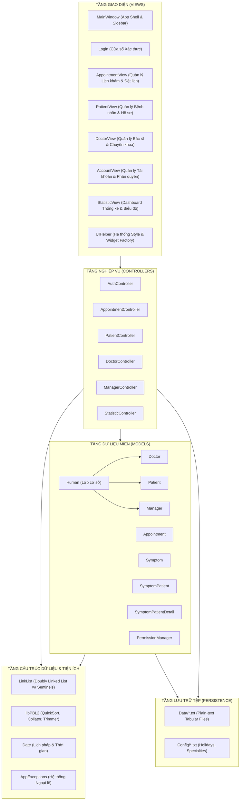

# 🏥 HỆ THỐNG QUẢN LÝ PHÒNG KHÁM ĐA KHOA AN TÂM (MngCareBook)

> **Đồ án Cơ sở Ngành Công nghệ Thông tin (PBL 2)**  
> **Khoa Công nghệ Thông tin - Trường Đại học Bách Khoa, Đại học Đà Nẵng**  
> **Ngôn ngữ:** C++20 / C++23 (`-std=gnu++2b`) | **Framework Giao diện:** Qt 6 (Widgets, Gui, Core, Charts, OpenGLWidgets)  
> **Nền tảng:** Windows Desktop (MinGW-w64 UCRT64 / MSYS2)

---

## 📌 1. TỔNG QUAN HỆ THỐNG

**Hệ thống Quản lý Phòng Khám Đa Khoa An Tâm (MngCareBook)** là phần mềm máy tính (Desktop Application) chuyên nghiệp phục vụ công tác quản lý phòng khám ngoại trú. Ứng dụng đáp ứng trọn vẹn quy trình khám chữa bệnh từ khâu tiếp đón bệnh nhân, sàng lọc triệu chứng lâm sàng, điều phối lịch hẹn theo chuyên khoa, quản lý bác sĩ, cho đến phân quyền nhân viên đa cấp và thống kê y tế chuyên sâu.

### 🌟 Các Điểm Nổi Bật Về Mặt Kỹ Thuật

1. **Quy tắc Zero Forbidden STL (Tự phát triển Cấu trúc Dữ liệu):**
   - Nghiêm cấm sử dụng các vùng chứa (containers) và giải thuật dựng sẵn của thư viện chuẩn C++ (`std::vector`, `std::list`, `std::map`, `std::queue`, `std::deque`, `std::sort`...) cho tầng lưu trữ dữ liệu nghiệp vụ cốt lõi.
   - Toàn bộ dữ liệu trong RAM được tổ chức và quản trị thông qua lớp mẫu **Danh sách liên kết đôi có nút canh giữ (`LinkList<T>`)** tự cài đặt từ đầu.
2. **Khung Thuật toán Sắp xếp Toàn năng (`libPBL2::qsort`):**
   - Thuật toán **QuickSort In-Place** chạy trực tiếp trên các nút của danh sách liên kết đôi bằng kỹ thuật hoán vị giá trị hai con trỏ, triệt tiêu phân mảnh bộ nhớ.
   - Hỗ trợ đa dạng động cơ so sánh: So sánh tự nhiên (`compareNatural`), so sánh tên người Việt Nam chuẩn Unicode (`compareVietnameseNames`), so sánh mốc thời gian đa trường (`compareDates`).
3. **Mô hình Kiến trúc Đa tầng (4-Layer MVC Architecture):**
   - Tách bạch tuyệt đối giữa Giao diện (Views), Nghiệp vụ (Controllers), Thực thể dữ liệu (Models), và Cấu trúc lưu trữ (Data Structures).
4. **Cơ chế Lưu trữ File Bền vững (Text-based Persistence):**
   - Lưu trữ dữ liệu dạng bảng phân cách chuẩn hóa ký tự sổ đứng `|`, hỗ trợ phân tích và khôi phục dễ dàng mà không phụ thuộc vào hệ quản trị cơ sở dữ liệu cồng kềnh.
5. **Giao diện Người dùng Hiện đại (Modern Healthcare Theme):**
   - Tông màu chủ đạo **Deep Teal / Slate Modern** (`#0f766e`, `#0d9488`, `#0f172a`), giao diện phẳng, sắc nét, tối ưu tương phản nhằm giảm mỏi mắt cho nhân viên y tế trong ca trực.
   - Biểu đồ thống kê y tế tương tác mượt mà với **QtCharts** (Donut Chart, Bar Chart, Line Chart).

---

## 🏗️ 2. KIẾN TRÚC HỆ THỐNG (M-V-C ARCHITECTURE)

Hệ thống được thiết kế theo mô hình **Model - View - Controller (MVC)** mở rộng với tầng Tiện ích & Cấu trúc dữ liệu độc lập:



### Chi tiết các tầng:
* **Views Layer:** Chịu trách nhiệm hiển thị bảng dữ liệu, phân trang động, tiếp nhận thao tác của người dùng, render biểu đồ `QtCharts`. Các view không chứa logic tính toán mà ủy thác hoàn toàn cho Controller.
* **Controllers Layer:** Xử lý toàn bộ logic nghiệp vụ (Validation số điện thoại/CCCD, sàng lọc triệu chứng và tính trọng số chuyên khoa, thuật toán tìm ca khám trống, phân quyền ma trận RBAC, tính toán KPI thống kê).
* **Models Layer:** Đại diện cho các thực thể dữ liệu y tế, kế thừa hướng đối tượng (`Human` $\to$ `Doctor`, `Patient`, `Manager`), cung cấp phương thức tuần tự hóa (`loadFromString`, `toString`, `loadFromFile`, `saveToFile`).
* **Core / DataStructures Layer:** Cung cấp danh sách liên kết đôi mẫu `LinkList<T>`, thư viện giải thuật `libPBL2` với QuickSort in-place và các hàm xử lý chuỗi/ngày tháng.

---

## 🚀 3. CÁC PHÂN HỆ CHỨC NĂNG CHÍNH

### 3.1. Phân Hệ Xác Thực & Phân Quyền (RBAC)
* **Xác thực bảo mật:** Kiểm tra tài khoản, mã hóa trạng thái, ngăn chặn đăng nhập đồng thời khi tài khoản bị khóa (`state == 0`).
* **Phân quyền vai trò hệ thống:**
  * **Quản trị viên (Administrator):** Toàn quyền kiểm soát hệ thống, quản lý tài khoản nhân viên, cấp phát quyền hạn động có thời hạn.
  * **Nhân viên tiếp tân đặc biệt (SpecialReceptionist):** Được thực hiện các nghiệp vụ tiếp nhận và điều phối ca khám nâng cao.
  * **Nhân viên tiếp tân (Receptionist):** Tiếp nhận bệnh nhân, đặt lịch khám cơ bản.
* **Cơ chế Phân quyền Đặc biệt có Thời hạn (`PermissionManager`):** Cho phép Root Admin cấp quyền tạm thời cho nhân viên (ví dụ quyền Hủy ca khám `Per_4`, quyền Thống kê `Per_6` trong 7 ngày hoặc 30 ngày). Hệ thống tự động quét và thu hồi quyền đã hết hạn lúc khởi động.
* **Đồng bộ Sidebar tức thì:** Khi nhân viên cập nhật thông tin họ tên cá nhân, Avatar và Họ tên trên thanh Sidebar bên trái tự động làm mới ngay lập tức.

### 3.2. Phân Hệ Quản Lý Bệnh Nhân & Tiếp Nhận Lâm Sàng
* **Quản lý hồ sơ bệnh nhân:** Mã tự sinh `P_XXX`, họ tên, số điện thoại, CCCD (12 chữ số), giới tính, tuổi. Kiểm tra tính hợp lệ và chống trùng lặp dữ liệu nghiêm ngặt.
* **Sàng lọc triệu chứng tiếp nhận:** Nhân viên tích chọn các biểu hiện lâm sàng ban đầu (ho, sốt, đau ngực, phát ban...). Hệ thống tự động tổng hợp mã phiếu `SP_XXX` và chi tiết triệu chứng `SymptomPatientDetail`.
* **Tra cứu lịch sử khám bệnh:** Hiển thị toàn bộ các ca khám trong quá khứ của bệnh nhân, bao gồm cả ca đã khám thành công và ca đã dời lịch, hỗ trợ tìm kiếm đa từ khóa thời gian thực.

### 3.3. Phân Hệ Quản Lý Đội Ngũ Bác Sĩ & Chuyên Khoa
* **Hồ sơ chuyên môn:** Mã bác sĩ `D_XXX`, họ tên, chuyên khoa phụ trách, phòng khám (ví dụ `Room 101`), số điện thoại, giá khám, điểm đánh giá uy tín (Rating).
* **Tìm kiếm & Ràng buộc toàn vẹn:** Tìm kiếm bác sĩ linh hoạt theo tên, chuyên khoa, phòng khám hoặc số điện thoại; kiểm tra chặn trùng số điện thoại giữa các bác sĩ.
* **Lịch sử ca khám phụ trách:** Bác sĩ có thể theo dõi chi tiết danh sách bệnh nhân đã và đang khám, các ca chuyển đổi dời lịch với huy hiệu trạng thái rõ ràng.

### 3.4. Phân Hệ Đặt Lịch & Điều Phối Ca Khám (Scheduling Engine)
* **Gợi ý Chuyên khoa Tự động (Triage Engine):** Dựa trên danh sách triệu chứng bệnh nhân chọn lúc tiếp nhận, thuật toán tính tổng điểm trọng số (`S_Score`) của từng chuyên khoa để tự động chọn chuyên khoa có điểm cao nhất.
* **Lịch trực quan & Kiểm soát Xung đột (Conflict Detection):**
  * Lịch khám chia thành các slot cố định 30 phút trong khung giờ làm việc: Sáng (07:30 - 11:30), Chiều (13:30 - 17:00).
  * Chặn đặt lịch vào ngày nghỉ lễ quốc gia hoặc kỳ nghỉ Tết Nguyên Đán (cấu hình trong `Config/holidays.txt`), tự động cảnh báo bằng ô màu đỏ trên lịch.
  * Tô màu ô lịch trực quan theo thứ tự ưu tiên: Ngày quá khứ (Vàng) > Ngày ngoài tháng (Xám) > Ngày nghỉ lễ (Đỏ) > Ngày có ca khám (Xanh).
  * Bộ đệm RAM Cache triệt tiêu 100% độ trễ đọc đĩa khi duyệt lịch.
* **Suy diễn Trạng thái Ca khám Động:**
  * `● Chưa khám` (Xanh/Vàng nhạt): Ca khám trong tương lai hoặc trong khoảng thời gian hợp lệ.
  * `● Trễ hẹn` (Cam đậm): Tự động kích hoạt khi đã **quá 30 phút** ân hạn so với giờ hẹn mà bệnh nhân chưa vào khám.
  * `● Đã khám` (Xanh lá): Bác sĩ đã hoàn tất ca khám (`state == 1`).
  * `● Đã dời lịch` (Xám Slate `#64748b`): Lưu vết lịch sử chuyển đổi ca khám (`state == -2`), hiển thị minh bạch trên mọi bảng biểu.
* **Dời Lịch & Hủy Ca Khám:**
  * Tìm kiếm thông minh bác sĩ khả dụng cùng chuyên khoa có ca trống gần nhất.
  * Hủy ca khám kèm cơ chế **Xóa tầng an toàn (Cascade Deletion)**: Tự động dọn sạch các bản ghi mồ côi `SymptomPatient` và `SymptomPatientDetail`.

### 3.5. Phân Hệ Báo Cáo & Thống Kê Y Tế (Analytics Dashboard)
* **Chỉ số KPI thời gian thực:** Tổng số bệnh nhân, bác sĩ trực tuyến, tổng ca khám, tỷ lệ hoàn thành ca khám (%), tổng doanh thu và doanh thu hôm nay.
* **Biểu đồ Trực quan QtCharts:**
  * **Donut Chart:** Tỷ trọng nhu cầu khám theo từng Chuyên khoa.
  * **Bar Chart / Line Chart:** Xu hướng số lượng ca khám 7 ngày gần nhất (tự động tính lùi ngày lịch pháp chính xác).
  * **Leaderboard:** Bảng vinh danh top bác sĩ có số lượt khám cao nhất và điểm đánh giá xuất sắc nhất.
* **Tự động loại bỏ ca ảo:** Mọi phép tính thống kê đều tự động loại bỏ các ca đã dời lịch (`state == -2`) để tránh sai lệch số liệu.

---

## 📂 4. CẤU TRÚC THƯ MỤC DỰ ÁN

```text
PBL_2/
├── bin/                          # Thư mục chứa tệp thực thi sau khi biên dịch
│   └── MngCareBook.exe           # Ứng dụng chính (GUI executable)
├── assets/                       # Tài nguyên giao diện nhúng qua Qt Resource (assets.qrc)
│   ├── fonts/                    # Phông chữ Be Vietnam Pro, Playfair Display
│   └── textures/                 # Icon, hình ảnh đại diện, mũi tên điều hướng
├── Config/                       # Cấu hình danh mục hệ thống
│   ├── holidays.txt              # Danh mục ngày lễ quốc gia & cấu hình Tết Âm lịch
│   └── specialties.txt           # Bảng mã chuyên khoa (Sp_ID) và tên khoa khám
├── Data/                         # Cơ sở dữ liệu tệp văn bản (Text-based Tabular Data)
│   ├── Appointment.txt           # Dữ liệu ca khám (Mã lịch, Mã SP, Bác sĩ, Ngày hẹn, Trạng thái)
│   ├── Manager.txt               # Danh sách tài khoản nhân sự (Họ tên, SĐT, User, Pass, Vai trò)
│   ├── Patient.txt               # Danh sách hồ sơ bệnh nhân (Họ tên, SĐT, Tuổi, Giới tính, CCCD)
│   ├── PermissionManager.txt     # Phân quyền hạn nhân viên đặc biệt theo thời hạn
│   ├── Doctor/
│   │   └── Doctor.txt            # Danh sách bác sĩ, phòng khám, chi phí, rating
│   └── Symptom/
│       ├── Symptom.txt           # Danh mục triệu chứng lâm sàng và điểm trọng số
│       ├── SymptomPatient.txt    # Phiếu ghi nhận triệu chứng bệnh nhân lúc tiếp nhận
│       └── SymptomPatientDetail.txt # Chi tiết liên kết N:N giữa phiếu khám và triệu chứng
├── src/                          # Toàn bộ mã nguồn C++ của dự án
│   ├── main.cpp                  # Điểm khởi chạy ứng dụng (Application Entry Point)
│   ├── DataStructures/           # Tầng cấu trúc dữ liệu tự phát triển (Zero STL)
│   │   ├── LinkList.h            # Khai báo lớp mẫu danh sách liên kết đôi (Doubly Linked List)
│   │   └── LinkList.cpp          # Hiện thực Template LinkList<T>
│   ├── Models/                   # Tầng mô hình thực thể thuần túy
│   │   ├── Human.h / .cpp        # Lớp cơ sở trừu tượng
│   │   ├── Doctor.h / .cpp       # Thực thể Bác sĩ (Kế thừa Human)
│   │   ├── Patient.h / .cpp      # Thực thể Bệnh nhân (Kế thừa Human)
│   │   ├── Manager.h / .cpp      # Thực thể Nhân sự (Kế thừa Human)
│   │   ├── Appointment.h / .cpp  # Thực thể Lịch hẹn khám
│   │   ├── Symptom.h / .cpp      # Thực thể Triệu chứng lâm sàng
│   │   ├── SymptomPatient.h / .cpp # Phiếu tiếp nhận triệu chứng
│   │   ├── SymptomPatientDetail.h / .cpp # Chi tiết mã triệu chứng
│   │   ├── Permission.h / .cpp   # Danh mục quyền hạn
│   │   └── PermissionManager.h / .cpp # Quan hệ cấp phát quyền cho nhân sự
│   ├── Controllers/              # Tầng xử lý nghiệp vụ tĩnh
│   │   ├── AuthController.h / .cpp     # Nghiệp vụ xác thực & đăng nhập
│   │   ├── AppointmentController.h / .cpp # Nghiệp vụ đặt lịch, xung đột, ngày lễ
│   │   ├── DoctorController.h / .cpp   # Nghiệp vụ bác sĩ & chuyên khoa
│   │   ├── PatientController.h / .cpp  # Nghiệp vụ bệnh nhân & triệu chứng
│   │   ├── ManagerController.h / .cpp  # Nghiệp vụ quản lý tài khoản & phân quyền
│   │   └── StatisticController.h / .cpp# Nghiệp vụ phân tích số liệu & biểu đồ
│   ├── Views/                    # Tầng giao diện người dùng
│   │   ├── MainWindow.h / .cpp   # App Shell điều hướng chính & thanh Sidebar
│   │   ├── UIHelper.h / .cpp     # Tiện ích tạo widget, style sheet, avatar
│   │   ├── Login/                # Mô-đun cửa sổ đăng nhập
│   │   ├── Appointment/          # Mô-đun giao diện lịch hẹn & đặt lịch
│   │   ├── Patient/              # Mô-đun giao diện bệnh nhân & lịch sử khám
│   │   ├── Doctor/               # Mô-đun giao diện danh sách bác sĩ
│   │   ├── Account/              # Mô-đun giao diện tài khoản & phân quyền
│   │   └── Statistic/            # Mô-đun dashboard thống kê y tế
│   └── Utils/                    # Tiện ích giải thuật, lịch pháp & ngoại lệ
│       ├── AppExceptions.h / .cpp# Cây ngoại lệ y tế tự định nghĩa
│       ├── Date.h / .cpp         # Quản lý thời gian, lịch pháp và toán tử
│       └── libPBL2.h / .cpp      # Khung thuật toán QuickSort & so sánh tiếng Việt
├── PBL_2.pro                     # Tệp cấu hình dự án qmake
├── algorithm.md                  # Tài liệu đặc tả kỹ thuật chi tiết cấu trúc dữ liệu & thuật toán
└── readme.md                     # Tài liệu hướng dẫn sử dụng & tổng quan hệ thống
```

---

## 🛠️ 5. HƯỚNG DẪN CÀI ĐẶT & BIÊN DỊCH

### 5.1. Yêu Cầu Môi Trường
* **Hệ điều hành:** Windows 10 / Windows 11 (64-bit).
* **Trình biên dịch:** MinGW-w64 GCC 13+ hoặc GCC 14+ (khuyến nghị môi trường **MSYS2 UCRT64**).
* **Bộ công cụ phát triển:** Qt 6.5+ (bao gồm các mô-đun: `Qt6Core`, `Qt6Gui`, `Qt6Widgets`, `Qt6Charts`, `Qt6OpenGLWidgets`).
* **Tiện ích Build:** `qmake` và `mingw32-make`.

### 5.2. Các Bước Biên Dịch & Chạy Bằng Command Line

1. **Khởi động Terminal UCRT64 (MSYS2):**
   Mở môi trường dòng lệnh `MSYS2 UCRT64` và chuyển vào thư mục dự án:
   ```bash
   cd /d/Documents/Universe_Materials/Semester_3/PBL_2
   ```

2. **Tạo Makefile bằng qmake:**
   ```bash
   qmake PBL_2.pro
   ```

3. **Tiến hành biên dịch đa luồng:**
   ```bash
   mingw32-make -j4
   ```

4. **Khởi chạy ứng dụng:**
   Sau khi biên dịch thành công, tệp thực thi sẽ nằm tại `bin/MngCareBook.exe`:
   ```bash
   ./bin/MngCareBook.exe
   ```

### 5.3. Mở và Biên Dịch Trên Qt Creator
1. Mở **Qt Creator**, chọn **File $\to$ Open File or Project...** và chọn tệp `PBL_2.pro`.
2. Chọn Kit biên dịch tương ứng với **Desktop Qt 6.x.x MinGW 64-bit**.
3. Nhấn tổ hợp phím `Ctrl + B` để build dự án hoặc `Ctrl + R` để chạy trực tiếp.

---

## 📋 6. QUY CÁCH DỮ LIỆU TỆP TIN (DATA FORMATS)

Mọi tệp dữ liệu trong thư mục `Data/` đều tuân theo chuẩn định dạng bảng văn bản với dòng 1 là Tiêu đề cột, dòng 2 là đường kẻ phân cách, và các dòng tiếp theo là dữ liệu ngăn cách bởi dấu gạch đứng `|`:

* **`Data/Patient.txt`**:
  ```text
  P_ID  | P_FullName           | P_Phone    | P_Gender | P_Age | P_CCCD
  ------+----------------------+------------+----------+-------+-------------
  P_001 | Nguyen Van A         | 0905123456 | 1        | 35    | 048095000123
  ```
* **`Data/Doctor/Doctor.txt`**:
  ```text
  D_ID   | D_FullName       | D_Phone    | D_Gender | D_Age | Sp_ID  | D_State | Room_ID  | Consultation_Fee | Rating
  -------+------------------+------------+----------+-------+--------+---------+----------+------------------+-------
  D_001  | Tran Thi Mai     | 0912345678 | 0        | 42    | SP_01  | 1       | Room 101 | 250000.0         | 4.9
  ```
* **`Data/Appointment.txt`**:
  ```text
  A_ID  | SP_ID  | D_ID  | A_DateGet        | A_State
  ------+--------+-------+------------------+---------
  A_001 | SP_001 | D_001 | 2026-11-16 09:30 | 0
  ```
  *(Trong đó `A_State`: `0` = Chưa khám, `1` = Đã khám, `-1` = Trễ hẹn, `-2` = Đã dời lịch; ngày đặt hẹn được quản lý tập trung tại `SymptomPatient.txt`)*.

---

## 👥 7. THÔNG TIN TÁC GIẢ & BẢN QUYỀN

* **Đề tài:** Hệ thống Quản lý Phòng khám Đa khoa An Tâm (AnTamMng / MngCareBook)
* **Học phần:** PBL 2: Đồ án Cơ sở Ngành Công nghệ Thông tin
* **Trường đào tạo:** Trường Đại học Bách Khoa, Đại học Đà Nẵng (DUT)
* **Giảng viên hướng dẫn:** Bộ môn Công nghệ Phần mềm / Khoa CNTT
* **Quyền sử dụng:** Dự án được phát triển phục vụ mục đích học tập và nghiên cứu học thuật. Nghiêm cấm sao chép vì mục đích thương mại khi chưa có sự đồng ý của tác giả.

> Chi tiết kỹ thuật về các cấu trúc dữ liệu và giải thuật chuyên sâu, xin vui lòng tham khảo tệp [algorithm.md](file:///d:/Documents/Universe_Materials/Semester_3/PBL_2/algorithm.md).
