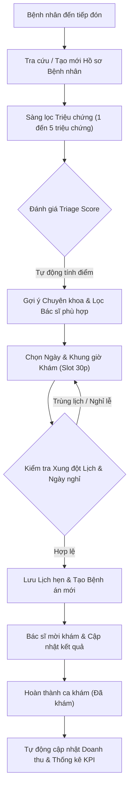

# 🏥 AnTamMng - HỆ THỐNG QUẢN LÝ PHÒNG KHÁM ĐA KHOA AN TÂM

> **Phần mềm máy tính để bàn chuyên nghiệp phục vụ quản lý lịch khám, tiếp đón và sàng lọc triệu chứng (Triage), điều phối bác sĩ, quản lý hồ sơ bệnh nhân, phân quyền nhân sự đa tầng và báo cáo thống kê trực quan cho phòng khám đa khoa.**

[](https://www.microsoft.com)
[](https://www.qt.io/)
[](https://isocpp.org/)
[](https://www.msys2.org/)
[](#)

---

## 📖 MỤC LỤC
1. [Giới thiệu Tổng quan](#1-giới-thiệu-tổng-quan)
2. [Điểm nổi bật Kỹ thuật & Kiến trúc](#2-điểm-nổi-bật-kỹ-thuật--kiến-trúc)
3. [Cấu trúc Thư mục Dự án](#3-cấu-trúc-thư-mục-dự-án)
4. [Các Phân hệ Chức năng Chi tiết](#4-các-phân-hệ-chức-năng-chi-tiết)
   - [4.1. Trang Tổng quan & Dashboard Chỉ số (Dashboard)](#41-trang-tổng-quan--dashboard-chỉ-số-dashboard)
   - [4.2. Đặt lịch Khám & Sàng lọc Triệu chứng (Booking & Triage)](#42-đặt-lịch-khám--sàng-lọc-triệu-chứng-booking--triage)
   - [4.3. Quản lý Lịch hẹn & Điều phối Khám bệnh (Appointment Management)](#43-quản-lý-lịch-hẹn--điều-phối-khám-bệnh-appointment-management)
   - [4.4. Quản lý Đội ngũ Bác sĩ (Doctor Management)](#44-quản-lý-đội-ngũ-bác-sĩ-doctor-management)
   - [4.5. Quản lý Hồ sơ Bệnh nhân & Bệnh án (Patient Management)](#45-quản-lý-hồ-sơ-bệnh-nhân--bệnh-án-patient-management)
   - [4.6. Quản lý Tài khoản & Phân quyền Đa tầng (Account & RBAC)](#46-quản-lý-tài-khoản--phân-quyền-đa-tầng-account--rbac)
   - [4.7. Thống kê & Báo cáo Trực quan (Statistics & Charts)](#47-thống-kê--báo-cáo-trực-quan-statistics--charts)
   - [4.8. Cấu hình Hệ thống & Quản lý Lịch Nghỉ Lễ (Holidays & Config)](#48-cấu-hình-hệ-thống--quản-lý-lịch-nghỉ-lễ-holidays--config)
5. [Cơ chế Xóa mềm Toàn diện (Soft Delete Architecture)](#5-cơ-chế-xóa-mềm-toàn-diện-soft-delete-architecture)
6. [Thuật toán Sắp xếp Nhanh Tương tác (QuickSort & Vietnamese Collation)](#6-thuật-toán-sắp-xếp-nhanh-tương-tác-quicksort--vietnamese-collation)
7. [Quy chuẩn Ma trận Phân quyền (RBAC Matrix)](#7-quy-chuẩn-ma-trận-phân-quyền-rbac-matrix)
8. [Yêu cầu Môi trường & Hướng dẫn Cài đặt / Biên dịch](#8-yêu-cầu-môi-trường--hướng-dẫn-cài-đặt--biên-dịch)
9. [Hướng dẫn Khởi chạy & Tài khoản Đăng nhập Mẫu](#9-hướng-dẫn-khởi-chạy--tài-khoản-đăng-nhập-mẫu)
10. [Thông tin Bản quyền & Hỗ trợ](#10-thông-tin-bản-quyền--hỗ-trợ)

---

## 1. GIỚI THIỆU TỔNG QUAN

**AnTamMng** (Hệ thống Quản lý Phòng Khám Đa Khoa An Tâm) là giải pháp phần mềm máy tính để bàn (Desktop Application) toàn diện, hiện đại, được thiết kế chuyên biệt để tự động hóa và nâng cao hiệu quả vận hành tại các cơ sở y tế đa khoa:
* **Chuẩn hóa quy trình tiếp đón:** Giảm thiểu tối đa thời gian chờ đợi của bệnh nhân từ khâu đăng ký, chọn triệu chứng đến phân luồng phòng khám.
* **Sàng lọc triệu chứng thông minh (Triage):** Đánh giá nguy cơ sức khỏe ban đầu, tự động đề xuất chuyên khoa và bác sĩ phụ trách tối ưu nhất.
* **Ngăn ngừa xung đột thời gian (Conflict Prevention):** Quản lý ca khám bệnh chính xác theo từng khung giờ slot 30 phút, đồng bộ với lịch làm việc và ngày nghỉ lễ của phòng khám.
* **Kiểm soát nhân sự và tài chính chặt chẽ:** Phân quyền vai trò chi tiết (RBAC) kết hợp cấp quyền ủy nhiệm có thời hạn, cung cấp bức tranh tài chính và công suất phòng khám thông qua biểu đồ trực quan.

Ứng dụng sở hữu phong cách thiết kế **Deep Dark Teal** (`#0F2A3A` - `#0A1F2C` - `#0D9488`) đồng nhất, thanh lịch, êm mắt khi làm việc ca dài và giao diện co giãn thích ứng mượt mà từ màn hình chuẩn HD đến 4K.



---

## 2. ĐIỂM NỔI BẬT KỸ THUẬT & KIẾN TRÚC

* **100% C++ Thuần & Cấu trúc Dữ liệu Tự hiện thực (No-STL banned containers):**
  - Tuyệt đối không sử dụng các container thư viện chuẩn STL bị cấm (`std::vector`, `std::list`, `std::map`, `std::set`, `<algorithm>`, `<functional>`).
  - Toàn bộ danh sách thực thể được lưu trữ và thao tác trên cấu trúc **Danh sách liên kết đôi có nút canh giữ** (`LinkList<T>`) và **Hàng đợi** (`Queue<T>`) tự lập trình từ đầu, đảm bảo tính chặt chẽ trong quản lý bộ nhớ con trỏ.
* **Mô hình Kiến trúc Phần mềm MVC phân tách độc lập:**
  - **Models (`src/Models/`):** Chứa các lớp thực thể (`Human`, `Doctor`, `Patient`, `Manager`, `Appointment`, `Symptom`, `SymptomPatient`, `Date`) đảm nhận đóng gói thuộc tính, kiểm tra hợp lệ, tải và ghi dữ liệu ra tệp tin định dạng chuẩn.
  - **Controllers (`src/Controllers/`):** Xử lý toàn bộ logic nghiệp vụ (thuật toán tính toán Triage, kiểm tra xung đột thời gian, xác thực mật khẩu, phân quyền động, tổng hợp doanh thu thống kê).
  - **Views (`src/Views/`):** Xây dựng trên Qt 6 Widgets hiện đại, tùy biến CSS cao cấp, phân trang stack động, hỗ trợ kéo thả và co giãn tự động bằng `UIHelper::setupTableScaling`.
* **Thuật toán Sắp xếp Hoare QuickSort Template chuyên dụng:**
  - Triển khai QuickSort tổng quát dạng template hỗ trợ mọi cấu trúc dữ liệu và tiêu chí so sánh tùy biến.
  - Áp dụng phân hoạch Hoare đối xứng và pivot trung vị giúp triệt tiêu hoàn toàn lỗi tràn ngăn xếp (Stack Overflow) hoặc suy thoái $O(N^2)$ khi có nhiều bản ghi trùng giá trị.
  - Thuật toán so sánh chữ cái tiếng Việt (`UIHelper::compareVietnameseNames`) ưu tiên tên gọi chính ở cuối trước, trùng tên mới xét Họ và Tên đệm.
* **Cơ chế Xóa mềm (Soft Delete) bảo vệ toàn vẹn lịch sử y khoa:**
  - Bổ sung cột cờ trạng thái logic `_Valid` (`bool`: `1` = hiển thị, `0` = đã xóa) trên toàn bộ các bảng dữ liệu bệnh nhân, bác sĩ, lịch hẹn và tài khoản quản lý.
* **Portable Windows Launcher (C Launcher):**
  - Tích hợp launcher nhị phân viết bằng C thuần (`AnTamMng.exe` tại thư mục gốc), tự động định vị đường dẫn làm việc, tải môi trường và khởi chạy ứng dụng lõi `bin/AnTamMng.exe` mà không gây nhấp nháy cửa sổ dòng lệnh đen (console window).
* **Tìm kiếm Tiếng Việt thông minh không phân biệt dấu:**
  - Hỗ trợ bóc tách dấu Unicode tiếng Việt giúp tìm kiếm nhanh hồ sơ bệnh nhân, bác sĩ, chuyên khoa bằng chữ có dấu, không dấu, chữ hoa hay chữ thường.

---

## 3. CẤU TRÚC THƯ MỤC DỰ ÁN

```text
pbl2_v1.1/
├── AnTamMng.exe                 # Trình khởi chạy portable gốc (C Launcher - No Console)
├── launcher.bat                 # Script batch khởi động nhanh
├── start.bat                    # Script kiểm tra môi trường, tự biên dịch nếu thiếu bin
├── PBL_2.pro                    # File cấu hình dự án qmake cho Qt 6
├── resource.qrc                 # File tài nguyên nhúng (Fonts, Icons, Textures)
├── README.md                    # Tài liệu tổng quan chức năng ứng dụng
├── funtionAlgorithms.md         # Phân tích chi tiết source code, thuật toán & cấu trúc dữ liệu
├── Config/                      # Cấu hình danh mục hệ thống
│   ├── Lichnghile.txt           # Danh mục các ngày nghỉ lễ, Tết của phòng khám
│   └── Permission.txt           # Danh mục mã quyền hệ thống chuẩn (Per_1 -> Per_5)
├── Data/                        # Cơ sở dữ liệu văn bản thuần (File-based Storage)
│   ├── Appointment.txt          # Dữ liệu cuộc hẹn khám bệnh (kèm cột A_Valid)
│   ├── Manager.txt              # Danh sách tài khoản người dùng hệ thống (kèm cột MA_Valid)
│   ├── Patient.txt              # Hồ sơ nhân khẩu học bệnh nhân (kèm cột P_Valid)
│   ├── PermissionManager.txt    # Bảng phân quyền động có thời hạn cho tài khoản
│   ├── Doctor/
│   │   ├── Doctor.txt           # Danh sách hồ sơ bác sĩ (kèm cột D_Valid)
│   │   └── Specialization.txt   # Danh mục chuyên khoa & mã khoa tương ứng
│   └── Symptom/
│       ├── Symptom.txt          # Danh mục triệu chứng lâm sàng & điểm Triage
│       └── SymptomPatient.txt   # Bệnh án triệu chứng gắn liền với từng bệnh nhân
├── assets/                      # Tài nguyên giao diện ngoài
│   ├── fonts/                   # Bộ font tiếng Việt Be Vietnam Pro & Playfair Display
│   └── textures/                # Icon app, biểu tượng SVG/ICO, texture y tế
├── bin/                         # Thư mục thực thi & DLL runtime Qt 6
│   ├── AnTamMng.exe             # Ứng dụng thực thi chính
│   └── *.dll                    # Thư viện liên kết động Qt 6 & MinGW runtime
└── src/                         # Toàn bộ mã nguồn dự án
    ├── main.cpp                 # Điểm khởi đầu ứng dụng (Application Entry Point)
    ├── Controllers/             # Các bộ điều khiển nghiệp vụ (6 Controllers)
    │   ├── AppointmentController.h/.cpp
    │   ├── AuthController.h/.cpp
    │   ├── DoctorController.h/.cpp
    │   ├── ManagerController.h/.cpp
    │   ├── PatientController.h/.cpp
    │   └── StatisticController.h/.cpp
    ├── DataStructures/          # Cấu trúc dữ liệu tự xây dựng (LinkList, Queue)
    │   ├── LinkList.h
    │   └── Queue.h
    ├── Launcher/                # Mã nguồn C Launcher & file tài nguyên Icon
    │   ├── launcher.c
    │   ├── resource.rc
    │   └── build_launcher.bat
    ├── Models/                  # Các lớp thực thể đối tượng (8 Models)
    │   ├── Appointment.h/.cpp
    │   ├── Date.h/.cpp
    │   ├── Doctor.h/.cpp
    │   ├── Human.h/.cpp
    │   ├── Manager.h/.cpp
    │   ├── Patient.h/.cpp
    │   ├── Symptom.h/.cpp
    │   └── SymptomPatient.h/.cpp
    ├── Utils/                   # Thư viện tiện ích chuỗi, ngày tháng
    │   ├── Date.h/.cpp
    │   └── libPBL2.h/.cpp
    └── Views/                   # Giao diện đồ họa người dùng Qt 6 (6 Phân hệ View)
        ├── MainWindow.h/.cpp
        ├── UIHelper.h/.cpp      # Chứa QuickSort Template, hộp thoại & thành phần giao diện mẫu
        ├── Account/             # Phân hệ Quản lý tài khoản & Phân quyền
        ├── Appointment/         # Phân hệ Dashboard, Đặt lịch & Quản lý lịch khám
        ├── Doctor/              # Phân hệ Quản lý hồ sơ bác sĩ
        ├── Login/               # Phân hệ Đăng nhập hệ thống
        ├── Patient/             # Phân hệ Quản lý hồ sơ bệnh nhân
        └── Statistic/           # Phân hệ Thống kê & Báo cáo đồ thị
```

---

## 4. CÁC PHÂN HỆ CHỨC NĂNG CHI TIẾT

### 4.1. Trang Tổng quan & Dashboard Chỉ số (Dashboard)
Trang chủ hiển thị tức thì khi đăng nhập thành công, cung cấp cái nhìn bao quát về tình hình hoạt động trong ngày của phòng khám:
* **Lời chào cá nhân hóa theo thời gian thực:** Tự động nhận diện buổi sáng, chiều hoặc tối (`Chào buổi sáng / chiều / tối`) kèm theo họ tên của tài khoản nhân viên đang đăng nhập.
* **4 Thẻ Chỉ số KPI Vận hành (Real-time Metric Cards):**
  - **BỆNH NHÂN:** Tổng số bệnh nhân hợp lệ đang được quản lý trong cơ sở dữ liệu.
  - **BÁC SĨ:** Tổng số bác sĩ đang công tác hợp lệ tại phòng khám.
  - **LỊCH KHÁM:** Tổng số lượt lịch khám bệnh được ghi nhận trên hệ thống.
  - **CHƯA KHÁM:** Số lượng ca khám bệnh đang trong trạng thái chờ phục vụ.
* **Banner Đặt lịch Nhanh (1-Click Booking Banner):** Nút điều hướng nhanh cho phép chuyển ngay sang giao diện tạo lịch hẹn chỉ với 1 cú click.
* **Bảng Lịch hẹn Sắp tới (Upcoming Appointments):**
  - Tự động lọc các ca khám bệnh trong ngày hôm nay và ngày mai còn hiệu lực và chưa khám.
  - Hiển thị thông tin: Tên bệnh nhân, Bác sĩ phụ trách, Khung giờ hẹn (ghi rõ "Hôm nay, HH:mm" hoặc "Ngày mai, HH:mm") và Trạng thái.
  - Tích hợp thanh phân trang 8 ca khám/trang.

---

### 4.2. Đặt lịch Khám & Sàng lọc Triệu chứng (Booking & Triage)
Quy trình tiếp đón và đặt hẹn khám bệnh 4 bước liền mạch, chống sai sót:
1. **Bước 1: Tiếp đón & Chọn Hồ sơ Bệnh nhân:**
   - Dropdown chọn bệnh nhân với tính năng tra cứu danh sách nhanh.
   - Nút `+ Thêm bệnh nhân nhanh` cho phép đăng ký hồ sơ bệnh nhân mới ngay tại chỗ mà không cần thoát khỏi màn hình đặt lịch.
2. **Bước 2: Sàng lọc Triệu chứng Lâm sàng Động (1 - 5 Triệu chứng):**
   - Hỗ trợ thêm linh hoạt từ 1 đến 5 triệu chứng bệnh nhân đang gặp phải. Khi chọn một triệu chứng, dòng triệu chứng tiếp theo tự động hiển thị mượt mà.
   - **Thuật toán Đánh giá Triage Score:** Mỗi triệu chứng mang một điểm số nguy cơ lâm sàng (`sScore`) và mã chuyên khoa tương ứng (`Sp_ID`). Hệ thống tự động tính toán tổng điểm và tự động suy luận chuyên khoa có trọng số cao nhất.
3. **Bước 3: Tự động Gợi ý Chuyên khoa & Lọc Bác sĩ:**
   - Ô chuyên khoa tự động cập nhật tên khoa tương ứng (Nội tổng quát, Ngoại tổng quát, Tim mạch, Thần kinh, Tai Mũi Họng, Hô hấp, Tiêu hóa, Cơ xương khớp, Da liễu, Mắt,...).
   - Danh sách bác sĩ tự động lọc chỉ hiển thị các bác sĩ thuộc chuyên khoa tương ứng đang trong trạng thái làm việc (`D_State = 1`), kèm theo thông tin phòng khám chỉ định (ví dụ: `BS. Lê Hữu Hoàng — Phòng 101`).
4. **Bước 4: Chọn Thời gian Khám & Kiểm tra Xung đột:**
   - Chọn ngày khám trên lịch điện tử và giờ khám theo bước nhảy 30 phút/ca (trong khung giờ hành chính: 07:30 - 11:30 và 13:30 - 17:30).
   - **Thuật toán Chống Trùng lịch (Conflict Detection):** Tự động kiểm tra lịch bận của bác sĩ đã chọn trong khoảng thời gian $\pm 30$ phút. Nếu bác sĩ đã có lịch hẹn trùng hoặc sát giờ, hệ thống cảnh báo và từ chối ghi nhận.
   - **Tự động Chặn Ngày Nghỉ Lễ/Tết:** Không cho phép đặt lịch vào các ngày nghỉ lễ, Tết Nguyên Đán hoặc các ngày nghỉ đột xuất đã cấu hình.

---

### 4.3. Quản lý Lịch hẹn & Điều phối Khám bệnh (Appointment Management)
Phân hệ điều phối và theo dõi toàn bộ các cuộc hẹn khám bệnh trong phòng khám:
* **Lịch Tháng Tương tác (`QCalendarWidget` Custom):**
  - Tự động đánh dấu và làm nổi bật các ngày có lịch khám bệnh.
  - Tự động nhận diện và tô màu đặc biệt cho các ngày nghỉ lễ, Tết theo lịch cấu hình.
* **Bộ lọc Đa năng Tức thì:**
  - Lọc theo bác sĩ phụ trách.
  - Lọc theo ngày khám (xem ngày đang chọn trên lịch hoặc xem toàn bộ tất cả các ngày).
  - Lọc theo trạng thái ca khám: Tất cả, Chưa khám, Đã khám, Trễ hẹn.
* **Bảng Danh sách Lịch hẹn Chuẩn hóa:**
  - Cột hiển thị: **BỆNH NHÂN**, **BÁC SĨ**, **CHUYÊN KHOA**, **NGÀY KHÁM**, **TRẠNG THÁI**, và cột Thao tác.
  - Trạng thái ca khám được hiển thị màu sắc rõ nét:
    - `Chưa khám` (Xanh dương / Amber)
    - `Đã khám` (Xanh lá đậm)
    - `Trễ hẹn` (Đỏ cảnh báo - tự động tính toán khi giờ hẹn đã qua so với đồng hồ hệ thống).
* **Nút "Mời khám" & Hoàn tất Ca khám:**
  - Cho phép bác sĩ / lễ tân gọi bệnh nhân vào phòng khám.
  - Hộp thoại chi tiết ca khám hiển thị đầy đủ triệu chứng, cho phép cập nhật kết quả và chuyển trạng thái sang `Đã khám (1)`.
* **Hủy Lịch hẹn Y tế An toàn:**
  - Nút biểu tượng thùng rác màu đỏ trên từng dòng cho phép hủy ca khám.
  - Hiển thị hộp thoại xác nhận hủy thanh lịch, tinh gọn (`UIHelper::confirmCancel`).
  - Khi hủy, lịch hẹn được đánh dấu xóa mềm (`A_Valid = 0`), triệu chứng bệnh nhân được hoàn nguyên về trạng thái chưa giải quyết (`Resolved = 0`), và lưu ngay vào tệp dữ liệu.
* **Tính năng Sắp xếp Nhanh QuickSort:** Nhấp chuột vào bất kỳ tiêu đề cột nào để sắp xếp tức thì theo Bệnh nhân, Bác sĩ, Chuyên khoa, Ngày khám hoặc Mã trạng thái gốc.

---

### 4.4. Quản lý Đội ngũ Bác sĩ (Doctor Management)
Quản lý toàn diện hồ sơ nhân sự y bác sĩ công tác tại phòng khám:
* **Bảng Danh mục Bác sĩ:**
  - Hiển thị trực quan: **BÁC SĨ** (Họ và tên), **CHUYÊN KHOA**, **PHÒNG KHÁM**, **PHÍ KHÁM** (định dạng tiền tệ VNĐ `xxx.xxx ₫`), **ĐÁNH GIÁ** (sao chất lượng `x.x ★`), **TRẠNG THÁI** (`Hoạt động` xanh lá / `Ngừng hoạt động` đỏ), và nút Xóa.
* **Tìm kiếm Đa năng Không Dấu:** Thanh tìm kiếm phía trên cho phép lọc tức thì theo tên bác sĩ, chuyên khoa, số phòng hoặc mã bác sĩ.
* **Thêm mới Bác sĩ:**
  - Tự động sinh mã bác sĩ duy nhất kế tiếp (`D_001`, `D_002`,...).
  - Nhập họ tên, số điện thoại, chọn giới tính, độ tuổi, chọn chuyên khoa từ danh mục, gán phòng làm việc, mức phí khám niêm yết và đánh giá khởi điểm.
* **Chỉnh sửa Hồ sơ Bằng Nháy đúp (Double-Click):**
  - Nhấp đúp chuột vào bất kỳ hàng nào trên bảng để mở hộp thoại cập nhật thông tin bác sĩ, thay đổi phòng làm việc, biểu phí hoặc chuyển đổi trạng thái công tác.
* **Xóa Bác sĩ An toàn (Kiểm tra Lịch hẹn):**
  - Khi nhấn xóa bác sĩ, hệ thống kiểm tra bác sĩ có đang phụ trách lịch hẹn nào trong tương lai ở trạng thái chưa khám hay không.
  - Nếu còn lịch hẹn chờ, hệ thống bật cảnh báo xác nhận nhiều cấp trước khi cho phép xóa mềm (`D_Valid = 0`).
* **Sắp xếp Nhanh QuickSort Từng Cột:** Click tiêu đề để sắp xếp chuẩn theo Tên tiếng Việt, Chuyên khoa, Phòng khám, Phí khám (số thực `double`), Đánh giá (`double`) và Trạng thái (`bool`).

---

### 4.5. Quản lý Hồ sơ Bệnh nhân & Bệnh án (Patient Management)
Lưu trữ và theo dõi tiền sử sức khỏe của bệnh nhân đến khám:
* **Bảng Danh sách Bệnh nhân:**
  - Hiển thị các trường: **HỌ VÀ TÊN**, **ĐIỆN THOẠI**, **CCCD**, **TUỔI**, **GIỚI TÍNH** (Nam / Nữ), và nút Xóa hồ sơ.
* **Tìm kiếm Nhanh Hồ sơ:** Tìm kiếm linh hoạt theo họ tên bệnh nhân, số CMND/CCCD, số điện thoại liên lạc hoặc mã hồ sơ bệnh nhân.
* **Thêm mới Hồ sơ Bệnh nhân:**
  - Sinh mã bệnh nhân tự động tăng (`P_001`, `P_002`,...).
  - Nhập họ tên, điện thoại, số định danh CCCD (12 chữ số), độ tuổi và giới tính.
* **Chi tiết Bệnh án & Lịch sử Khám bệnh:**
  - Nháy đúp chuột vào bệnh nhân để xem chi tiết thông tin nhân khẩu học và toàn bộ lịch sử các đợt khám bệnh trước đó.
  - Cập nhật thông tin liên lạc khi bệnh nhân có thay đổi.
* **Xóa mềm Hồ sơ Bệnh nhân:**
  - Kiểm tra điều kiện bệnh nhân có đang có lịch hẹn khám sắp tới chưa khám hay không.
  - Hiển thị hộp thoại cảnh báo và xác nhận xóa mềm (`P_Valid = 0`).
* **Sắp xếp Nhanh QuickSort Từng Cột:** Sắp xếp danh sách dựa trên dữ liệu gốc: Họ và tên (chuẩn tiếng Việt), Số điện thoại, CCCD, Tuổi (`int`), và Giới tính (`bool`).

---

### 4.6. Quản lý Tài khoản & Phân quyền Đa tầng (Account & RBAC)
Dành riêng cho Quản trị viên (`Administrator`) quản lý người dùng và bảo mật hệ thống:
* **Bảng Quản trị Người dùng:**
  - Cột hiển thị: **HỌ VÀ TÊN**, **TÀI KHOẢN** (Username), **VAI TRÒ** (Quản trị viên, Lễ tân, Lễ tân chuyên trách), **TRẠNG THÁI** (Hoạt động / Khóa), và nút Xóa.
* **Thêm mới Quản lý / Lễ tân:**
  - Sinh mã tài khoản tự động tăng (`MA_001`, `MA_002`,...).
  - Thiết lập tên đăng nhập, mật khẩu khởi tạo, họ tên, điện thoại, tuổi, giới tính và vai trò.
* **Phân quyền Động Có Thời hạn (Time-based Dynamic RBAC):**
  - Mở hộp thoại chi tiết tài khoản để ủy quyền các quyền hạn đặc biệt (`Per_1` đến `Per_5`).
  - Thiết lập số ngày có hiệu lực cho từng quyền hạn (tự động tính thời điểm hết hạn `Expiry DateTime` và ghi vào `PermissionManager.txt`). Khi quá hạn, quyền sẽ tự động hết hiệu lực mà không cần can thiệp thủ công.
* **Khóa / Mở khóa Tài khoản:** Chuyển đổi trạng thái tài khoản lập tức vô hiệu hóa khả năng đăng nhập của tài khoản đó.
* **Xóa Tài khoản An toàn:**
  - Tuyệt đối không cho phép tài khoản tự xóa chính mình khi đang đăng nhập.
  - Chặn xóa tài khoản Quản trị viên gốc của hệ thống (`MA_001` / `HoangMA001`).
  - Xóa mềm tài khoản (`MA_Valid = 0`) và thu hồi ngay các quyền hạn liên quan.
* **Sắp xếp Nhanh QuickSort Từng Cột:** Hỗ trợ sắp xếp theo Họ và tên, Tên tài khoản, Cấp bậc vai trò (`enum`), Trạng thái (`int/bool`).

---

### 4.7. Thống kê & Báo cáo Trực quan (Statistics & Charts)
Hệ thống báo cáo tài chính và hiệu suất khám chữa bệnh thông minh tích hợp thư viện đồ họa **QtCharts**:
* **Hệ thống 6 Thẻ KPI Tài chính & Vận hành:**
  - **TỔNG DOANH THU:** Tổng tiền phí khám từ tất cả các ca đã khám hoàn tất (`Đã khám`).
  - **DOANH THU HÔM NAY:** Doanh thu thực thu trong ngày hiện tại.
  - **TỶ LỆ HOÀN THÀNH (Completion Rate %):** Tỷ lệ phần trăm các ca đã hoàn thành khám trên tổng số ca tính đến thời điểm hiện tại.
  - **TỔNG LỊCH HÔM NAY:** Số ca khám bệnh được xếp lịch trong ngày.
  - **ĐÃ KHÁM HÔM NAY:** Số ca khám đã được bác sĩ hoàn thành trong ngày.
  - **CHỜ KHÁM:** Số ca khám đang chờ thực hiện.
* **Biểu đồ Tròn Phân tích Nhân khẩu học Bệnh nhân (Donut Charts):**
  - **Cơ cấu Giới tính:** Tỷ lệ phần trăm Bệnh nhân Nam so với Nữ.
  - **Phân bổ Độ tuổi:** 4 nhóm tuổi rõ ràng (Dưới 18 tuổi, 18 - 45 tuổi, 46 - 60 tuổi, Trên 60 tuổi).
* **Phân tích Nhu cầu Chuyên khoa (Specialty Demand Analytics):**
  - Thống kê tỷ lệ phần trăm số lượt khám theo từng chuyên khoa, giúp ban quản lý đánh giá chuyên khoa mũi nhọn để phân bổ nhân lực.
* **Bảng Vinh danh Bác sĩ Tiêu biểu (Doctor Leaderboard):**
  - Xếp hạng Top các bác sĩ có số lượng ca khám phụ trách nhiều nhất kèm điểm đánh giá chất lượng (Rating sao).
* **Biểu đồ Cột Lưu lượng Khám 7 Ngày Gần nhất (Weekly Trend Bar Chart):**
  - Vẽ đồ thị cột thể hiện biến động số lượng lịch hẹn khám bệnh trong 7 ngày liên tục tính đến thời điểm hiện tại.
* *Lưu ý:* Toàn bộ các phép tính thống kê tự động loại bỏ các bản ghi đã xóa mềm (`valid = 0`).

---

### 4.8. Cấu hình Hệ thống & Quản lý Lịch Nghỉ Lễ (Holidays & Config)
* **Quản lý Danh mục Ngày Nghỉ Lễ:**
  - Quản lý danh mục các ngày nghỉ lễ cố định theo luật lao động (Tết Dương lịch, Giỗ tổ Hùng Vương, 30/4 - 1/5, Quốc khánh) và các ngày nghỉ đột xuất của phòng khám.
  - **Thuật toán Tính Tết Âm lịch:** Tự động tính toán các ngày nghỉ Tết Nguyên Đán theo lịch âm và hiển thị chính xác trên giao diện.
* **Hộp thoại Quản lý Lịch Nghỉ:**
  - Thêm ngày nghỉ mới kèm ghi chú (ví dụ: "Nghỉ lễ Quốc khánh 2/9").
  - Xóa ngày nghỉ với hộp thoại xác nhận an toàn (`UIHelper::confirmDelete`).
  - Đồng bộ tự động với tệp tin `Config/Lichnghile.txt`.

---

## 5. CƠ CHẾ XÓA MỀM TOÀN DIỆN (SOFT DELETE ARCHITECTURE)

Nhằm đảm bảo an toàn dữ liệu và tuân thủ nguyên tắc lưu trữ hồ sơ bệnh án y khoa, hệ thống áp dụng cơ chế **Xóa mềm (Soft Delete)** thống nhất trên tất cả 4 thực thể cốt lõi:

| Thực thể | Tệp lưu trữ | Cột cờ xóa mềm | Ý nghĩa giá trị |
| :--- | :--- | :---: | :--- |
| **Bệnh nhân** (`Patient`) | `Data/Patient.txt` | `P_Valid` | `1`: Hoạt động & Hiển thị<br>`0`: Đã xóa mềm (Ẩn khỏi danh sách) |
| **Bác sĩ** (`Doctor`) | `Data/Doctor/Doctor.txt` | `D_Valid` | `1`: Đang công tác<br>`0`: Đã xóa mềm (Ẩn khỏi phân công) |
| **Lịch hẹn** (`Appointment`) | `Data/Appointment.txt` | `A_Valid` | `1`: Lịch hẹn hợp lệ<br>`0`: Lịch hẹn đã bị hủy |
| **Tài khoản** (`Manager`) | `Data/Manager.txt` | `MA_Valid` | `1`: Tài khoản hợp lệ<br>`0`: Tài khoản đã bị xóa (Chặn đăng nhập) |

### Các nguyên tắc vận hành xóa mềm:
1. **Lọc hiển thị tự động:** Các hàm nạp danh sách, phân trang, vẽ bảng và thống kê đều lọc điều kiện `!info.isDefault() && info.getValid()`.
2. **Bảo toàn liên kết khóa ngoại (Foreign Key Integrity):** Khi một bệnh nhân hoặc bác sĩ bị xóa mềm, các ca khám cũ đã hoàn tất trong quá khứ (`Completed`) vẫn hiển thị đầy đủ tên bệnh nhân và tên bác sĩ trên báo cáo lịch sử mà không bị mất dữ liệu.
3. **Sinh mã không trùng lặp:** Các hàm `generateNextId` duyệt qua toàn bộ mã ID kể cả các bản ghi đã xóa mềm, đảm bảo không bao giờ tái sử dụng lại mã cũ gây xung đột.
4. **Chặn đăng nhập triệt để:** [`AuthController`](file:///d:/Documents/Project/pbl_2/pbl2_v1.1/src/Controllers/AuthController.cpp) kiểm tra cờ `getValid()`, từ chối đăng nhập với thông báo *"Tài khoản không tồn tại trên hệ thống!"* nếu tài khoản đã bị xóa mềm.

---

## 6. THUẬT TOÁN SẮP XẾP NHANH TƯƠNG TÁC (QUICKSORT & VIETNAMESE COLLATION)

Hệ thống tích hợp thuật toán sắp xếp nhanh mẫu (Template QuickSort) độc quyền tại [`src/Views/UIHelper.h`](file:///d:/Documents/Project/pbl_2/pbl2_v1.1/src/Views/UIHelper.h):

```cpp
template <typename Container, typename Compare>
static void quickSort(Container &c, int low, int high, Compare comp) {
    if (low >= high) return;
    auto pivot = c[low + (high - low) / 2]; // Chọn pivot trung vị
    int i = low, j = high;
    while (i <= j) {
        while (comp(c[i], pivot)) ++i;
        while (comp(pivot, c[j])) --j;
        if (i <= j) {
            std::swap(c[i], c[j]);
            ++i;
            --j;
        }
    }
    if (low < j) quickSort(c, low, j, comp);
    if (i < high) quickSort(c, i, high, comp);
}
```

### Các ưu điểm vượt trội:
1. **Phân hoạch Hoare đối xứng:** Sử dụng 2 con trỏ quét đối xứng vào giữa, hoán vị các phần tử sai vị trí so với pivot. Thuật toán xử lý trơn tru các cột có nhiều giá trị trùng lặp (như Giới tính Nam/Nữ, Trạng thái 0/1, Điểm đánh giá), triệt tiêu hoàn toàn nguy cơ đệ quy sâu gây tràn ngăn xếp.
2. **Sắp xếp Tên tiếng Việt Chuẩn xác (`UIHelper::compareVietnameseNames`):**
   - Bóc tách từ cuối cùng trong chuỗi họ tên làm **Tên gọi chính** để so sánh trước (ví dụ: *"Nguyễn Văn An"* đứng trước *"Trần Thị Bình"*, *"Bình"* đứng trước *"Tùng"*).
   - Nếu trùng Tên gọi chính, hệ thống tự động so sánh toàn bộ chuỗi Họ và Tên đệm.
3. **So sánh trên Dữ liệu Gốc (Underlying Database Fields):**
   - Sắp xếp trực tiếp trên giá trị trường của đối tượng Model thay vì lấy chuỗi định dạng từ ô bảng giao diện:
     - Phí khám: so sánh số thực `double` (`150000.0 < 200000.0`).
     - Đánh giá: so sánh số thực `double` (`4.5 < 4.9`).
     - Trạng thái / Giới tính: so sánh kiểu logic `bool` / `int` (`0 < 1`).
4. **Tie-Breaking Đối xứng:** Bổ sung tiêu chí phụ so sánh mã ID `return asc ? (a->getID() < b->getID()) : (a->getID() > b->getID());` đảm bảo khi chuyển đổi giữa Tăng dần $\leftrightarrow$ Giảm dần thì danh sách đảo ngược thứ tự một cách ổn định và nhất quán.
5. **Giao diện Tinh tế:** Ẩn hoàn toàn các biểu tượng mũi tên chỉ báo (sort indicator arrows) trên thanh tiêu đề để giữ giao diện bảng luôn thoáng đãng và không bị đè chữ.

---

## 7. QUY CHUẨN MA TRẬN PHÂN QUYỀN (RBAC MATRIX)

Quy định quyền hạn được lưu trữ tại `Config/Permission.txt` và ánh xạ động với tài khoản tại `Data/PermissionManager.txt`:

| Mã Quyền | Tên Quyền Hạn Chi Tiết | Administrator | Receptionist | Special Receptionist |
| :---: | :--- | :---: | :---: | :---: |
| **—** | **Đăng nhập & Xem Dashboard tổng quan** |  Có |  Có |  Có |
| **—** | **Đặt lịch khám & Tra cứu hồ sơ** |  Có |  Có |  Có |
| **Per_1** | **Cấp quyền tạm thời làm Admin có thời hạn** |  Có | ❌ Không |  Khi được cấp |
| **Per_2** | **Chỉnh sửa / Quản lý thông tin Bác sĩ** |  Có | ❌ Không |  Khi được cấp |
| **Per_3** | **Chỉnh sửa / Quản lý thông tin Bệnh nhân** |  Có | ❌ Không |  Khi được cấp |
| **Per_4** | **Chỉnh sửa / Hủy lịch hẹn khám bệnh** |  Có | ❌ Không |  Khi được cấp |
| **Per_5** | **Chỉnh sửa lịch nghỉ lễ của phòng khám** |  Có | ❌ Không |  Khi được cấp |

> [!NOTE]
> Administrator có toàn quyền cấu hình cấp các quyền phụ (`Per_1` đến `Per_5`) cho tài khoản khác kèm theo **Thời hạn hiệu lực (Expiration Date)**. Khi quá thời hạn này, quyền hạn sẽ tự động vô hiệu hóa.

---

## 8. YÊU CẦU MÔI TRƯỜNG & HƯỚNG DẪN CÀI ĐẶT / BIÊN DỊCH

### Yêu cầu phần mềm
* **Hệ điều hành:** Microsoft Windows 10 hoặc Windows 11 (64-bit).
* **Trình biên dịch:** MinGW-w64 GCC hỗ trợ chuẩn C++20 / C++2b (khuyến nghị môi trường MSYS2 UCRT64).
* **Thư viện đồ họa:** Qt 6.8+ (yêu cầu các module: `Core`, `Gui`, `Widgets`, `Charts`, `OpenGL`, `OpenGLWidgets`).

### Các bước biên dịch từ mã nguồn

1. **Mở terminal MSYS2 UCRT64** (hoặc PowerShell / Command Prompt có cấu hình `PATH` tới MinGW và Qt 6):
   ```powershell
   $env:PATH = "C:\msys64\ucrt64\bin;C:\msys64\usr\bin;$env:PATH"
   ```

2. **Di chuyển vào thư mục dự án:**
   ```powershell
   cd "d:\Documents\Project\pbl_2\pbl2_v1.1"
   ```

3. **Sinh Makefile bằng qmake:**
   ```powershell
   qmake PBL_2.pro
   ```

4. **Biên dịch mã nguồn song song (8 luồng):**
   ```powershell
   mingw32-make -j8
   ```
   *File thực thi lõi sẽ được tạo ra tại: `bin\AnTamMng.exe`.*

5. **(Tùy chọn) Biên dịch Portable C Launcher:**
   ```powershell
   cd src/Launcher
   cmd /c build_launcher.bat
   cd ../..
   ```
   *File launcher `AnTamMng.exe` sẽ được cập nhật trực tiếp tại thư mục gốc dự án.*

---

## 9. HƯỚNG DẪN KHỞI CHẠY & TÀI KHOẢN ĐĂNG NHẬP MẪU

Người dùng có thể khởi chạy ứng dụng bằng một trong các cách sau:
1. **Cách 1 (Khuyên dùng):** Nhấp đúp chuột trực tiếp vào file **[`AnTamMng.exe`](file:///d:/Documents/Project/pbl_2/pbl2_v1.1/AnTamMng.exe)** ở thư mục gốc. Đây là trình khởi chạy C portable chuyên dụng, tự động tải môi trường DLL và không nhấp nháy cửa sổ console đen.
2. **Cách 2:** Chạy script **[`start.bat`](file:///d:/Documents/Project/pbl_2/pbl2_v1.1/start.bat)** hoặc **[`launcher.bat`](file:///d:/Documents/Project/pbl_2/pbl2_v1.1/launcher.bat)**.
3. **Cách 3:** Chạy trực tiếp từ file thực thi lõi **[`bin/AnTamMng.exe`](file:///d:/Documents/Project/pbl_2/pbl2_v1.1/bin/AnTamMng.exe)**.

### Danh sách Tài khoản Đăng nhập Mẫu trong Hệ thống

| Tên đăng nhập (Username) | Mật khẩu (Password) | Họ và tên | Vai trò (Role) | Trạng thái |
| :--- | :--- | :--- | :---: | :---: |
| `HoangMA001` | `HoangMA001` | Lê Hữu Hoàng | **Administrator** (Root) | Hoạt động |
| `LocMA002` | `LocMA002` | Đặng Thanh Bảo Lộc | **Special Receptionist** | Hoạt động |
| `LongMA003` | `LongMA003` | Nguyễn Bảo Long | **Special Receptionist** | Hoạt động |
| `NaMA004` | `NaMA004` | Hồ Khuynh Na | **Special Receptionist** | Hoạt động |
| `VuMA005` | `VuMA005` | Lam Hãi Vu | **Receptionist** | Hoạt động |
| `GiaiMA006` | `GiaiMA006` | Nguyệt Việt Giai | **Receptionist** | Đã khóa |

---

## 10. THÔNG TIN BẢN QUYỀN & HỖ TRỢ

* **Học phần:** Dự án PBL 2 - Đồ án Cơ sở Ngành Công nghệ Thông tin.
* **Tên đề tài:** Hệ thống Quản lý Phòng Khám Đa Khoa An Tâm (AnTam Clinic Management System).
* **Bản quyền:** © 2026 Nhà Khám An Tâm. Mọi quyền được bảo lưu.
* **Tài liệu tham khảo chuyên sâu:** Vui lòng đọc tệp [`funtionAlgorithms.md`](file:///d:/Documents/Project/pbl_2/pbl2_v1.1/funtionAlgorithms.md) để tra cứu tài liệu giải thích chi tiết về thuật toán, hàm và cấu trúc lớp trong toàn bộ mã nguồn dự án.
