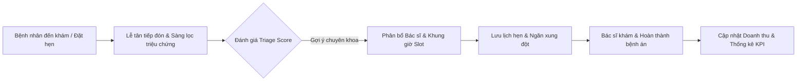

# 🏥 AnTamMng - HỆ THỐNG QUẢN LÝ PHÒNG KHÁM ĐA KHOA AN TÂM

> **Hệ thống phần mềm chuyên nghiệp phục vụ quản lý lịch khám, điều phối bệnh nhân, quản lý bác sĩ, phân quyền nhân sự và báo cáo thống kê dành cho phòng khám đa khoa.**

[](https://www.microsoft.com)
[](https://www.qt.io/)
[](https://isocpp.org/)
[](https://www.msys2.org/)
[](#)

---

## 📖 MỤC LỤC
1. [Giới thiệu Tổng quan](#1-giới-thiệu-tổng-quan)
2. [Điểm nổi bật Kỹ thuật](#2-điểm-nổi-bật-kỹ-thuật)
3. [Cấu trúc Thư mục Dự án](#3-cấu-trúc-thư-mục-dự-án)
4. [Các Phân hệ Chức năng Chính](#4-các-phân-hệ-chức-năng-chính)
   - [4.1. Xác thực & Phân quyền Tài khoản (RBAC)](#41-xác-thực--phân-quyền-tài-khoản-rbac)
   - [4.2. Quản lý Đặt lịch Khám & Điều phối (Appointment & Triage)](#42-quản-lý-đặt-lịch-khám--điều-phối-appointment--triage)
   - [4.3. Quản lý Đội ngũ Bác sĩ (Doctor Management)](#43-quản-lý-đội-ngũ-bác-sĩ-doctor-management)
   - [4.4. Quản lý Bệnh nhân & Bệnh án (Patient Management)](#44-quản-lý-bệnh-nhân--bệnh-án-patient-management)
   - [4.5. Thống kê & Báo cáo Trực quan (Analytics & Charts)](#45-thống-kê--báo-cáo-trực-quan-analytics--charts)
   - [4.6. Cấu hình Hệ thống & Quản lý Nghỉ Lễ (Config & Holidays)](#46-cấu-hình-hệ-thống--quản-lý-nghỉ-lễ-config--holidays)
5. [Quy chuẩn Ma trận Phân quyền](#5-quy-chuẩn-ma-trận-phân-quyền)
6. [Yêu cầu Môi trường & Hướng dẫn Cài đặt](#6-yêu-cầu-môi-trường--hướng-dẫn-cài-đặt)
7. [Hướng dẫn Khởi chạy Ứng dụng](#7-hướng-dẫn-khởi-chạy-ứng-dụng)
8. [Thông tin Bản quyền & Hỗ trợ](#8-thông-tin-bản-quyền--hỗ-trợ)

---

## 1. GIỚI THIỆU TỔNG QUAN

**AnTamMng** (Phòng Khám Đa Khoa An Tâm) là giải pháp máy tính để bàn (Desktop Application) toàn diện hỗ trợ tối ưu hóa quy trình tiếp đón, sàng lọc bệnh nhân ban đầu, đặt lịch hẹn khám bệnh chính xác theo khung giờ, điều phối bác sĩ và báo cáo tài chính - chuyên môn cho cơ sở y tế đa khoa.

Ứng dụng được thiết kế theo phong cách giao diện hiện đại **Deep Dark Teal** (`#0F2A3A` - `#0A1F2C` - `#0D9488`), mang lại trải nghiệm êm mắt, chuyên nghiệp và tối ưu cho nhân viên y tế làm việc liên tục trong thời gian dài.



---

## 2. ĐIỂM NỔI BẬT KỸ THUẬT

* **100% Thuần C++ & Cấu trúc Dữ liệu Tự xây dựng (No-STL banned headers):**
  - Tuyệt đối không sử dụng các container có sẵn của thư viện chuẩn STL (`<vector>`, `<algorithm>`, `<map>`, `<set>`, `<functional>`,...).
  - Tự hiện thực cấu trúc dữ liệu danh sách liên kết đôi có nút canh giữ (`LinkList<T>`) và hàng đợi FIFO (`Queue<T>`).
* **Kiến trúc Phần mềm MVC phân tách mạch lạc:**
  - **Models:** Đại diện cho các thực thể nghiệp vụ (`Human`, `Doctor`, `Patient`, `Manager`, `Appointment`, `Symptom`, `SymptomPatient`, `Permission`).
  - **Controllers:** Chứa toàn bộ logic nghiệp vụ, thuật toán sắp xếp, lọc, tính toán doanh thu và phân quyền.
  - **Views:** Giao diện đồ họa Qt 6 tương tác phong phú, tự động co giãn thích ứng từ độ phân giải 1024x768 đến 4K.
* **Portable Windows Launcher chuyên dụng:**
  - Tích hợp launcher nhị phân viết bằng C thuần (`AnTamMng.exe` ở thư mục gốc), tự động định vị thư mục làm việc, tải môi trường và khởi chạy ứng dụng lõi `bin/AnTamMng.exe` mà không gây nhấp nháy cửa sổ dòng lệnh đen (console window).
* **Tìm kiếm Tiếng Việt thông minh không phân biệt dấu:**
  - Thuật toán bóc tách dấu Unicode tiếng Việt giúp người dùng tìm kiếm tên bệnh nhân, bác sĩ, triệu chứng dễ dàng bằng cả chữ thường, chữ hoa hoặc gõ không dấu.

---

## 3. CẤU TRÚC THƯ MỤC DỰ ÁN

```text
pbl2_v1.1/
├── AnTamMng.exe                 # Trình khởi chạy portable gốc (C Launcher)
├── launcher.bat                 # Script khởi động tự động nhanh
├── start.bat                    # Script khởi chạy và tự động biên dịch nếu thiếu bin
├── PBL_2.pro                    # File cấu hình dự án qmake cho Qt 6
├── resource.qrc                 # File tài nguyên nhúng (Fonts, Icons, Textures)
├── README.md                    # Tài liệu tổng quan chức năng ứng dụng
├── funtionAlgorithms.md         # Phân tích chi tiết source code, thuật toán & hàm
├── Config/                      # Cấu hình hệ sinh thái
│   ├── Lichnghile.txt           # Danh mục các ngày nghỉ lễ, Tết của phòng khám
│   └── Permission.txt           # Danh mục quyền hệ thống chuẩn (Per_1 -> Per_5)
├── data/                        # Cơ sở dữ liệu văn bản thuần (File-based Storage)
│   ├── Appointment.txt          # Dữ liệu các cuộc hẹn khám bệnh
│   ├── Manager.txt              # Danh sách tài khoản người dùng hệ thống
│   ├── Patient.txt              # Hồ sơ nhân khẩu học bệnh nhân
│   ├── PermissionManager.txt    # Bảng phân quyền động cho từng tài khoản
│   ├── Doctor/
│   │   ├── Doctor.txt           # Danh sách hồ sơ bác sĩ
│   │   └── Specialization.txt   # Danh mục chuyên khoa & phòng khám
│   └── Symptom/
│       ├── Symptom.txt          # Danh mục triệu chứng lâm sàng & điểm Triage
│       └── SymptomPatient.txt   # Bệnh án triệu chứng gắn với từng bệnh nhân
├── assets/                      # Tài nguyên giao diện
│   ├── fonts/                   # Bộ font Be Vietnam Pro & Playfair Display
│   └── textures/                # Icon app, biểu tượng mũi tên, đồ họa y tế
├── bin/                         # Thư mục chứa file nhị phân & DLL runtime Qt 6
│   ├── AnTamMng.exe             # Ứng dụng thực thi chính
│   └── *.dll                    # Các thư viện liên kết động Qt 6 & MinGW
└── src/                         # Mã nguồn dự án
    ├── main.cpp                 # Điểm khởi đầu ứng dụng (Application Entry)
    ├── Controllers/             # Các bộ điều khiển nghiệp vụ (6 Controllers)
    ├── DataStructures/          # Cấu trúc dữ liệu tự định nghĩa (LinkList, Queue)
    ├── Launcher/                # Mã nguồn trình khởi chạy C & Resource Icon
    ├── Models/                  # Các lớp thực thể đối tượng (8 Models)
    ├── Utils/                   # Tiện ích ngày tháng (Date) và chuỗi (libPBL2)
    └── Views/                   # Giao diện người dùng Qt 6 (6 Phân hệ View)
```

---

## 4. CÁC PHÂN HỆ CHỨC NĂNG CHÍNH

### 4.1. Xác thực & Phân quyền Tài khoản (RBAC)
* **Đăng nhập an toàn:**
  - Giao diện đăng nhập hiện đại với hình họa y tế (sóng ECG, dấu thập y khoa, hiệu ứng ánh sáng ambient).
  - Kiểm tra tính hợp lệ của tài khoản: tên đăng nhập, mật khẩu, trạng thái tài khoản (`Active` / `Locked`).
  - Hỗ trợ nút bật/tắt ẩn hiện mật khẩu bảo mật.
* **Phân cấp vai trò người dùng (User Roles):**
  - **Administrator:** Quyền quản trị tối cao, kiểm tra toàn bộ thông tin hệ thống, quản lý tài khoản nhân viên, cấp/thu hồi quyền và cấu hình ngày nghỉ lễ.
  - **Receptionist (Lễ tân):** Chuyên trách tiếp đón, tra cứu hồ sơ bệnh nhân, tạo và điều phối lịch hẹn khám bệnh.
  - **Special Receptionist:** Lễ tân nâng cao được ủy quyền thêm một số tính năng quản trị thông qua cơ chế cấp quyền động.
* **An toàn dữ liệu người dùng:**
  - Ngăn chặn người dùng tự khóa tài khoản của chính mình.
  - Ngăn chặn chỉnh sửa hoặc thao tác nguy hiểm lên các tài khoản đồng cấp hoặc cấp cao hơn.

### 4.2. Quản lý Đặt lịch Khám & Điều phối (Appointment & Triage)
* **Dashboard Lịch khám Tương tác:**
  - Lịch tháng thông minh (`QCalendarWidget`) được tùy biến giao diện: tự động làm nổi bật các ngày có lịch hẹn khám, đổi màu đặc biệt cho các ngày nghỉ lễ/Tết.
  - Xem nhanh danh sách các cuộc hẹn trong ngày được chọn hoặc toàn bộ lịch sắp tới.
* **Quy trình Đặt lịch Khám 3 bước:**
  1. *Bước 1: Chọn / Thêm mới Bệnh nhân:* Tìm kiếm bệnh nhân theo tên, CCCD hoặc số điện thoại.
  2. *Bước 2: Sàng lọc Triệu chứng (Triage):* Chọn các triệu chứng bệnh nhân đang gặp phải. Hệ thống tự động tính điểm nguy cơ (`sScore`) và gợi ý chuyên khoa phù hợp nhất.
  3. *Bước 3: Chọn Bác sĩ & Khung giờ (Time Slot):* Lọc danh sách bác sĩ theo chuyên khoa, gợi ý bác sĩ có đánh giá cao nhất và ít lịch bận nhất.
* **Thuật toán Chống Trùng lịch (Conflict Detection):**
  - Tự động kiểm tra xung đột thời gian giữa các lịch khám của cùng một bác sĩ.
  - Khung giờ khám chuẩn: 30 phút/ca, trong khung giờ hành chính (07:30 - 11:30 và 13:30 - 17:30).
  - Tự động chặn đặt lịch vào các ngày nghỉ lễ, tết theo cấu hình phòng khám.
* **Quản lý Trạng thái Lịch khám Thời gian thực:**
  - `Pending (0)` - Chờ khám.
  - `Completed (1)` - Đã hoàn thành khám bệnh.
  - `Delayed (-1)` - Trễ hẹn (hệ thống tự động tính toán dựa trên thời gian thực tế so với giờ hẹn).
* **Bộ lọc Đa tiêu chí:** Lọc tức thì theo ngày hẹn, trạng thái, bác sĩ phụ trách, chuyên khoa và thanh tìm kiếm từ khóa không dấu.

### 4.3. Quản lý Đội ngũ Bác sĩ (Doctor Management)
* **Hồ sơ Bác sĩ Chi tiết:**
  - Mã bác sĩ (`D_ID`), Họ và tên, Giới tính, Tuổi, Số điện thoại.
  - Chuyên khoa trực thuộc (Nội khoa, Ngoại khoa, Nhi khoa, Tai Mũi Họng, Răng Hàm Mặt, Mắt, Da liễu, Tim mạch,...).
  - Phòng khám chỉ định (`P101`, `P202`,...).
  - Mức phí khám chuyên khoa niêm yết (VNĐ).
  - Điểm đánh giá chất lượng (Rating từ 1.0 đến 5.0 sao).
  - Trạng thái làm việc (Đang làm việc / Nghỉ phép).
* **Nghiệp vụ Quản lý:**
  - Thêm mới bác sĩ với mã tự động tăng (`DOC001`, `DOC002`,...).
  - Chỉnh sửa thông tin hồ sơ, phòng làm việc, biểu phí.
  - Khóa/mở trạng thái hoạt động của bác sĩ.
  - Theo dõi danh sách các ca khám được phân công theo bác sĩ.

### 4.4. Quản lý Bệnh nhân & Bệnh án (Patient Management)
* **Hồ sơ Nhân khẩu học:**
  - Mã bệnh nhân (`PAT001`, `PAT002`,...), Số CCCD/CMND định danh.
  - Họ và tên, Tuổi, Giới tính, Số điện thoại liên hệ.
* **Liên kết Bệnh án Triệu chứng:**
  - Ghi nhận lịch sử triệu chứng của từng lần khám (`SymptomPatient`).
  - Phân loại trạng thái triệu chứng: Chưa xử lý (đang chờ khám) và Đã xử lý (sau khi hoàn thành cuộc hẹn).
  - Thống kê lịch sử khám bệnh và các lần tái khám của bệnh nhân.

### 4.5. Thống kê & Báo cáo Trực quan (Analytics & Charts)
* **Hệ thống Thẻ KPI Tổng quan:**
  - Tổng số bệnh nhân đăng ký trong hệ thống.
  - Tổng số bác sĩ đang công tác.
  - Tổng số lượt đặt lịch và số ca đang chờ khám.
  - Doanh thu dự kiến / thực tế (tổng hợp theo ngày, tháng).
  - Tỷ lệ hoàn thành lịch hẹn khám (`Completion Rate %`).
* **Đồ họa Trực quan với QtCharts:**
  - **Biểu đồ Cột (Bar Chart):** Xu hướng số lượng lịch hẹn khám trong 7 ngày gần nhất.
  - **Biểu đồ Tròn (Donut / Pie Chart):** Cơ cấu tỷ lệ bệnh nhân theo giới tính và các nhóm độ tuổi (Dưới 18, 18-45, 46-60, Trên 60).
  - **Bảng Xếp hạng (Leaderboard):** Top các bác sĩ tiêu biểu có số ca khám nhiều nhất và đánh giá cao nhất.
  - **Phân tích Nhu cầu Chuyên khoa:** Thống kê chuyên khoa có số lượng bệnh nhân quan tâm cao nhất để tối ưu hóa điều phối nhân lực.

### 4.6. Cấu hình Hệ thống & Quản lý Nghỉ Lễ (Config & Holidays)
* **Quản lý Danh mục Lịch Nghỉ Lễ:**
  - Quản lý danh sách ngày nghỉ theo lịch nhà nước (Tết Dương lịch, Giỗ tổ Hùng Vương, 30/4 - 1/5, Quốc khánh) và các ngày nghỉ đột xuất của phòng khám.
  - Thêm, sửa, xóa ngày nghỉ kèm ghi chú giải thích.
  - Hiển thị trực tiếp cảnh báo màu sắc trên giao diện lịch đặt hẹn.

---

## 5. QUY CHUẨN MA TRẬN PHÂN QUYỀN

Hệ thống triển khai cơ chế kiểm soát truy cập dựa trên vai trò kết hợp phân quyền động theo thời gian:

| Mã Quyền | Tên Quyền Hạn | Administrator | Receptionist | Special Receptionist |
| :---: | :--- | :---: | :---: | :---: |
| **-** | **Đăng nhập & Xem Dashboard** |  Có |  Có |  Có |
| **-** | **Đặt lịch khám & Tra cứu bệnh nhân** |  Có |  Có |  Có |
| **Per_1** | **Chỉnh sửa / Cập nhật Bác sĩ** |  Có | ❌ Không |  Khi được cấp |
| **Per_2** | **Chỉnh sửa / Xóa Bệnh nhân** |  Có | ❌ Không |  Khi được cấp |
| **Per_3** | **Xem Thống kê & Báo cáo Doanh thu** |  Có | ❌ Không |  Khi được cấp |
| **Per_4** | **Cấu hình Ngày nghỉ lễ & Quy định** |  Có | ❌ Không |  Khi được cấp |
| **Per_5** | **Quản lý Tài khoản & Phân quyền (RBAC)**|  Có | ❌ Không | ❌ Không |

> [!NOTE]
> Administrator có thể cấp các quyền phụ (`Per_1` đến `Per_4`) cho tài khoản Receptionist kèm **thời hạn hiệu lực (Expiration Date)**. Khi quá thời hạn quy định, quyền sẽ tự động thu hồi.

---

## 6. YÊU CẦU MÔI TRƯỜNG & HƯỚNG DẪN CÀI ĐẶT

### Yêu cầu phần mềm
* **Hệ điều hành:** Windows 10 / Windows 11 (64-bit).
* **Trình biên dịch:** MinGW-w64 GCC hỗ trợ chuẩn C++20/C++2b (khuyến nghị môi trường MSYS2 UCRT64).
* **Bộ thư viện:** Qt 6.8+ (các module: `Core`, `Gui`, `Widgets`, `Charts`, `OpenGL`, `OpenGLWidgets`).

### Các bước biên dịch từ mã nguồn

1. **Mở terminal MSYS2 UCRT64** hoặc Command Prompt đã thiết lập đường dẫn `PATH` tới Qt 6:
   ```cmd
   set PATH=C:\msys64\ucrt64\bin;%PATH%
   ```

2. **Di chuyển vào thư mục dự án:**
   ```cmd
   cd /d "d:\Documents\Project\pbl_2\pbl2_v1.1"
   ```

3. **Tạo Makefile bằng qmake:**
   ```cmd
   qmake PBL_2.pro
   ```

4. **Biên dịch mã nguồn song song (8 luồng):**
   ```cmd
   mingw32-make -j8
   ```
   *File thực thi lõi sẽ được tạo ra tại: `bin\AnTamMng.exe`.*

5. **(Tùy chọn) Biên dịch Portable C Launcher:**
   ```cmd
   cd src\Launcher
   build_launcher.bat
   ```
   *File launcher gốc `AnTamMng.exe` sẽ được tạo ra tại thư mục gốc của dự án.*

---

## 7. HƯỚNG DẪN KHỞI CHẠY ỨNG DỤNG

Người dùng có thể khởi chạy ứng dụng bằng một trong các phương thức tiện lợi sau:

1. **Cách 1 (Khuyên dùng):** Nhấp đúp chuột trực tiếp vào file **[`AnTamMng.exe`](file:///d:/Documents/Project/pbl_2/pbl2_v1.1/AnTamMng.exe)** ở thư mục gốc. Đây là portable launcher C không nhấp nháy cửa sổ console đen, tự động liên kết tài nguyên và mở giao diện ứng dụng mượt mà.
2. **Cách 2:** Chạy file kịch bản **[`start.bat`](file:///d:/Documents/Project/pbl_2/pbl2_v1.1/start.bat)** hoặc **[`launcher.bat`](file:///d:/Documents/Project/pbl_2/pbl2_v1.1/launcher.bat)**. Kịch bản này tự động kiểm tra môi trường, nạp thư viện DLL và nếu chưa có file thực thi sẽ tự động biên dịch dự án.
3. **Cách 3:** Chạy trực tiếp từ file nhị phân chính **[`bin/AnTamMng.exe`](file:///d:/Documents/Project/pbl_2/pbl2_v1.1/bin/AnTamMng.exe)**.

### Tài khoản đăng nhập mẫu

| Tài khoản (Username) | Mật khẩu (Password) | Vai trò (Role) | Mô tả |
| :--- | :--- | :--- | :--- |
| `admin` | `admin123` | **Administrator** | Toàn quyền quản trị hệ thống |
| `receptionist1` | `rec123` | **Receptionist** | Nhân viên tiếp đón & đặt lịch |

---

## 8. THÔNG TIN BẢN QUYỀN & HỖ TRỢ

* **Đơn vị phát triển:** Dự án PBL 2 - Đồ án Cơ sở Ngành Công nghệ Thông tin.
* **Bản quyền:** © 2026 Nhà Khám An Tâm. Hệ thống Quản lý Đặt lịch Khám bệnh.
* **Email hỗ trợ kỹ thuật:** `antam@support.vn`
* **Tài liệu thuật toán chuyên sâu:** Vui lòng tham khảo file [`funtionAlgorithms.md`](file:///d:/Documents/Project/pbl_2/pbl2_v1.1/funtionAlgorithms.md) để xem phân tích chi tiết về thuật toán, cấu trúc dữ liệu và chức năng của từng file mã nguồn.
