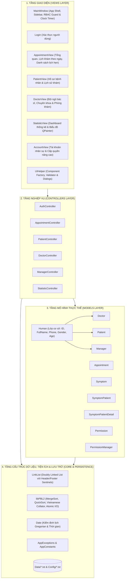

# 🏥 HỆ THỐNG QUẢN LÝ PHÒNG KHÁM ĐA KHOA AN TÂM (MngCareBook)

> **Đồ án Cơ sở Ngành Công nghệ Thông tin (PBL 2)**  
> **Khoa Công nghệ Thông tin — Trường Đại học Bách Khoa, Đại học Đà Nẵng (DUT)**  
> **Ngôn ngữ phát triển:** C++20 / C++23 (`-std=gnu++2b`) | **Framework Giao diện:** Qt 6 (`Qt6Core`, `Qt6Gui`, `Qt6Widgets`)  
> **Kiến trúc:** 4-Layer MVC Architecture & Zero Forbidden STL | **Nền tảng:** Windows Desktop (MinGW-w64 UCRT64)

---

## 📌 1. GIỚI THIỆU HỆ THỐNG

**Hệ thống Quản lý Phòng Khám Đa Khoa An Tâm (MngCareBook)** là ứng dụng máy tính (Desktop Application) quản trị toàn diện hoạt động khám chữa bệnh ngoại trú tại phòng khám đa khoa. Phần mềm số hóa xuyên suốt quy trình vận hành thực tế tại phòng khám: từ **tiếp đón bệnh nhân**, **khai thác triệu chứng lâm sàng & tự động gợi ý chuyên khoa**, **điều phối lịch hẹn theo khung giờ**, **quản lý đội ngũ bác sĩ & phòng khám**, **quản lý lịch nghỉ lễ Âm/Dương lịch**, cho đến **phân quyền nhân sự đa cấp (RBAC)** và **phân tích thống kê — doanh thu y tế trực quan**.

### 🌟 Điểm Nhấn Công Nghệ & Học Thuật

1. **Tuân thủ tuyệt đối nguyên tắc "Zero Forbidden STL":**
   - Không sử dụng các cấu trúc dữ liệu vùng chứa hay hàm sắp xếp dựng sẵn của thư viện chuẩn C++ (`std::vector`, `std::list`, `std::map`, `std::set`, `std::unordered_map`, `std::sort`...) cho tầng dữ liệu cốt lõi.
   - Tự thiết kế và hiện thực hóa từ gốc lớp mẫu **Danh sách liên kết đôi có hai nút canh giữ (`LinkList<T>`)** quản lý toàn bộ thực thể trong bộ nhớ RAM.
2. **Khung Thuật toán Sắp xếp Đa năng (`libPBL2::qsort`):**
   - **MergeSort tái nối con trỏ (`sortNodeChain` / `mergeSortedNodes`)** trên `LinkList<T>` đạt độ phức tạp $O(N \log N)$ trong mọi trường hợp và **bảo toàn địa chỉ nút (pointer-stable)**.
   - **QuickSort kết hợp Tiền tính toán khóa (Schwartzian Transform)** và **Bộ nhớ đệm phân trang (`cachedFiltered`)** giúp sắp xếp và chuyển trang tức thì ($0\text{ ms}$) ngay cả trên bộ dữ liệu lớn hàng nghìn lịch hẹn.
   - Hỗ trợ 4 động cơ so sánh chuyên biệt: So sánh mã tự nhiên (`compareNatural`), so sánh họ tên tiếng Việt chuẩn Unicode theo Tên chính (`compareVietnameseNames`), so sánh chuỗi tiếng Việt có dấu (`compareVietnameseStrings`) và so sánh mốc thời gian (`compareDates`).
3. **Động cơ Lịch Âm Thiên Văn Việt Nam (`UTC+7`) & Điều phối Lịch Tự động:**
   - Tự động tính ngày **Tết Nguyên Đán (`Tet`)** và **Giỗ Tổ Hùng Vương (`GioTo` — 10/3 Âm lịch)** bằng công thức thiên văn Jean Meeus / Hồ Ngọc Đức cho mọi năm từ `1900` đến `2199`.
   - Tự động tái điều phối các lịch hẹn bị ảnh hưởng khi bác sĩ tạm nghỉ/nghỉ việc hoặc khi phòng khám thêm ngày nghỉ lễ mới.
4. **An toàn Dữ liệu & Ngoại lệ Toàn diện:**
   - Cây ngoại lệ chuyên biệt (`AppException` $\to$ `FileIOException`, `DataFormatException`, `ValidationException`, `MemoryAllocationException`).
   - Giao thức ghi tệp nguyên tử 3 bước (`safeAtomicCommit`: `.tmp` $\to$ `.bak` $\to$ commit) kèm cơ chế hoàn tác trên RAM (Atomic Rollback) khi có sự cố I/O.
5. **Giao diện Y tế Hiện đại (Modern Healthcare UI & Custom QPainter Charts):**
   - Thiết kế theo ngôn ngữ **Deep Teal & Slate Modern** (`#0d9488`, `#0f766e`, `#0f172a`), sắc nét, thân thiện với nhân viên y tế.
   - Toàn bộ biểu đồ thống kê (Donut Chart, Linear Status Bar, Revenue Line Chart, Multi-Line Status Chart) được vẽ thủ công bằng **`QPainter`** với khử răng cưa và hiệu ứng tương tác chuột (Hover Tooltip).

---

## 🏗️ 2. KIẾN TRÚC TỔNG THỂ (4-LAYER MVC ARCHITECTURE)

Hệ thống được tổ chức thành 4 tầng tách biệt rõ ràng, đảm bảo tính đóng gói và dễ bảo trì:



---

## 🚀 3. CÁC PHÂN HỆ CHỨC NĂNG CHI TIẾT

### 3.1. Phân Hệ Đăng Nhập, Quản Lý Tài Khoản & Phân Quyền Động (RBAC)
* **3 Cấp độ Vai trò Nhân sự (`ManagerRole` & `EffectiveRole`):**
  * **Quản trị viên (`Administrator` / `RootAdmin`):** Toàn quyền điều hành hệ thống, quản lý nhân sự, phân quyền và truy cập phân hệ **Thống kê & Doanh thu**.
  * **Quản trị viên tạm thời (`TemporaryAdmin` — Quyền `Per_1`):** Nhân viên được Quản trị viên gốc (`MA_001` hoặc tài khoản ẩn) cấp quyền quản trị có thời hạn (tính theo ngày, tự động kiểm tra hết hạn mỗi giây và tự động đăng xuất ngay khi hết hạn).
  * **Lễ tân chuyên trách (`SpecialReceptionist`) & Lễ tân (`Receptionist`):** Thực hiện các nghiệp vụ tiếp đón, đặt lịch, quản lý bác sĩ/bệnh nhân/lịch nghỉ theo đúng danh mục quyền `Per_2..Per_5` được cấp.
* **Danh mục 5 Quyền Hệ thống ([Config/Permission.txt](file:///d:/Documents/Universe_Material/Semester_3/PBL_2/Config/Permission.txt)):**
  * `Per_1`: Cấp quyền tạm thời làm Admin có thời hạn.
  * `Per_2`: Chỉnh sửa thông tin bác sĩ (Thêm / Sửa / Đổi trạng thái / Xóa).
  * `Per_3`: Chỉnh sửa thông tin bệnh nhân (Thêm / Sửa / Xóa hồ sơ).
  * `Per_4`: Chỉnh sửa thông tin lịch hẹn khám bệnh (Đặt lịch / Xác nhận đã khám / Dời lịch / Hủy lịch chờ).
  * `Per_5`: Chỉnh sửa danh mục lịch nghỉ lễ của phòng khám.

### 3.2. Phân Hệ Tổng Quan (Dashboard) & Lịch Khám Theo Ngày
* **Bảng Tổng quan (Dashboard):**
  * Hiển thị 4 thẻ chỉ số thời gian thực: **Bệnh nhân**, **Bác sĩ đang làm việc**, **Ca khám hôm nay**, và **Tổng lịch hẹn**.
  * Bảng **Lịch hẹn sắp tới** hiển thị các ca khám chờ trong ngày hôm nay và ngày mai, hỗ trợ phân trang, sắp xếp theo từng cột và nhấp trực tiếp vào dòng để xử lý ca khám.
* **Lịch khám bệnh theo ngày (`createBookingWidget`):**
  * Lịch tháng tương tác trực quan với bộ chọn `< Tháng >` và `< Năm >` (`2000..2099`), tự động tô màu phân biệt: **Ngày đang chọn** (Xanh ngọc), **Ngày quá khứ** (Xám/Vàng), **Ngày nghỉ lễ** (Đỏ nhạt kèm chú thích tên ngày lễ), và **Ngày có lịch hẹn** (Xanh bạc hà).
  * Danh sách ca khám chi tiết của ngày đang chọn hiển thị bên phải kèm huy hiệu số lượng ca khám hoặc thông báo ngày nghỉ lễ.

### 3.3. Phân Hệ Đặt Lịch Khám, Sàng Lọc Triệu Chứng & Điều Phối Tự Động
* **Gợi ý Chuyên khoa từ Triệu chứng (Medical Triage):**
  * Nhân viên chọn từ 1 đến 5 triệu chứng lâm sàng; hệ thống tự động tính điểm trọng số và chọn chuyên khoa phù hợp nhất đang có bác sĩ trực.
* **11 Khung Giờ Khám Cố Định (45 phút/ca):**
  * **Buổi sáng:** `07:00`, `07:45`, `08:30`, `09:15`, `10:00`, `10:45`.
  * **Buổi chiều:** `13:00`, `13:45`, `14:30`, `15:15`, `16:00`.
  * Tự động khóa các khung giờ đã qua, khung giờ bác sĩ đã có lịch hẹn khác, hoặc khung giờ mà chính bệnh nhân đó đã đặt khám ở chuyên khoa khác.
* **4 Trạng thái Ca khám & Thời gian Ân hạn 20 Phút:**
  * `● Chưa khám`: Ca khám chưa diễn ra hoặc đang trong vòng **20 phút ân hạn** kể từ giờ hẹn.
  * `● Đã khám`: Bệnh nhân đã hoàn tất khám, hệ thống chốt mức phí thực thu (`A_Fee`) vào lịch sử.
  * `● Trễ hẹn`: Tự động chuyển sang Trễ hẹn khi quá 20 phút ân hạn mà bệnh nhân chưa vào khám.
  * `● Đã dời lịch`: Lưu dấu vết lịch sử khi ca khám được dời sang khung giờ/bác sĩ mới.
* **Quản lý Lịch nghỉ lễ & Tự động Dời lịch Hàng loạt:**
  * Cho phép thêm/sửa/xóa ngày nghỉ lễ cố định (`dd/MM`), ngày nghỉ theo năm (`dd/MM/yyyy`), Tết Nguyên Đán (`Tet`) và Giỗ Tổ Hùng Vương (`GioTo`).
  * Khi thêm ngày nghỉ lễ trùng vào ngày đang có lịch hẹn chờ, hệ thống tự động tìm bác sĩ và khung giờ trống sớm nhất ở các ngày làm việc kế tiếp để dời lịch và xuất bảng tổng kết chi tiết.

### 3.4. Phân Hệ Quản Lý Bệnh Nhân & Đội Ngũ Bác Sĩ
* **Quản lý Bệnh nhân (`PatientView`):**
  * Tìm kiếm tức thì không phân biệt dấu theo Tên, Mã bệnh nhân, SĐT hoặc CCCD; sắp xếp đa cột.
  * Hộp thoại chi tiết bệnh nhân tích hợp **bảng lịch sử toàn bộ các lần khám**, bộ lọc riêng và nút **`＋ Đặt lịch khám mới`** gắn sẵn hồ sơ bệnh nhân đó.
* **Quản lý Bác sĩ (`DoctorView`):**
  * Quản lý 10 chuyên khoa, phòng khám chuẩn hóa (`Phòng 101`..`Phòng 1005`), phí khám và điểm đánh giá (`Rating`).
  * Khi chuyển bác sĩ sang trạng thái **Tạm nghỉ** hoặc **Xóa bác sĩ**, hệ thống tự động rà soát các lịch hẹn sắp tới của bác sĩ đó để điều phối sang bác sĩ cùng chuyên khoa có Rating cao nhất còn trống lịch.

### 3.5. Phân Hệ Thống Kê & Phân Tích Doanh Thu (`StatisticView`)
* **Bộ lọc Kỳ thống kê Đồng bộ:** Lọc theo **Ngày**, **Tháng**, **Quý**, **Năm** hoặc **Tất cả thời gian**, cập nhật đồng bộ cho cả 2 Tab:
  * **Tab 1 — Tổng quan & Cơ cấu:** Thẻ phân bổ trạng thái lịch hẹn (`LinearStatusBar`), Biểu đồ vòng nhân khẩu học theo độ tuổi & giới tính (`PatientDonutChart`), Xếp hạng nhu cầu khám theo chuyên khoa và Bảng xếp hạng bác sĩ tiêu biểu.
  * **Tab 2 — Doanh thu & Xu hướng:** 3 thẻ KPI tài chính (Tổng doanh thu thực thu, Doanh thu trung bình mỗi ca hoàn thành, Tỷ lệ hoàn thành), Biểu đồ đường xu hướng doanh thu (`RevenueLineChart`) và Biểu đồ đa đường biến động trạng thái lịch khám (`StatusMultiLineChart`).

---

## 🔑 4. TÀI KHOẢN ĐĂNG NHẬP & BỘ DỮ LIỆU MẪU QUY MÔ LỚN

Dự án đi kèm bộ dữ liệu mô phỏng quy mô lớn trong thư mục `Data/` (gồm **35 tài khoản nhân sự**, **150 bác sĩ** thuộc **10 chuyên khoa**, **800 bệnh nhân**, **5.400 lịch hẹn** và **9.969 chi tiết triệu chứng** trải dài trong 2 năm `2025–2026`):

| Vai trò | Tên đăng nhập (`Username`) | Mật khẩu (`Password`) | Quyền hạn trong hệ thống |
| :--- | :---: | :---: | :--- |
| **Quản trị viên gốc (Root Admin)** | `HoangMA001` | `HoangMA001` | Toàn quyền hệ thống, Thống kê doanh thu, Cấp quyền `Per_1..Per_5` |
| **Tài khoản Quản trị ẩn** | `1` | `1` | Toàn quyền hệ thống (Root Admin dự phòng, ẩn khỏi danh sách) |
| **Quản trị viên tạm thời (`Per_1`)** | `LocMA002` | `LocMA002` | Lễ tân chuyên trách đang được cấp quyền Admin tạm thời (`Per_1..Per_5`) |
| **Lễ tân chuyên trách** | `LongMA003` | `LongMA003` | Được cấp quyền `Per_2`, `Per_3`, `Per_4`, `Per_5` |
| **Lễ tân chuyên trách** | `NaMA004` | `NaMA004` | Được cấp quyền `Per_3` (Bệnh nhân) và `Per_4` (Lịch hẹn) |
| **Nhân viên Lễ tân** | `VuMA005` | `VuMA005` | Xem danh sách và tra cứu lịch khám cơ bản |
| **Tài khoản bị khóa (Test)** | `GiaiMA006` | `GiaiMA006` | Dùng để kiểm thử tính năng chặn đăng nhập tài khoản bị khóa |

---

## 📂 5. CẤU TRÚC THƯ MỤC DỰ ÁN

```text
PBL_2/
├── bin/
│   └── MngCareBook.exe                   # Tệp thực thi chính sau khi biên dịch Release
├── assets/                               # Tài nguyên hình ảnh, icon & font chữ (nhúng qua assets.qrc)
├── Config/
│   ├── Lichnghile.txt                    # Cấu hình ngày lễ Dương lịch, Tết (Tet) & Giỗ Tổ (GioTo)
│   └── Permission.txt                    # Danh mục 5 quyền hệ thống (Per_1 .. Per_5)
├── Data/
│   ├── Appointment.txt                   # 5.400 bản ghi lịch hẹn khám bệnh
│   ├── Manager.txt                       # 35 bản ghi tài khoản nhân sự quản lý
│   ├── Patient.txt                       # 800 bản ghi hồ sơ bệnh nhân
│   ├── PermissionManager.txt             # Bảng cấp phát quyền hạn & thời hạn hiệu lực
│   ├── Doctor/
│   │   ├── Doctor.txt                    # 150 bản ghi bác sĩ thuộc 10 chuyên khoa
│   │   └── Specialization.txt            # Danh mục 10 chuyên khoa (Sp_001 .. Sp_010)
│   └── Symptom/
│       ├── Symptom.txt                   # Danh mục 30 triệu chứng lâm sàng & trọng số điểm
│       ├── SymptomPatient.txt            # 5.400 phiếu ghi nhận triệu chứng bệnh nhân
│       └── SymptomPatientDetail.txt      # 9.969 bản ghi chi tiết triệu chứng (quan hệ N:N)
├── src/
│   ├── main.cpp                          # Điểm khởi chạy ứng dụng (Entry Point)
│   ├── DataStructures/
│   │   └── LinkList.h / .cpp             # Danh sách liên kết đôi mẫu có nút canh giữ (Zero STL)
│   ├── Utils/
│   │   ├── AppConstants.h                # Hằng số nghiệp vụ & đường dẫn tệp dữ liệu
│   │   ├── AppExceptions.h / .cpp        # Cây ngoại lệ kiểm soát lỗi toàn cục
│   │   ├── Date.h / .cpp                 # Lớp xử lý & kiểm định ngày giờ
│   │   └── libPBL2.h / .cpp              # MergeSort, QuickSort, Vietnamese Collator, Atomic File Commit
│   ├── Models/                           # Các lớp thực thể: Human, Doctor, Patient, Manager, Appointment...
│   ├── Controllers/                      # Các lớp điều khiển: Auth, Appointment, Doctor, Patient, Manager, Statistic
│   └── Views/                            # Giao diện Qt6: MainWindow, UIHelper, Login, Appointment, Patient, Doctor, Account, Statistic
├── PBL_2.pro                             # Tệp cấu hình build qmake (Qt 6 / C++2b)
├── algorithm.md                          # Tài liệu đặc tả Đối tượng, Sơ đồ quan hệ & Luồng thuật toán
└── README.md                             # Tài liệu giới thiệu & hướng dẫn sử dụng hệ thống
```

---

## 🛠️ 6. HƯỚNG DẪN BIÊN DỊCH & CHẠY ỨNG DỤNG

### 6.1. Yêu Cầu Môi Trường
* **Hệ điều hành:** Windows 10 / Windows 11 (64-bit).
* **Trình biên dịch:** MinGW-w64 GCC 13+ (môi trường **MSYS2 UCRT64**).
* **Thư viện:** Qt 6 (`Qt6Core`, `Qt6Gui`, `Qt6Widgets`), `qmake6`, `mingw32-make`.

### 6.2. Biên Dịch Bằng Dòng Lệnh (PowerShell / MSYS2 UCRT64)

```powershell
# 1. Thêm đường dẫn MSYS2 UCRT64 vào PATH (nếu chạy từ PowerShell)
$env:PATH = "D:\Anothers\msys2\ucrt64\bin;" + $env:PATH

# 2. Sinh Makefile từ PBL_2.pro
qmake6 PBL_2.pro

# 3. Biên dịch bản Release đa luồng
mingw32-make -f Makefile.Release -j8

# 4. Chạy ứng dụng
.\bin\MngCareBook.exe
```

### 6.3. Biên Dịch Bằng Qt Creator
1. Mở **Qt Creator** $\to$ **File** $\to$ **Open File or Project...** $\to$ chọn [PBL_2.pro](file:///d:/Documents/Universe_Material/Semester_3/PBL_2/PBL_2.pro).
2. Chọn bộ Kit **Desktop Qt 6.x MinGW 64-bit (UCRT64)**.
3. Nhấn `Ctrl + B` để biên dịch và `Ctrl + R` để khởi chạy ứng dụng.

---

## 📖 7. TÀI LIỆU KỸ THUẬT CHI TIẾT

Toàn bộ đặc tả về **Hệ thống Đối tượng (Classes & Objects)**, **Sơ đồ Lớp UML & Sơ đồ Thực thể Liên kết (ERD)**, **Cấu trúc dữ liệu `LinkList<T>`** và **Lưu đồ Luồng Thuật toán (Algorithm Workflows)** được trình bày chi tiết tại:
👉 **[algorithm.md — Tài liệu Kỹ thuật Cấu trúc Dữ liệu & Thuật toán](file:///d:/Documents/Universe_Material/Semester_3/PBL_2/algorithm.md)**
