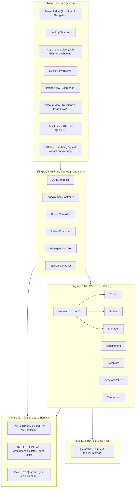

# 🏥 HỆ THỐNG QUẢN LÝ PHÒNG KHÁM ĐA KHOA AN TÂM (AnTamMng)

> **Dự án PBL 2 (Đồ án Cơ sở Ngành Công nghệ Thông tin) - Đại học Bách Khoa, Đại học Đà Nẵng.**  
> Ứng dụng Desktop chuyên nghiệp phục vụ quản lý lịch khám, điều phối bệnh nhân, quản lý đội ngũ bác sĩ, phân quyền nhân sự nhiều tầng (RBAC) và thống kê y tế trực quan.

---

## 📌 ĐIỂM NỔI BẬT & RÀNG BUỘC KỸ THUẬT

* **Ngôn ngữ & Chuẩn C++:** C++20 / C++23 (`-std=gnu++2b`), biên dịch bằng GCC MinGW UCRT64 (MSYS2).
* **Framework Giao diện:** Qt 6 (QtWidgets, QtGui, QtCore, QtCharts, QtOpenGLWidgets).
* **Quy chuẩn Zero Forbidden STL:**
  - Không sử dụng các container có sẵn của thư viện chuẩn C++ (`std::vector`, `std::list`, `std::map`, `std::queue`, `std::sort`...) trong tầng lưu trữ dữ liệu cốt lõi và nghiệp vụ.
  - Toàn bộ cấu trúc lưu trữ dựa trên **Danh sách liên kết đôi có nút canh giữ (Sentinel-node Doubly Linked List - `LinkList<T>`)** tự xây dựng từ đầu.
* **Khung Thuật toán QuickSort Toàn năng (`libPBL2`):**
  - Thuật toán QuickSort In-Place trực tiếp trên các nút của danh sách liên kết đôi bằng kỹ thuật hoán vị giá trị hai con trỏ.
  - Quản lý phân tách Template C++ chuẩn mực: Khai báo template đặt tại header (`.h`), phần định nghĩa / hiện thực (implementation) nằm hoàn toàn trong file `.cpp` tương ứng và được nạp ở cuối header trước `#endif`.
* **Giao diện Người dùng Hiện đại (Modern UI/UX):**
  - Ngôn ngữ thiết kế phẳng theo tone màu **Deep Teal / Slate Modern** (`#0f766e`, `#0d9488`, `#0f172a`), tối ưu tương phản và giảm mỏi mắt cho nhân viên y tế.
  - Hỗ trợ đầy đủ bảng dữ liệu co giãn tự động (Responsive Scaling), phân trang động (Pagination), lọc đa tiêu chí thời gian thực.
  - Biểu đồ thống kê chuyên sâu với **QtCharts** (Donut chart nhu cầu chuyên khoa, Bar/Line chart xu hướng lịch hẹn theo tuần).

---

## 🏗️ KIẾN TRÚC HỆ THỐNG (M-V-C ARCHITECTURE)

Dự án áp dụng mô hình phân lớp **Model - View - Controller (MVC)** độc lập, phân tách rành mạch giữa giao diện, luồng xử lý và dữ liệu nghiệp vụ:



---

## 📁 CẤU TRÚC THƯ MỤC DỰ ÁN

```text
PBL_2/
├── bin/                          # Thư mục chứa tệp thực thi sau khi biên dịch
│   └── MngCareBook.exe           # Ứng dụng chính
├── assets/                       # Tài nguyên giao diện
│   ├── fonts/                    # Phông chữ nhúng (Be Vietnam Pro, Playfair Display)
│   └── textures/                 # Icon và hình ảnh minh họa giao diện
├── Config/                       # Tệp cấu hình ngày nghỉ lễ (Holidays.txt)
├── Data/                         # Dữ liệu nguồn hệ thống (định dạng văn bản phân cách '|')
│   ├── Appointment.txt           # Danh sách lịch hẹn khám
│   ├── Manager.txt               # Tài khoản quản lý, bác sĩ, tiếp tân
│   ├── Patient.txt               # Hồ sơ bệnh nhân
│   ├── PermissionManager.txt     # Phân quyền chi tiết theo mã nhân sự
│   ├── Doctor/
│   │   ├── Doctor.txt            # Thông tin bác sĩ, phòng khám, chi phí
│   │   └── Specialty.txt         # Danh mục chuyên khoa
│   └── Symptom/
│       ├── Symptom.txt           # Danh mục triệu chứng bệnh
│       └── SymptomPatient.txt    # Phiếu sàng lọc triệu chứng của bệnh nhân
├── src/                          # Mã nguồn C++
│   ├── main.cpp                  # Điểm khởi chạy ứng dụng (main entry point)
│   ├── DataStructures/           # Cấu trúc dữ liệu tự định nghĩa
│   │   ├── LinkList.h            # Khai báo cấu trúc danh sách liên kết đôi
│   │   └── LinkList.cpp          # Hiện thực template LinkList
│   ├── Models/                   # Các lớp thực thể (Kế thừa, đóng gói, tệp I/O)
│   │   ├── Human.h / .cpp        # Lớp cha trừu tượng cho con người
│   │   ├── Doctor.h / .cpp       # Thực thể Bác sĩ
│   │   ├── Patient.h / .cpp      # Thực thể Bệnh nhân
│   │   ├── Manager.h / .cpp      # Thực thể Quản trị / Nhân viên
│   │   ├── Appointment.h / .cpp  # Thực thể Lịch hẹn
│   │   ├── Symptom.h / .cpp      # Thực thể Triệu chứng
│   │   ├── SymptomPatient.h / .cpp# Liên kết Bệnh nhân - Triệu chứng
│   │   └── Permission.h / .cpp   # Phân quyền chi tiết
│   ├── Controllers/              # Xử lý logic nghiệp vụ và tính toán
│   │   ├── AuthController.h / .cpp
│   │   ├── AppointmentController.h / .cpp
│   │   ├── DoctorController.h / .cpp
│   │   ├── PatientController.h / .cpp
│   │   ├── ManagerController.h / .cpp
│   │   └── StatisticController.h / .cpp
│   ├── Utils/                    # Thư viện tiện ích và thuật toán
│   │   ├── Date.h / .cpp         # Quản lý thời gian, lịch âm dương, năm nhuận
│   │   ├── libPBL2.h             # Khai báo QuickSort, chuẩn hóa chuỗi, phân quyền
│   │   └── libPBL2.cpp           # Triển khai thuật toán QuickSort & so sánh tiếng Việt
│   └── Views/                    # Giao diện người dùng Qt
│       ├── MainWindow.h / .cpp   # Shell điều hướng chính
│       ├── UIHelper.h / .cpp     # Thiết kế giao diện dùng chung
│       ├── Login/                # Màn hình đăng nhập
│       ├── Appointment/          # Dashboard, Đặt lịch, Danh sách lịch, Lịch nghỉ
│       ├── Doctor/               # Quản lý bác sĩ
│       ├── Patient/              # Quản lý bệnh nhân
│       ├── Account/              # Quản trị tài khoản
│       └── Statistic/            # Thống kê số liệu & biểu đồ
├── PBL_2.pro                     # Tệp cấu hình dự án QMake
├── Makefile                      # Make orchestration script
├── resource.qrc                  # Tài nguyên Qt nhúng binary
├── AGENTS.md                     # Quy tắc phát triển dành cho trợ lý AI
├── GEMINI.md                     # Quy tắc phát triển bổ trợ
└── Algorithms.md                 # Tài liệu phân tích cấu trúc dữ liệu & thuật toán chi tiết
```

---

## 🚀 CÁC PHÂN HỆ CHỨC NĂNG CHÍNH

### 1. Phân quyền Người dùng Nhiều tầng (Role-Based Access Control - RBAC)
* **3 vai trò hệ thống:**
  - `Administrator`: Toàn quyền quản trị tài khoản, danh mục bác sĩ, phòng ban, lịch nghỉ và cấu hình.
  - `Doctor`: Xem danh sách bệnh nhân đặt khám cho mình, gọi bệnh nhân vào khám, cập nhật trạng thái đã khám.
  - `Receptionist`: Tiếp đón bệnh nhân, thực hiện sàng lọc triệu chứng, đặt lịch khám mới, hủy lịch theo yêu cầu.
* Kiểm tra quyền động thông qua ma trận quyền trong `PermissionManager.txt` và hàm `libPBL2::isAllowed()`.

### 2. Quản lý Đặt lịch Khám & Sàng lọc Triệu chứng (Triage)
* **Quy trình đặt lịch 4 bước trực quan:**
  1. *Chọn / Tạo hồ sơ bệnh nhân* (tự động điền thông tin nếu đã từng khám).
  2. *Sàng lọc triệu chứng*: Bệnh nhân chọn các triệu chứng đang gặp phải $\to$ thuật toán tự động chấm điểm và gợi ý Chuyên khoa phù hợp nhất.
  3. *Chọn bác sĩ & Ngày giờ hẹn*: Kiểm tra lịch làm việc, tránh trùng giờ với lịch hẹn đã có của bác sĩ.
  4. *Xác nhận*: Tạo mã lịch tự tăng `A_xxx` và lưu trữ đồng bộ.
* **Bảng danh sách lịch hẹn:**
  - **Mặc định sắp xếp giảm dần theo Ngày khám (`DateGet`)**: Lịch hẹn mới nhất luôn được đưa lên đầu danh sách để nhân viên y tế tiện theo dõi.
  - Hỗ trợ đổi chiều sắp xếp tức thì khi bấm vào tiêu đề các cột (Bệnh nhân, Bác sĩ, Chuyên khoa, Ngày khám, Trạng thái).
  - Phân trang 50 mục/trang, lọc nhanh theo Bác sĩ, Ngày hẹn cụ thể, hoặc Trạng thái (Đã khám, Chưa khám, Trễ hẹn).
* **Lịch trực quan (Calendar Heatmap):**
  - Đánh dấu trực quan số lượng lịch hẹn theo ngày trong tháng bằng màu xanh ngọc.
  - Tự động nhận diện và làm nổi bật các ngày nghỉ lễ Tết (tính toán cả Tết Nguyên Đán theo lịch âm) bằng màu đỏ cảnh báo.

### 3. Quản lý Đội ngũ Bác sĩ & Bệnh nhân
* **Bác sĩ:** Quản lý họ tên, số điện thoại, chuyên khoa, phòng khám chỉ định, đơn giá khám, điểm đánh giá uy tín (rating) và trạng thái công tác.
* **Bệnh nhân:** Lưu trữ hồ sơ định danh duy nhất qua Số điện thoại (chuẩn 10 số bắt đầu bằng số 0) và Số CCCD (chuẩn đúng 12 số).

### 4. Báo cáo Thống kê Chuyên sâu (Analytics & Charts)
* **Chỉ số KPI thời gian thực:** Doanh thu tổng, doanh thu trong ngày, tổng số lượt đặt lịch, tỷ lệ hoàn tất khám bệnh.
* **Biểu đồ QtCharts sinh động:**
  - *Biểu đồ cột/đường:* Xu hướng số lượng bệnh nhân khám theo từng ngày trong tuần.
  - *Biểu đồ vành khuyên (Donut Chart):* Tỷ trọng phân bổ nhu cầu khám giữa các chuyên khoa.
  - *Bảng xếp hạng (Leaderboard):* Top bác sĩ có số lượt khám nhiều nhất, sắp xếp bằng thuật toán QuickSort mảng thô.

---

## 🛠️ YÊU CẦU MÔI TRƯỜNG & HƯỚNG DẪN CÀI ĐẶT

### 1. Môi trường phát triển yêu cầu
* **Hệ điều hành:** Windows 10 / 11 (64-bit).
* **Trình biên dịch:** MinGW-w64 UCRT64 GCC 13.0+ hoặc GCC 14.0+ (hỗ trợ C++20/C++23).
* **Bộ công cụ Qt:** Qt 6.5.0 trở lên (khuyên dùng Qt 6.8.x hoặc Qt 6.11.x) gồm các module:
  - `qtbase` (QtCore, QtGui, QtWidgets)
  - `qtcharts` (QtCharts)
  - `qtopengl` (QtOpenGL, QtOpenGLWidgets)

### 2. Các bước biên dịch từ dòng lệnh (Command Line)

```powershell
# 1. Di chuyển vào thư mục dự án
cd "d:\Documents\Universe_Materials\Semester_3\PBL_2"

# 2. Sinh Makefile từ tệp cấu hình dự án bằng qmake
qmake PBL_2.pro -spec win32-g++

# 3. Tiến hành biên dịch bản Release
mingw32-make -f Makefile.Release

# 4. Khởi chạy ứng dụng
.\bin\MngCareBook.exe
```

*Hoặc mở trực tiếp file `PBL_2.pro` bằng **Qt Creator**, chọn Kit **MinGW UCRT64 Qt 6** và nhấn tổ hợp phím `Ctrl + R` để chạy.*

---

## 🔑 TÀI KHOẢN MẪU TRẢI NGHIỆM HỆ THỐNG

| Tên đăng nhập | Mật khẩu | Quyền hạn (Role) | Mô tả phạm vi công việc |
| :--- | :--- | :--- | :--- |
| `admin` | `admin123` | **Administrator** | Toàn quyền cấu hình, tài khoản, lịch nghỉ, thống kê |
| `doctor1` | `123456` | **Doctor** | Xem lịch khám của bác sĩ, gọi bệnh nhân, khám bệnh |
| `reception1` | `123456` | **Receptionist** | Sàng lọc triệu chứng, đặt lịch hẹn, quản lý hồ sơ |

---

## 📚 TÀI LIỆU KỸ THUẬT & GIẢI THUẬT CHI TIẾT

Toàn bộ đặc tả toán học, phân tích độ phức tạp thời gian/bộ nhớ ($\mathcal{O}$), cấu trúc con trỏ của `LinkList<T>`, kỹ thuật phân hoạch hai con trỏ trong QuickSort và thuật toán sàng lọc bệnh lý được trình bày đầy đủ tại:
👉 [**`Algorithms.md` (Tài liệu Thuật toán Chuyên sâu)**](file:///d:/Documents/Universe_Materials/Semester_3/PBL_2/Algorithms.md)

---
*Bản quyền phát triển thuộc về Nhóm tác giả Đồ án PBL 2 - Đại học Bách Khoa, Đại học Đà Nẵng.*
