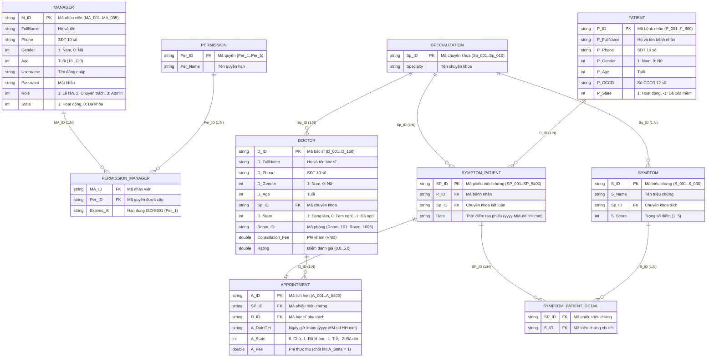
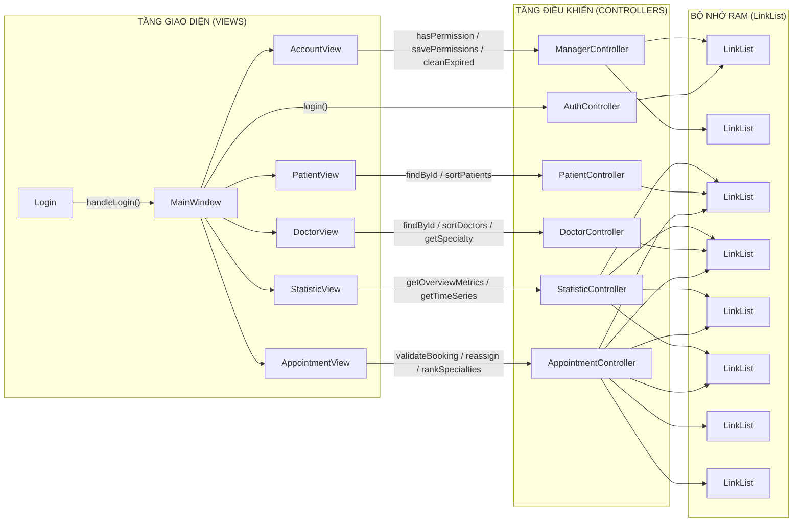
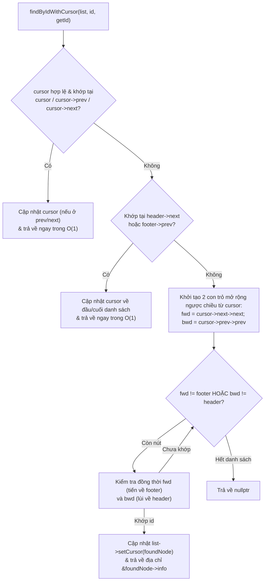
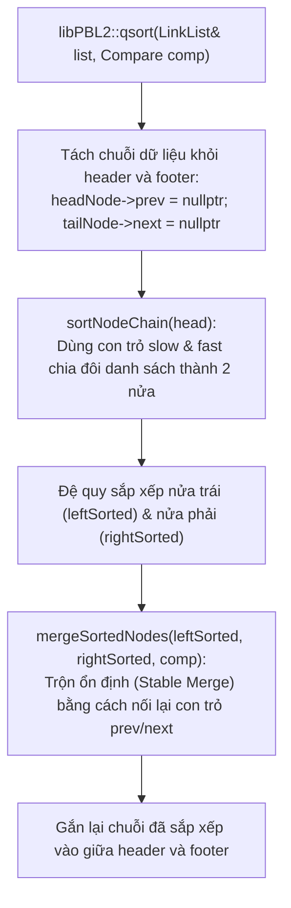
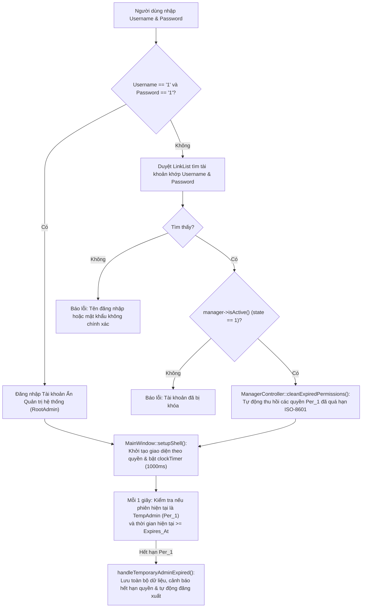
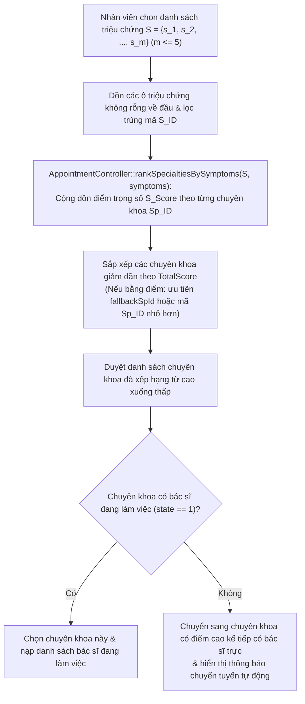
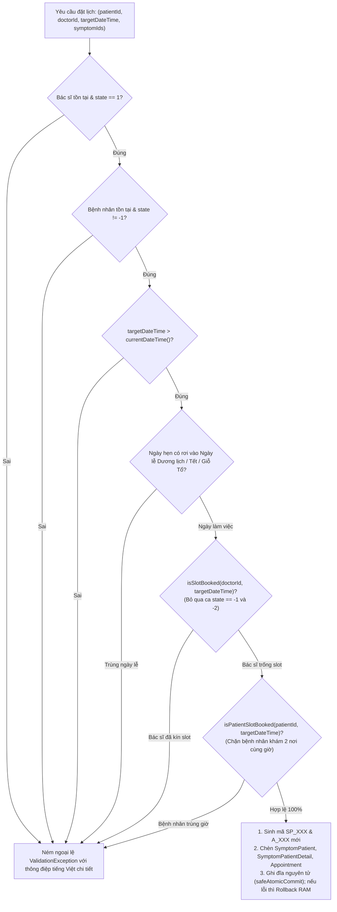
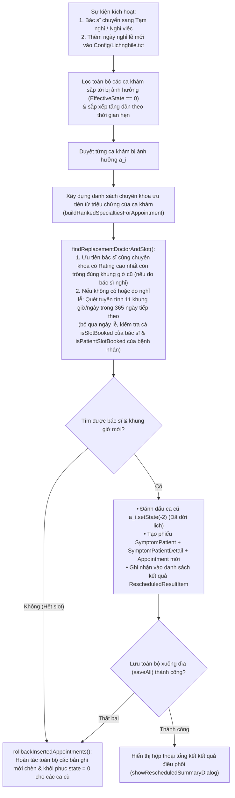

# 🔬 TÀI LIỆU KỸ THUẬT: ĐỐI TƯỢNG, SƠ ĐỒ QUAN HỆ, LUỒNG THUẬT TOÁN & CẤU TRÚC DỮ LIỆU

> **Dự án:** Hệ thống Quản lý Phòng Khám Đa Khoa An Tâm (**MngCareBook**)  
> **Học phần:** Đồ án Cơ sở Ngành Công nghệ Thông tin (PBL 2)  
> **Ngôn ngữ:** C++20 / C++23 (`-std=gnu++2b`) | **Framework Giao diện:** Qt 6 (`Qt6Core`, `Qt6Gui`, `Qt6Widgets`)  
> **Nguyên tắc cốt lõi:** Tuân thủ nghiêm ngặt quy tắc **Zero Forbidden STL** (tự xây dựng danh sách liên kết đôi có nút canh giữ `LinkList<T>` tích hợp con trỏ gợi ý vị trí `cursor`, thuật toán tìm kiếm hai chiều `libPBL2::findByIdWithCursor` và khung thuật toán sắp xếp `libPBL2::qsort`), kết hợp hệ thống **Ngoại lệ An toàn (`AppException`)** và **Lưu trữ Nguyên tử (`safeAtomicCommit`)**.

---

## 📑 MỤC LỤC

1. [Hệ Thống Đối Tượng (Object & Class Specification)](#1-hệ-thống-đối-tượng-object--class-specification)
   - [1.1. Tầng Cấu trúc dữ liệu & Tiện ích (`DataStructures` & `Utils`)](#11-tầng-cấu-trúc-dữ-liệu--tiện-ích-datastructures--utils)
   - [1.2. Tầng Mô hình Thực thể Y tế (`Models`)](#12-tầng-mô-hình-thực-thể-y-tế-models)
   - [1.3. Tầng Điều khiển Nghiệp vụ (`Controllers`)](#13-tầng-điều-khiển-nghiệp-vụ-controllers)
   - [1.4. Tầng Giao diện Người dùng (`Views`)](#14-tầng-giao-diện-người-dùng-views)
2. [Sơ Đồ Quan Hệ Đối Tượng & Cơ Sở Dữ Liệu (UML & ERD Diagrams)](#2-sơ-đồ-quan-hệ-đối-tượng--cơ-sở-dữ-liệu-uml--erd-diagrams)
   - [2.1. Sơ đồ Lớp Hướng Đối Tượng Toàn Hệ Thống (UML Class Diagram)](#21-sơ-đồ-lớp-hướng-đối-tượng-toàn-hệ-thống-uml-class-diagram)
   - [2.2. Sơ đồ Thực thể Liên kết Dữ liệu (Entity-Relationship Diagram - ERD)](#22-sơ-đồ-thực-thể-liên-kết-dữ-liệu-entity-relationship-diagram---erd)
   - [2.3. Sơ đồ Tương tác MVC giữa các Đối tượng (Object Interaction Diagram)](#23-sơ-đồ-tương-tác-mvc-giữa-các-đối-tượng-object-interaction-diagram)
3. [Cấu Trúc Dữ Liệu Cốt Lõi: Danh Sách Liên Kết Đôi `LinkList<T>` & Tìm Kiếm Hai Chiều `findByIdWithCursor`](#3-cấu-trúc-dữ-liệu-cốt-lõi-danh-sách-liên-kết-đôi-linklistt--tìm-kiếm-hai-chiều-findbyidwithcursor)
   - [3.1. Kiến trúc Nút Canh Giữ (`header` & `footer` Sentinels) và Con trỏ Gợi ý (`cursor`)](#31-kiến-trúc-nút-canh-giữ-header--footer-sentinels-và-con-trỏ-gợi-ý-cursor)
   - [3.2. Đặc tả Thuật toán Chèn, Xóa tự bảo vệ `cursor`, Sao chép sâu & Quản lý Bộ nhớ](#32-đặc-tả-thuật-toán-chèn-xóa-tự-bảo-vệ-cursor-sao-chép-sâu--quản-lý-bộ-nhớ)
   - [3.3. Thuật toán Tìm kiếm Hai chiều Có Nhớ Vị trí (`libPBL2::findByIdWithCursor`)](#33-thuật-toán-tìm-kiếm-hai-chiều-có-nhớ-vị-trí-libpbl2findbyidwithcursor)
4. [Khung Thuật Toán Sắp Xếp Đa Năng `libPBL2::qsort`](#4-khung-thuật-toán-sắp-xếp-đa-năng-libpbl2qsort)
   - [4.1. Thuật toán MergeSort Tái Nối Con Trỏ Trên `LinkList<T>`](#41-thuật-toán-mergesort-tái-nối-con-trỏ-trên-linklistt)
   - [4.2. Thuật toán QuickSort Trên Mảng Thô & Danh sách Truy cập Ngẫu nhiên](#42-thuật-toán-quicksort-trên-mảng-thô--danh-sách-truy-cập-ngẫu-nhiên)
   - [4.3. Thuật toán Tiền Tính Toán Khóa Sắp Xếp (Schwartzian Transform / Precomputed Keys)](#43-thuật-toán-tiền-tính-toán-khóa-sắp-xếp-schwartzian-transform--precomputed-keys)
   - [4.4. Bốn Động Cơ So Sánh Chuyên Biệt (Comparison Engines)](#44-bốn-động-cơ-so-sánh-chuyên-biệt-comparison-engines)
5. [Các Thuật Toán Nghiệp Vụ Y Tế & Luồng Thuật Toán (Algorithm Workflows)](#5-các-thuật-toán-nghiệp-vụ-y-tế--luồng-thuật-toán-algorithm-workflows)
   - [5.1. Luồng Xác thực & Phân quyền RBAC Thời gian thực (`Per_1..Per_5`)](#51-luồng-xác-thực--phân-quyền-rbac-thời-gian-thực-per_1per_5)
   - [5.2. Thuật toán Sàng lọc Triệu chứng & Xếp hạng Chuyên khoa (Medical Triage Engine)](#52-thuật-toán-sàng-lọc-triệu-chứng--xếp-hạng-chuyên-khoa-medical-triage-engine)
   - [5.3. Thuật toán Đặt lịch, Kiểm soát Xung đột & Tính Ngày Lễ Âm Lịch Thiên Văn UTC+7](#53-thuật-toán-đặt-lịch-kiểm-soát-xung-đột--tính-ngày-lễ-âm-lịch-thiên-văn-utc7)
   - [5.4. Thuật toán Suy diễn Trạng thái Động (Ân hạn 20 Phút)](#54-thuật-toán-suy-diễn-trạng-thái-động-ân-hạn-20-phút)
   - [5.5. Luồng Tự động Điều phối Lịch khám Khi Bác sĩ Nghỉ hoặc Thêm Ngày Nghỉ Lễ](#55-luồng-tự-động-điều-phối-lịch-khám-khi-bác-sĩ-nghỉ-hoặc-thêm-ngày-nghỉ-lễ)
   - [5.6. Thuật toán Xóa Tầng Toàn Vẹn Dữ Liệu (Cascade Deletion & Atomic Rollback)](#56-thuật-toán-xóa-tầng-toàn-vẹn-dữ-liệu-cascade-deletion--atomic-rollback)
   - [5.7. Thuật toán Thống kê Chỉ số Y tế & Chuỗi Thời gian Doanh thu ($O(N \log D)$)](#57-thuật-toán-thống-kê-chỉ-số-y-tế--chuỗi-thời-gian-doanh-thu-on-log-d)
   - [5.8. Thuật toán Gia hạn Quyền Quản trị Tạm thời Bảo toàn Mốc Giờ:Phút (`Per_1`)](#58-thuật-toán-gia-hạn-quyền-quản-trị-tạm-thời-bảo-toàn-mốc-giờphút-per_1)
   - [5.9. Thuật toán Tìm kiếm Debounce (`QTimer`), Bộ nhớ đệm Phân trang (`cachedFiltered`) & Lưu File Nguyên tử (`safeAtomicCommit`)](#59-thuật-toán-tìm-kiếm-debounce-qtimer-bộ-nhớ-đệm-phân-trang-cachedfiltered--lưu-file-nguyên-tử-safeatomiccommit)
6. [Bảng Ma Trận Độ Phức Tạp Thuật Toán Toàn Hệ Thống](#6-bảng-ma-trận-độ-phức-tạp-thuật-toán-toàn-hệ-thống)

---

## 1. HỆ THỐNG ĐỐI TƯỢNG (OBJECT & CLASS SPECIFICATION)

Toàn bộ mã nguồn được chia thành **4 tầng đối tượng** độc lập, liên kết chặt chẽ theo nguyên lý hướng đối tượng (Kế thừa, Đóng gói, Đa hình và Trừu tượng hóa):

### 1.1. Tầng Cấu trúc dữ liệu & Tiện ích (`DataStructures` & `Utils`)

| Tên Lớp / Namespace | Tệp Mã Nguồn | Thuộc Tính Chính | Phương Thức & Trách Nhiệm Cốt Lõi |
| :--- | :--- | :--- | :--- |
| **`LinkList<T>`** | `src/DataStructures/LinkList.h`<br>`src/DataStructures/LinkList.cpp` | `Node *header`<br>`Node *footer`<br>`mutable Node *cursor`<br>`int count` | Danh sách liên kết đôi mẫu có 2 nút canh giữ (`header`, `footer`) và con trỏ nhớ vị trí `cursor`. Cung cấp `insert(T)`, `remove(Node*)` (tự động dịch `cursor` an toàn khi xóa), Copy Constructor, `getHeader()`, `getFooter()`, `getCursor()`, `setCursor(Node*)`, `getCount()`. |
| **`LinkList<T>::Node`** | `src/DataStructures/LinkList.h` | `T info`<br>`Node *next`<br>`Node *prev` | Đơn vị nút lưu trữ đối tượng thực thể `T` cùng 2 liên kết hai chiều `prev` và `next`. |
| **`Date`** | `src/Utils/Date.h`<br>`src/Utils/Date.cpp` | `int day, month, year`<br>`int hour, minute` | Quản lý thời gian đến từng phút (`yyyy-MM-dd HH:mm`), kiểm định lịch Gregorian năm nhuận (`isValidCalendarDateTime`), nạp/xuất chuỗi (`loadFromString`, `toString`) và lấy thời gian thực `Date::now()`. |
| **`libPBL2`** | `src/Utils/libPBL2.h`<br>`src/Utils/libPBL2.cpp` | `QCollator *ptr` (static cache) | Thư viện giải thuật lõi: `findByIdWithCursor` (tìm kiếm 2 chiều từ `cursor`), `qsort` (MergeSort trên `LinkList<T>` & QuickSort trên mảng/container), `compareNatural`, `compareVietnameseNames`, `compareVietnameseStrings`, `compareDates`, `generateNextId`, `safeAtomicCommit`, `extractRoomCode`, `canonicalRoomKey`, `formatRoomDisplay`, `storageRoomId`. |
| **`AppException`** & các lớp con | `src/Utils/AppExceptions.h`<br>`src/Utils/AppExceptions.cpp` | `std::string message` | Cây phân cấp ngoại lệ kế thừa `std::exception`:<br>• `FileIOException` (lỗi đọc/ghi tệp)<br>• `DataFormatException` (lỗi sai định dạng dòng dữ liệu kèm số dòng)<br>• `ValidationException` (lỗi vi phạm quy tắc nghiệp vụ)<br>• `MemoryAllocationException` (lỗi cấp phát Heap). |
| **`AppConstants`** | `src/Utils/AppConstants.h` | `APPOINTMENT_GRACE_MINUTES = 20`<br>`APPOINTMENT_SLOT_MINUTES = 45`<br>`Paths::*` | Tập trung toàn bộ hằng số thời gian ân hạn (20 phút), độ dài ca khám (45 phút), giới hạn năm lịch (`2000..2099`) và đường dẫn tệp dữ liệu chuẩn. |

---

### 1.2. Tầng Mô hình Thực thể Y tế (`Models`)

Nhóm đối tượng nhân sự & con người kế thừa từ lớp cơ sở **`Human`**:

| Tên Lớp Đối Tượng | Kế Thừa | Thuộc Tính Riêng | Vai Trò & Tệp Dữ Liệu Ánh Xạ |
| :--- | :---: | :--- | :--- |
| **`Human`** | *(Lớp cơ sở)* | `std::string id`<br>`std::string fullName`<br>`std::string phone`<br>`bool gender`<br>`int age` | Lớp cha định nghĩa các thuộc tính nhân khẩu học chung và giao diện ảo `toString()`, `isDefault()`, `setDefault()`. |
| **`Doctor`** | `: public Human` | `std::string spId`<br>`int state` (`1`, `0`, `-1`)<br>`std::string roomId`<br>`double fee`<br>`double rating` | Thực thể Bác sĩ (`Data/Doctor/Doctor.txt`). Quản lý chuyên khoa `Sp_ID`, phòng khám `Room_ID`, phí khám, điểm đánh giá và trạng thái công tác (`1`: Đang làm việc, `0`: Tạm nghỉ, `-1`: Đã xóa/nghỉ hẳn). |
| **`Patient`** | `: public Human` | `std::string CCCD`<br>`int state` (`1`, `-1`) | Thực thể Bệnh nhân (`Data/Patient.txt`). Quản lý số CCCD 12 chữ số và trạng thái hồ sơ (`1`: Hoạt động, `-1`: Đã xóa mềm). |
| **`Manager`** | `: public Human` | `std::string username`<br>`std::string password`<br>`ManagerRole role`<br>`int state` (`1`, `0`) | Thực thể Nhân viên quản lý (`Data/Manager.txt`). Hỗ trợ 3 vai trò `ManagerRole`: `Receptionist (1)`, `SpecialReceptionist (2)`, `Administrator (3)`. |
| **`Appointment`** | *(Độc lập)* | `std::string id` (`A_XXX`)<br>`std::string symptomPatientId` (`SP_XXX`)<br>`std::string doctorId` (`D_XXX`)<br>`Date dateGet`<br>`int state` (`0`, `1`, `-1`, `-2`)<br>`double paidFee` | Thực thể Ca hẹn khám (`Data/Appointment.txt`). Chứa hàm `computeEffectiveState(...)` và `computeEffectiveStateNow()` tự động suy diễn trạng thái `Chưa khám (0)`, `Đã khám (1)`, `Trễ hẹn (-1)`, `Đã dời lịch (-2)` và chốt phí thực thu `paidFee`. |
| **`Symptom`** | *(Độc lập)* | `std::string S_id` (`S_XXX`)<br>`std::string sName`<br>`std::string Sp_id` (`Sp_XXX`)<br>`int sScore` | Thực thể Triệu chứng lâm sàng (`Data/Symptom/Symptom.txt`). Lưu trọng số điểm `sScore` gắn với chuyên khoa `Sp_id` phục vụ thuật toán gợi ý chuyên khoa. |
| **`SymptomPatient`** | *(Độc lập)* | `std::string SP_id` (`SP_XXX`)<br>`std::string P_id` (`P_XXX`)<br>`std::string Sp_id` (`Sp_XXX`)<br>`Date date` | Thực thể Phiếu tiếp nhận triệu chứng của bệnh nhân (`Data/Symptom/SymptomPatient.txt`), đóng vai trò thực thể trung gian nối `Patient` với `Appointment` và lưu thời điểm tạo phiếu hẹn (`Ngày lên lịch hẹn`). |
| **`SymptomPatientDetail`** | *(Độc lập)* | `std::string SP_id` (`SP_XXX`)<br>`std::string S_id` (`S_XXX`) | Thực thể Chi tiết triệu chứng (`Data/Symptom/SymptomPatientDetail.txt`), biểu diễn quan hệ nhiều-nhiều ($N:N$) giữa phiếu `SymptomPatient` và danh mục `Symptom`. |
| **`Permission`** | *(Độc lập)* | `std::string Per_id` (`Per_1..Per_5`)<br>`std::string Per_Name`<br>`std::string description` | Thực thể Danh mục quyền hệ thống nạp từ `Config/Permission.txt`. |
| **`PermissionManager`** | *(Độc lập)* | `std::string MA_id` (`MA_XXX`)<br>`std::string Per_id` (`Per_X`)<br>`std::string Expires_At` (ISO-8601) | Thực thể Bản ghi cấp quyền cho nhân sự (`Data/PermissionManager.txt`). Hỗ trợ cả quyền vĩnh viễn (`Expires_At == ""`) và quyền tạm thời có hạn (`isTemporary()`, `isExpired()`). |

---

### 1.3. Tầng Điều khiển Nghiệp vụ (`Controllers`)

Các lớp Controller được thiết kế dưới dạng các dịch vụ tĩnh không trạng thái (Stateless Static Controllers), thao tác trực tiếp trên các con trỏ `LinkList<T>*`:

1. **`AuthController`** (`src/Controllers/AuthController.h`):
   - `login(managers, username, password, errorMessage, loggedInManager)`: Kiểm tra thông tin đăng nhập, hỗ trợ tài khoản ẩn quản trị hệ thống (`1 / 1`) và chặn tài khoản bị khóa (`state == 0`).
2. **`AppointmentController`** (`src/Controllers/AppointmentController.h`):
   - Điều phối toàn bộ vòng đời lịch khám: `findById` (dùng `findByIdWithCursor`), `sortAppointmentsById`, `validateBooking`, `isSlotBooked`, `isPatientSlotBooked`, `rankSpecialtiesBySymptoms`, `syncExpiredAppointments`.
   - Tính lịch âm thiên văn UTC+7 (`getLunarNewYear`, `getHungKingsDay`, `isTetHoliday`, `isHoliday`, `isHolidayInList`) và tự động dời lịch hàng loạt khi bác sĩ nghỉ (`reassignAppointmentsForDoctor`) hoặc khi thêm ngày nghỉ lễ (`rescheduleAppointmentsLinear`) kèm hoàn tác nguyên tử (`rollbackInsertedAppointments`).
3. **`DoctorController`** (`src/Controllers/DoctorController.h`):
   - Tìm kiếm `findById` (dùng `findByIdWithCursor`), sắp xếp đa tiêu chí `sortDoctors` (ID, Tên, Chuyên khoa, Phòng, Phí khám, Rating, Trạng thái), sinh mã `generateNextId` và bộ đệm tra cứu tên chuyên khoa (`getSpecialty`, `getSpecializationList`, `clearSpecialtyCache`).
4. **`PatientController`** (`src/Controllers/PatientController.h`):
   - Tìm kiếm `findById` (dùng `findByIdWithCursor`) và sắp xếp đa tiêu chí `sortPatients` (ID, Tên tiếng Việt, Tuổi, CCCD, Số điện thoại, Giới tính).
5. **`ManagerController`** (`src/Controllers/ManagerController.h`):
   - Quản lý ma trận phân quyền RBAC: `findById`, `sortManagers`, `getEffectiveRole`, `displayRoleName`, `isRootAdmin`, `isAdministrator`, `isTemporaryAdmin`, `getPrivilegeLevel`, `canViewAccount`, `canViewPassword`, `hasPermission`, `getGrantedPermissions`, `cleanExpiredPermissions`, `savePermissions`, `permissionExpiry`.
6. **`StatisticController`** (`src/Controllers/StatisticController.h`):
   - Tổng hợp báo cáo y tế với bảng tra cứu nhị phân nội bộ (`DoctorLookupTable`, `SpPatientTable`, `PatientLookupTable`): `getOverviewMetrics`, `getPatientDemographics`, `getSpecialtyDemands`, `getTopDoctors`, `getTimeSeriesDaily`, `getTimeSeriesMonthlyRange`.

---

### 1.4. Tầng Giao diện Người dùng (`Views`)

1. **`MainWindow`** (`src/Views/MainWindow.h`): Đối tượng cửa sổ chính (Application Shell) sở hữu toàn bộ 8 con trỏ `LinkList<T>*` dữ liệu trong RAM, bộ đếm thời gian `clockTimer` (kiểm tra hết hạn quyền `Per_1` mỗi giây), thanh điều hướng Sidebar và `QStackedWidget *pages` chứa 7 phân hệ.
2. **`Login`** (`src/Views/Login/Login.h`): Giao diện đăng nhập với hiệu ứng đổ bóng, nút ẩn/hiện mật khẩu và kiểm tra lỗi trực quan.
3. **`AppointmentView`** (`src/Views/Appointment/AppointmentView.h`): Quản lý 3 màn hình lớn (**Tổng quan Dashboard**, **Lịch khám theo ngày & Đặt lịch**, **Danh sách lịch hẹn**) cùng các hộp thoại **Đặt lịch mới** (`SideCalendarTimeWidget`, `SearchablePatientComboBox`), **Chi tiết/Xác nhận/Dời lịch khám**, **Quản lý ngày nghỉ lễ** và **Bảng tổng kết dời lịch tự động**.
4. **`PatientView`** (`src/Views/Patient/PatientView.h`): Bảng quản lý bệnh nhân, hộp thoại thêm mới và hộp thoại chi tiết bệnh nhân tích hợp lịch sử khám bệnh & nút đặt lịch nhanh.
5. **`DoctorView`** (`src/Views/Doctor/DoctorView.h`): Bảng quản lý bác sĩ, hộp thoại thêm/sửa bác sĩ tích hợp lịch sử ca khám và tự động kích hoạt điều phối lịch hẹn khi chuyển trạng thái bác sĩ sang Tạm nghỉ / Xóa.
6. **`StatisticView`** (`src/Views/Statistic/StatisticView.h`): Dashboard phân tích gồm 2 Tab với bộ lọc kỳ thống kê (`PeriodSelectionDialog`, `DateSelectionDialog`) và 4 lớp biểu đồ tự vẽ bằng `QPainter` (`LinearStatusBar`, `PatientDonutChart`, `RevenueLineChart`, `StatusMultiLineChart`).
7. **`AccountView`** (`src/Views/Account/AccountView.h`): Bảng quản lý tài khoản nhân sự và hộp thoại cấp quyền chi tiết (`Per_1..Per_5`) kèm bộ chọn số ngày hiệu lực cho quyền Quản trị viên tạm thời.
8. **`UIHelper`** (`src/Views/UIHelper.h`): Lớp tiện ích giao diện chuẩn hóa bảng, nút bấm, thẻ bo góc, bộ co giãn cột tự động (`setupTableScaling`), kiểm định input SĐT/CCCD và hộp thoại xác nhận.

---

## 2. SƠ ĐỒ QUAN HỆ ĐỐI TƯỢNG & CƠ SỞ DỮ LIỆU (UML & ERD DIAGRAMS)

### 2.1. Sơ đồ Lớp Hướng Đối Tượng Toàn Hệ Thống (UML Class Diagram)

Sơ đồ dưới đây mô tả đầy đủ cấu trúc kế thừa, thành phần dữ liệu (`Composition` / `Aggregation`) và mối liên hệ giữa tất cả các lớp đối tượng trong hệ thống:

```mermaid
classDiagram
    direction TB

    class LinkList~T~ {
        -Node* header
        -Node* footer
        -Node* cursor
        -int count
        +insert(T info) bool
        +remove(Node* N) bool
        +getCount() int
        +getHeader() Node*
        +getFooter() Node*
        +getCursor() Node*
        +setCursor(Node* N)
    }

    class Date {
        -int day
        -int month
        -int year
        -int hour
        -int minute
        +isDefault() bool
        +toString() string
        +loadFromString(string)$ Date
        +now()$ Date
    }

    class Human {
        #string id
        #string fullName
        #string phone
        #bool gender
        #int age
        +getID() string
        +getfullName() string
        +getPhone() string
        +getGender() bool
        +getAge() int
        +isDefault()* bool
        +toString()* string
    }

    class Doctor {
        -string spId
        -int state
        -string roomId
        -double fee
        -double rating
        +getSpId() string
        +getState() int
        +getRoomId() string
        +getFee() double
        +getRating() double
        +loadFromFile(string)$ LinkList~Doctor~*
        +saveToFile(string, LinkList~Doctor~*)$ bool
    }

    class Patient {
        -string CCCD
        -int state
        +getCCCD() string
        +getState() int
        +loadFromFile(string)$ LinkList~Patient~*
        +saveToFile(string, LinkList~Patient~*)$ bool
    }

    class Manager {
        -string username
        -string password
        -ManagerRole role
        -int state
        +getUsername() string
        +getRole() ManagerRole
        +isActive() bool
        +loadFromFile(string)$ LinkList~Manager~*
        +saveToFile(string, LinkList~Manager~*)$ bool
    }

    class Appointment {
        -string id
        -string symptomPatientId
        -string doctorId
        -Date dateGet
        -int state
        -double paidFee
        +computeEffectiveState(...) int
        +computeEffectiveStateNow() int
        +loadFromFile(string)$ LinkList~Appointment~*
        +saveToFile(string, LinkList~Appointment~*)$ bool
    }

    class Symptom {
        -string S_id
        -string sName
        -string Sp_id
        -int sScore
        +loadFromFile(string)$ LinkList~Symptom~*
    }

    class SymptomPatient {
        -string SP_id
        -string P_id
        -string Sp_id
        -Date date
        +loadFromFile(string)$ LinkList~SymptomPatient~*
        +saveToFile(string, LinkList~SymptomPatient~*)$ bool
    }

    class SymptomPatientDetail {
        -string SP_id
        -string S_id
        +loadFromFile(string)$ LinkList~SymptomPatientDetail~*
        +saveToFile(string, LinkList~SymptomPatientDetail~*)$ bool
    }

    class Permission {
        -string Per_id
        -string Per_Name
        -string description
        +getSystemCatalog()$ LinkList~Permission~*
    }

    class PermissionManager {
        -string MA_id
        -string Per_id
        -string Expires_At
        +isTemporary() bool
        +isExpired() bool
        +loadFromFile(string)$ LinkList~PermissionManager~*
        +saveToFile(string, LinkList~PermissionManager~*)$ bool
    }

    class MainWindow {
        -LinkList~Manager~* managers
        -LinkList~Patient~* patients
        -LinkList~Doctor~* doctors
        -LinkList~Symptom~* symptoms
        -LinkList~SymptomPatient~* symptomPatients
        -LinkList~SymptomPatientDetail~* symptomPatientDetails
        -LinkList~Appointment~* appointments
        -LinkList~PermissionManager~* permissionRecords
        -Manager* currentManager
        +initApp() bool
        +saveAll(SaveScope, SaveAction) bool
        +hasPermission(string) bool
        +refreshPage(int)
    }

    Human <|-- Doctor : Kế thừa
    Human <|-- Patient : Kế thừa
    Human <|-- Manager : Kế thừa

    Appointment *-- Date : dateGet
    SymptomPatient *-- Date : date

    MainWindow *-- LinkList~T~ : Sở hữu 8 danh sách
    MainWindow o-- Manager : currentManager
    LinkList~T~ o-- Doctor
    LinkList~T~ o-- Patient
    LinkList~T~ o-- Manager
    LinkList~T~ o-- Appointment
    LinkList~T~ o-- Symptom
    LinkList~T~ o-- SymptomPatient
    LinkList~T~ o-- SymptomPatientDetail
    LinkList~T~ o-- PermissionManager
    LinkList~T~ o-- Permission
```



---

### 2.2. Sơ đồ Thực thể Liên kết Dữ liệu (Entity-Relationship Diagram - ERD)

Sơ đồ ERD dưới đây thể hiện khóa chính (`PK`), khóa ngoại (`FK`) và bản số quan hệ giữa toàn bộ các tệp dữ liệu trong thư mục `Data/` và `Config/`:



---

### 2.3. Sơ đồ Tương tác MVC giữa các Đối tượng (Object Interaction Diagram)



---

## 3. CẤU TRÚC DỮ LIỆU CỐT LÕI: DANH SÁCH LIÊN KẾT ĐÔI `LinkList<T>` & TÌM KIẾM HAI CHIỀU `findByIdWithCursor`

### 3.1. Kiến trúc Nút Canh Giữ (`header` & `footer` Sentinels) và Con trỏ Gợi ý (`cursor`)

Mọi danh sách `LinkList<T>` (`src/DataStructures/LinkList.h`) duy trì hai nút canh giữ cố định ở hai đầu là `header` và `footer`, đồng thời tích hợp con trỏ gợi ý vị trí truy cập gần nhất `mutable Node *cursor`:

```text
[header] <===> [Node 1] <===> ... <===> [Node k (cursor)] <===> ... <===> [Node N] <===> [footer]
(Sentinel)      (Data)                  (Last Visited)                    (Data)        (Sentinel)
```

- **Khi danh sách rỗng (`count == 0`):** `header->next == footer`, `footer->prev == header` và `cursor == nullptr`.
- **Chuẩn duyệt an toàn trên toàn hệ thống:**
  ```cpp
  auto *node = list->getHeader()->next;
  while (node && node->next) { // Dừng chính xác khi chạm nút footer (vì footer->next == nullptr)
      // Xử lý node->info
      node = node->next;
  }
  ```

### 3.2. Đặc tả Thuật toán Chèn, Xóa tự bảo vệ `cursor`, Sao chép sâu & Quản lý Bộ nhớ

1. **Chèn cuối danh sách (`insert(const T &info)`) — $O(1)$:**
   - Cấp phát nút mới `Node *tmp = new Node` trong khối `try-catch(std::bad_alloc)` (ném `MemoryAllocationException` nếu hết RAM).
   - Nối trực tiếp vào giữa `footer->prev` và `footer` trong $O(1)$.
2. **Xóa nút bất kỳ kèm bảo vệ con trỏ gợi ý (`remove(Node *N)`) — $O(1)$:**
   - Kiểm tra bảo vệ: từ chối xóa nếu `N == nullptr`, `N == header` hoặc `N == footer`.
   - **Tự động cập nhật `cursor` chống lỗi con trỏ treo (Dangling Pointer Protection):**
     ```cpp
     if (cursor == N) {
         if (N->prev && N->prev != header) cursor = N->prev;
         else if (N->next && N->next != footer) cursor = N->next;
         else cursor = nullptr;
     }
     ```
   - Ngắt liên kết 2 chiều (`N->next->prev = N->prev; N->prev->next = N->next;`) và giải phóng vùng nhớ `delete N;`.
3. **Sao chép sâu an toàn ngoại lệ (Exception-Safe Deep Copy):**
   - Trong Copy Constructor `LinkList(const LinkList &L)`, nếu quá trình sao chép nút thứ $k$ gặp lỗi cấp phát bộ nhớ, khối `catch(...)` sẽ tự động giải phóng toàn bộ chuỗi nút đã tạo dở, đảm bảo không rò rỉ bộ nhớ.

### 3.3. Thuật toán Tìm kiếm Hai chiều Có Nhớ Vị trí (`libPBL2::findByIdWithCursor`)

Trong các nghiệp vụ lọc và tìm kiếm lịch khám (5.400 bản ghi `Appointment` ánh xạ sang 5.400 bản ghi `SymptomPatient`), việc tìm kiếm tuyến tính một chiều từ `header->next` tốn trung bình $5.400 \times 2.700 \approx 14,58 \text{ triệu}$ bước nhảy con trỏ. Để giải quyết triệt để mà vẫn giữ nguyên 100% cấu trúc `LinkList<T>`, hệ thống triển khai thuật toán **`libPBL2::findByIdWithCursor`** (`src/Utils/libPBL2.cpp`):



- **Hiệu quả đột phá trên `LinkList<T>`:**
  - Khi duyệt `LinkList<Appointment>` theo chiều giảm dần (`A_5400` $\to$ `A_001`) trong khi `LinkList<SymptomPatient>` đang xếp tăng dần (`SP_001` $\to$ `SP_5400`):
    - Lịch hẹn đầu tiên (`A_5400` $\to$ `SP_5400`) khớp ngay lập tức tại `footer->prev` (**1 bước**) và đặt `cursor = SP_5400`.
    - Toàn bộ 5.399 lịch hẹn tiếp theo (`A_5399` $\to$ `A_001`) đều khớp ngay tại `cursor->prev` (**1 bước**).
  - Tổng số bước nhảy con trỏ khi quét toàn bộ 5.400 lịch hẹn giảm từ **14.580.000 bước xuống đúng 5.400 bước** (nhanh hơn **2.700 lần**, đạt độ phức tạp $O(1)$ khấu hao cho mỗi lần tra cứu tuần tự).

---

## 4. KHUNG THUẬT TOÁN SẮP XẾP ĐA NĂNG `libPBL2::qsort`

### 4.1. Thuật toán MergeSort Tái Nối Con Trỏ Trên `LinkList<T>`

Khi sắp xếp trực tiếp trên `LinkList<T>` (`DoctorController::sortDoctors`, `PatientController::sortPatients`, `AppointmentController::sortAppointmentsById`, `ManagerController::sortManagers`), hệ thống sử dụng thuật toán **MergeSort tái nối liên kết nút (`sortNodeChain` & `mergeSortedNodes`)** tại `src/Utils/libPBL2.cpp`:



- **Ưu điểm kỹ thuật:**
  - **Độ phức tạp thời gian:** Luôn đạt $O(N \log N)$ trong mọi trường hợp (kể cả khi dữ liệu đã có thứ tự hoặc ngược thứ tự).
  - **Bảo toàn địa chỉ nút (Pointer-Stable):** Không sao chép hay hoán đổi vùng nhớ `node->info`; mọi con trỏ `Doctor*`, `Patient*`, `Appointment*` đang trỏ tới `&node->info` đều giữ nguyên địa chỉ hợp lệ sau khi sắp xếp.
  - **Tính ổn định (Stable Sort):** Điều kiện trộn `if (comp(b->info, a->info))` giữ nguyên thứ tự tương đối của các phần tử có khóa bằng nhau.

### 4.2. Thuật toán QuickSort Trên Mảng Thô & Danh sách Truy cập Ngẫu nhiên

Đối với mảng động (`T*`) và `QList<T>` trong các bộ lọc hiển thị và bảng tra cứu thống kê (`src/Utils/libPBL2.cpp`):
- Chọn chốt ở vị trí trung tâm (`center = low + (high - low) / 2`) để tránh suy biến $O(N^2)$ trên dữ liệu đã sắp xếp sẵn.
- Phân hoạch Lomuto cải tiến và đệ quy hai nửa `[low .. sep - 1]` và `[sep + 1 .. high]`.

### 4.3. Thuật toán Tiền Tính Toán Khóa Sắp Xếp (Schwartzian Transform / Precomputed Keys)

Khi sắp xếp danh sách 5.400+ lịch hẹn theo **Tên bệnh nhân**, **Tên bác sĩ**, **Chuyên khoa**, hoặc **Trạng thái** tại `src/Views/Appointment/AppointmentView.cpp`:
- Thay vì tra cứu `findPatientForAppointment` bên trong hàm so sánh của QuickSort (gây tốn $O(N \log N)$ lần tra cứu liên bảng), hệ thống thực hiện **Tiền tính toán khóa (Precomputed Sort Keys)**:
  1. Duyệt qua $N$ lịch hẹn **đúng 1 lần duy nhất** (kết hợp `findByIdWithCursor`), trích xuất sẵn khóa chính `key1` (tên gọi / chuyên khoa / trạng thái) và khóa phụ `key2` (họ tên đầy đủ) vào cấu trúc `ApptSortEntry`.
  2. Chạy `libPBL2::qsort` trên danh sách `ApptSortEntry` với phép so sánh chuỗi trực tiếp trong RAM.
  3. Ghi lại thứ tự con trỏ `Appointment*` đã sắp xếp vào danh sách kết quả.

### 4.4. Bốn Động Cơ So Sánh Chuyên Biệt (Comparison Engines)

1. **So sánh Tự nhiên (`compareNatural`):** Tự động tách phần chữ và phần số trong mã định danh (`A_009 < A_010 < A_100 < A_1000`), bỏ qua các chữ số `0` đứng đầu và so sánh theo độ dài chữ số thực tế.
2. **So sánh Họ Tên Tiếng Việt (`compareVietnameseNames`):** Tách từ cuối cùng làm **Tên chính** (`extractLastName`), so sánh Tên chính trước theo bảng chữ cái tiếng Việt chuẩn (`QCollator(QLocale::Vietnamese)`), nếu trùng Tên chính mới so sánh toàn bộ Họ và Tên đệm.
3. **So sánh Chuỗi Tiếng Việt (`compareVietnameseStrings`):** So sánh trực tiếp hai chuỗi có dấu tiếng Việt không phân biệt hoa thường.
4. **So sánh Thời gian (`compareDates`):** So sánh thứ bậc `Năm -> Tháng -> Ngày -> Giờ -> Phút` trong $O(1)$.

---

## 5. CÁC THUẬT TOÁN NGHIỆP VỤ Y TẾ & LUỒNG THUẬT TOÁN (ALGORITHM WORKFLOWS)

### 5.1. Luồng Xác thực & Phân quyền RBAC Thời gian thực (`Per_1..Per_5`)

Hệ thống kết hợp **Vai trò cơ sở (`ManagerRole`)** và **Quyền cấp thêm (`PermissionManager`)** để suy diễn **Vai trò hiệu lực (`EffectiveRole`)** và **Cấp độ đặc quyền (`getPrivilegeLevel` từ `0` đến `3`)**:



---

### 5.2. Thuật toán Sàng lọc Triệu chứng & Xếp hạng Chuyên khoa (Medical Triage Engine)

Khi nhân viên lễ tân chọn từ 1 đến 5 triệu chứng lâm sàng cho bệnh nhân trong hộp thoại Đặt lịch (`AppointmentView::showBookingDialog`):



---

### 5.3. Thuật toán Đặt lịch, Kiểm soát Xung đột & Tính Ngày Lễ Âm Lịch Thiên Văn UTC+7

#### 1. Thuật toán Lịch Âm Thiên Văn Việt Nam (`convertLunarToSolarVN` — UTC+7):
Để tự động nhận diện **Tết Nguyên Đán (`Tet - <số ngày>`)** và **Giỗ Tổ Hùng Vương (`GioTo` — 10/3 Âm lịch)** cho bất kỳ năm nào từ `1900` đến `2199` mà không cần tra bảng cứng:
1. Tính **Ngày Julius (`jdFromDate`)** và điểm **Sóc (`getNewMoonDay(k, 7.0)`)** theo công thức thiên văn Jean Meeus tại múi giờ Việt Nam (`UTC+7`).
2. Tính **Kinh độ Mặt Trời (`getSunLongitude`)** chia theo 12 tiết khí để tìm tháng 11 Âm lịch chứa Đông Chí (`getLunarMonth11`).
3. Nếu giữa hai tháng 11 Âm lịch liên tiếp có 13 tháng sóc ($b_{11} - a_{11} > 365$ ngày), dùng `getLeapMonthOffset` để xác định chính xác vị trí tháng nhuận âm lịch.
4. Suy ra ngày Dương lịch chính xác của Mùng 1 Tết (`convertLunarToSolarVN(1, 1, year)`) và Giỗ Tổ (`convertLunarToSolarVN(10, 3, year)`).
   - Kỳ nghỉ Tết $K$ ngày (mặc định $K = 5$) bắt đầu từ **29 hoặc 30 tháng Chạp** (`mung1.addDays(-1)`) đến hết ngày **`mung1.addDays(K - 2)`**.

#### 2. Luồng Kiểm định Đặt lịch (`AppointmentController::validateBooking`):



---

### 5.4. Thuật toán Suy diễn Trạng thái Động (Ân hạn 20 Phút)

Mỗi ca khám lưu trạng thái gốc `state` trong tệp `Appointment.txt`, nhưng trạng thái hiệu lực tại thời điểm thực được suy diễn qua `Appointment::computeEffectiveState` với ngưỡng ân hạn **`APPOINTMENT_GRACE_MINUTES = 20` phút** (`1200` giây):

$$\text{EffectiveState} = \begin{cases} 
-2 & \text{nếu } \text{state} = -2 \text{ (Đã dời lịch)} \\
1 & \text{nếu } \text{state} = 1 \text{ (Đã khám)} \\
-1 & \text{nếu } \text{state} = -1 \text{ hoặc } (\text{Ngày hẹn} < \text{Hôm nay}) \text{ hoặc } (\text{Ngày hẹn} = \text{Hôm nay và } t_{\text{hiện tại}} > t_{\text{hẹn}} + 1200\text{s}) \\
0 & \text{trong các trường hợp còn lại (Chưa khám / Đang trong 20 phút ân hạn)}
\end{cases}$$

---

### 5.5. Luồng Tự động Điều phối Lịch khám Khi Bác sĩ Nghỉ hoặc Thêm Ngày Nghỉ Lễ

Khi một bác sĩ chuyển sang trạng thái **Tạm nghỉ (`0`) / Xóa (`-1`)** (`reassignAppointmentsForDoctor`) hoặc khi Quản trị viên **thêm một ngày nghỉ lễ mới** trùng với các lịch hẹn đang chờ (`rescheduleAppointmentsLinear`):



---

### 5.6. Thuật toán Xóa Tầng Toàn Vẹn Dữ Liệu (Cascade Deletion & Atomic Rollback)

Để đảm bảo không bao giờ phát sinh bản ghi mồ côi (Orphan Records) và không bao giờ mất dữ liệu khi lỗi ghi đĩa:
1. **Khi hủy lịch hẹn chờ (`state == 0`):**
   - Trước khi xóa trên RAM, hệ thống tạo bản sao lưu tạm thời (`backupAppt`, `backupSp`, `backupSpds`).
   - Tiến hành xóa `Appointment`, xóa `SymptomPatient` tương ứng và xóa toàn bộ các nút `SymptomPatientDetail` có cùng `SP_ID`.
   - Gọi `mainWindow->saveAll(SaveScope::Appointment)`. Nếu đĩa báo lỗi, hệ thống lập tức khôi phục lại toàn bộ `backupAppt`, `backupSp`, `backupSpds` vào các `LinkList` trên RAM.
2. **Khi xóa tài khoản Quản lý (`Manager`):**
   - Duyệt `LinkList<PermissionManager>` theo kỹ thuật lưu con trỏ kế tiếp trước khi xóa (`auto *toDel = curr; curr = curr->next; list->remove(toDel);`), thu hồi toàn bộ quyền gắn với `MA_ID` đó.

---

### 5.7. Thuật toán Thống kê Chỉ số Y tế & Chuỗi Thời gian Doanh thu ($O(N \log D)$)

Khi tổng hợp dữ liệu trên hàng nghìn ca khám trong `StatisticController` (`src/Controllers/StatisticController.cpp`):
1. **Xây dựng Bảng tra cứu Nhị phân Nội bộ (`DoctorLookupTable`, `SpPatientTable`, `PatientLookupTable`):**
   - Thay vì duyệt tuyến tính `LinkList<Doctor>` và `LinkList<SymptomPatient>` cho từng lịch hẹn (tốn $O(N \times (D + M))$), `StatisticController` trích xuất các khóa vào mảng động `std::unique_ptr<Entry[]>`, sắp xếp bằng `libPBL2::qsort` và tra cứu bằng **Tìm kiếm nhị phân (Binary Search)** trong $O(\log D)$ và $O(\log M)$.
2. **Định giá Doanh thu Lịch sử Chính xác (`resolvedCompletedAppointmentFee`):**
   - Chỉ tính doanh thu cho các ca đã hoàn thành (`EffectiveState == 1`).
   - Nếu ca khám đã chốt mức phí thực thu tại thời điểm khám (`a.hasPaidFee()`), sử dụng chính xác `a.getPaidFee()`; nhờ đó khi bác sĩ thay đổi giá khám về sau, số liệu doanh thu lịch sử không bị sai lệch.
3. **Chuỗi Thời gian Tự động Thích ứng (`Daily` vs `Monthly`):**
   - Khoảng lọc $\le 366$ ngày: Phân bổ vào các bucket theo từng ngày (`getTimeSeriesDaily`).
   - Khoảng lọc $> 366$ ngày: Tự động gom nhóm theo từng tháng `MM/yyyy` (`getTimeSeriesMonthlyRange`) nhưng vẫn kiểm tra chính xác biên ngày bắt đầu `startDate` và ngày kết thúc `endDate`.

---

### 5.8. Thuật toán Gia hạn Quyền Quản trị Tạm thời Bảo toàn Mốc Giờ:Phút (`Per_1`)

Trong hộp thoại phân quyền nâng cao (`src/Views/Account/AccountView.cpp`):
1. **Tính số ngày còn lại theo quy tắc làm tròn lên (`Ceil-to-Day`):**
   $$\Delta t = \text{secsTo}(T_{\text{now}}, T_{\text{exp}}), \quad \text{baseDays} = \max\left(1, \left\lfloor \frac{\Delta t + 86399}{86400} \right\rfloor\right)$$
2. **Bảo toàn mốc Giờ:Phút gốc (`Anchor-based Expiry Preservation`):**
   - Lưu mốc thời gian hết hạn gốc $\text{baseExpiry} = T_{\text{exp}}$ và số ngày cơ sở $\text{baseDays}$.
   - Khi Quản trị viên gốc tăng/giảm giá trị trên `QSpinBox` thành $V$ ngày (mà không tắt checkbox), thời điểm hết hạn mới được tính từ mốc gốc:
     $$T_{\text{new}} = \text{baseExpiry}.\text{addDays}(V - \text{baseDays})$$
   - Nhờ vậy, chỉ có phần **Ngày/Tháng/Năm** dịch chuyển đúng $\delta = V - \text{baseDays}$ ngày, còn mốc **Giờ:Phút:Giây** hết hạn ban đầu được giữ nguyên tuyệt đối.

---

### 5.9. Thuật toán Tìm kiếm Debounce (`QTimer`), Bộ nhớ đệm Phân trang (`cachedFiltered`) & Lưu File Nguyên tử (`safeAtomicCommit`)

1. **Tìm kiếm Không Độ Trễ với Debounce `QTimer` (120 ms) + `findByIdWithCursor`:**
   - Tại ô tìm kiếm danh sách lịch hẹn và `SearchablePatientComboBox` (`src/Views/Appointment/AppointmentView.cpp`), một `QTimer` (`SingleShot`, `120 ms`) được gắn vào sự kiện `QLineEdit::textChanged`.
   - Khi người dùng gõ liên tục hoặc tổ hợp dấu tiếng Việt (Unikey/EVKey phát sinh nhiều sự kiện `textChanged` cho 1 chữ), bộ đếm tự động reset và chỉ kích hoạt lọc **1 lần duy nhất** khi ngừng tay `120 ms` (hoặc kích hoạt ngay lập tức khi xóa trắng ô tìm kiếm / nhấn `Enter`).
   - Bên trong vòng lặp lọc 5.400 lịch hẹn, việc tra cứu `SymptomPatient`, `Patient` và `Doctor` sử dụng `libPBL2::findByIdWithCursor` đạt $O(1)$ khấu hao cho mỗi lịch hẹn.
2. **Bộ nhớ đệm Phân trang (`cachedFiltered` & `cacheDirty`):**
   - Tại trang Danh sách lịch hẹn, kết quả sau khi Lọc và Sắp xếp được lưu trong `cachedFiltered`.
   - Cờ `cacheDirty` chỉ bật lên `true` khi người dùng thay đổi điều kiện lọc, bấm tiêu đề cột để Sort, hoặc thêm/sửa/hủy ca khám.
   - Khi người dùng bấm **`Trang trước` / `Trang sau`**, `*cacheDirty == false` nên chương trình bỏ qua hoàn toàn bước Lọc và Sort, cắt trực tiếp 50 dòng từ `cachedFiltered[startIdx .. endIdx - 1]` trong thời gian **$O(1)$ (0 ms)**.
3. **Giao thức Lưu File Nguyên tử 3 Bước (`libPBL2::safeAtomicCommit`):**
   - **Bước 1:** Ghi toàn bộ dữ liệu mới vào tệp tạm `<path>.tmp` và kiểm tra `f.flush()`, `f.good()`.
   - **Bước 2:** Đổi tên tệp gốc `<path>` sang bản sao lưu `<path>.bak`.
   - **Bước 3:** Đổi tên `<path>.tmp` thành `<path>`. Nếu thành công thì xóa `<path>.bak`; nếu thất bại thì tự động khôi phục `<path>.bak` về lại `<path>`, đảm bảo tệp dữ liệu không bao giờ bị cụt hoặc hỏng khi mất điện hay lỗi ổ cứng.

---

## 6. BẢNG MA TRẬN ĐỘ PHỨC TẠP THUẬT TOÁN TOÀN HỆ THỐNG

| Tên Thuật Toán / Nghiệp Vụ | Mô-đun Thực Hiện | Thời Gian (Trung Bình) | Thời Gian (Xấu Nhất) | Bộ Nhớ Phụ Trợ |
| :--- | :--- | :---: | :---: | :---: |
| Chèn / Xóa nút bảo vệ `cursor` trên DSLK | `LinkList<T>::insert / remove` | $O(1)$ | $O(1)$ | $O(1)$ |
| Tìm kiếm 2 chiều có nhớ vị trí `cursor` | `libPBL2::findByIdWithCursor` | $O(1)$ (duyệt tuần tự) | $O(N)$ | $O(1)$ |
| Sắp xếp MergeSort bảo toàn địa chỉ nút | `libPBL2::qsort(LinkList<T>&)` | $O(N \log N)$ | $O(N \log N)$ | $O(\log N)$ stack |
| Sắp xếp lịch hẹn với khóa tiền tính toán | `sortAppointmentPtrList` | $O(N + K \log K)$ | $O(N \cdot P + K^2)$ | $O(K)$ entries |
| Lọc tìm kiếm danh sách 5.400 lịch hẹn | `createAppointmentListWidget` | $O(N \cdot (P + D))$ | $O(N \cdot (M + P + D))$ | $O(K)$ |
| Chuyển trang phân trang có bộ nhớ đệm | `createAppointmentListWidget` | $O(B)$ ($B = 50$) | $O(B)$ | $O(1)$ |
| Sàng lọc triệu chứng & xếp hạng chuyên khoa | `rankSpecialtiesBySymptoms` | $O(m \cdot S)$ | $O(m \cdot S + C \log C)$ | $O(C)$ |
| Tính ngày Tết & Giỗ Tổ Âm lịch thiên văn | `convertLunarToSolarVN` | $O(1)$ | $O(1)$ | $O(1)$ |
| Kiểm định đặt lịch & chống trùng khung giờ | `validateBooking` | $O(N)$ | $O(N \cdot M)$ | $O(1)$ |
| Điều phối lịch khám tự động khi nghỉ lễ | `rescheduleAppointmentsLinear` | $O(A \cdot D \cdot N)$ | $O(A \cdot 365 \cdot 11 \cdot N)$ | $O(A)$ |
| Suy diễn trạng thái ca khám (ân hạn 20p) | `computeEffectiveState` | $O(1)$ | $O(1)$ | $O(1)$ |
| Tổng hợp thống kê với bảng tra cứu nhị phân | `StatisticController::get*` | $O(D \log D + M \log M + N \log M)$ | $O((D + M + N) \log M)$ | $O(D + M + P)$ |

*(Ký hiệu: $N = 5.400$ là số lượng lịch hẹn, $K$ là số lịch hẹn sau khi lọc, $M = 5.400$ là số phiếu triệu chứng `SymptomPatient`, $D = 150$ là số bác sĩ, $P = 800$ là số bệnh nhân, $B = 50$ là kích thước mỗi trang hiển thị, $S = 30$ là số triệu chứng trong danh mục, $C = 10$ là số chuyên khoa, $m \le 5$ là số triệu chứng bệnh nhân chọn, $A$ là số ca khám bị ảnh hưởng bởi ngày nghỉ).*
