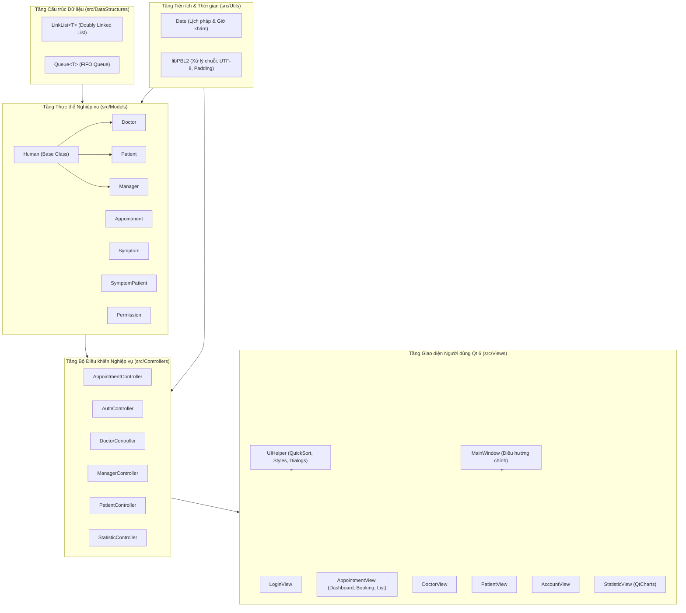
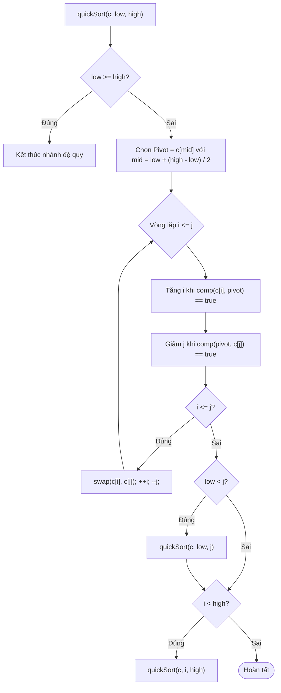

# 🔬 TÀI LIỆU CHI TIẾT SOURCE CODE, CẤU TRÚC DỮ LIỆU & THUẬT TOÁN (funtionAlgorithms.md)

> **Tài liệu kỹ thuật chuyên sâu về kiến trúc mã nguồn, các lớp thực thể, cấu trúc dữ liệu tự định nghĩa, thuật toán sắp xếp Hoare QuickSort, chuẩn hóa tiếng Việt, cơ chế xóa mềm (Soft Delete) và các giải thuật nghiệp vụ cốt lõi trong hệ thống AnTamMng.**

---

## 📑 MỤC LỤC
1. [Kiến trúc Tổng thể của Source Code & Nguyên tắc Thiết kế](#1-kiến-trúc-tổng-thể-của-source-code--nguyên-tắc-thiết-kế)
2. [Cấu trúc Dữ liệu Tự xây dựng (Data Structures)](#2-cấu-trúc-dữ-liệu-tự-xây-dựng-data-structures)
   - [2.1. LinkList&lt;T&gt; (Doubly Linked List with Sentinels)](#21-linklistt-doubly-linked-list-with-sentinels)
   - [2.2. Queue&lt;T&gt; (FIFO Queue with Dynamic Allocation)](#22-queuet-fifo-queue-with-dynamic-allocation)
3. [Các Thư viện Tiện ích & Xử lý Chuỗi, Thời gian (Utils)](#3-các-thư-viện-tiện-ích--xử-lý-chuỗi-thời-gian-utils)
   - [3.1. Lớp Ngày tháng Thời gian: Date](#31-lớp-ngày-tháng-thời-gian-date)
   - [3.2. Không gian tên Tiện ích: libPBL2](#32-không-gian-tên-tiện-ích-libpbl2)
4. [Các Lớp Thực thể Nghiệp vụ (Domain Models)](#4-các-lớp-thực-thể-nghiệp-vụ-domain-models)
   - [4.1. Lớp Cơ sở Trừu tượng: Human](#41-lớp-cơ-sở-trừu-tượng-human)
   - [4.2. Lớp Thực thể Bác sĩ: Doctor](#42-lớp-thực-thể-bác-sĩ-doctor)
   - [4.3. Lớp Thực thể Bệnh nhân: Patient](#43-lớp-thực-thể-bệnh-nhân-patient)
   - [4.4. Lớp Thực thể Quản trị & Nhân sự: Manager](#44-lớp-thực-thể-quản-trị--nhân-sự-manager)
   - [4.5. Lớp Thực thể Cuộc hẹn Khám bệnh: Appointment](#45-lớp-thực-thể-cuộc-hẹn-khám-bệnh-appointment)
   - [4.6. Lớp Thực thể Triệu chứng Lâm sàng: Symptom](#46-lớp-thực-thể-triệu-chứng-lâm-sàng-symptom)
   - [4.7. Lớp Liên kết Bệnh án Triệu chứng: SymptomPatient](#47-lớp-liên-kết-bệnh-án-triệu-chứng-symptompatient)
   - [4.8. Lớp Thực thể Bản ghi Phân quyền: Permission](#48-lớp-thực-thể-bản-ghi-phân-quyền-permission)
5. [Các Bộ Điều khiển Nghiệp vụ (Controllers)](#5-các-bộ-điều-khiển-nghiệp-vụ-controllers)
   - [5.1. AppointmentController](#51-appointmentcontroller)
   - [5.2. AuthController](#52-authcontroller)
   - [5.3. DoctorController](#53-doctorcontroller)
   - [5.4. ManagerController](#54-managercontroller)
   - [5.5. PatientController](#55-patientcontroller)
   - [5.6. StatisticController](#56-statisticcontroller)
6. [Các Giải thuật Cốt lõi của Hệ thống (Core System Algorithms)](#6-các-giải-thuật-cốt-lõi-của-hệ-thống-core-system-algorithms)
   - [6.1. Thuật toán Sắp xếp Nhanh Hoare QuickSort Template (UIHelper::quickSort)](#61-thuật-toán-sắp-xếp-nhanh-hoare-quicksort-template-uihelperquicksort)
   - [6.2. Thuật toán So sánh Tên Tiếng Việt Chuẩn hóa (UIHelper::compareVietnameseNames)](#62-thuật-toán-so-sánh-tên-tiếng-việt-chuẩn-hóa-uihelpercomparevietnamesenames)
   - [6.3. Cơ chế Xóa mềm & Ràng buộc Toàn vẹn Dữ liệu (Soft-Delete Architecture)](#63-cơ-chế-xóa-mềm--ràng-buộc-toàn-vẹn-dữ-liệu-soft-delete-architecture)
   - [6.4. Thuật toán Phân loại Sàng lọc Y tế (Medical Triage Scoring)](#64-thuật-toán-phân-loại-sàng-lọc-y-tế-medical-triage-scoring)
   - [6.5. Thuật toán Phát hiện Xung đột Lịch hẹn (Appointment Slot Conflict Detection)](#65-thuật-toán-phát-hiện-xung-đột-lịch-hẹn-appointment-slot-conflict-detection)
   - [6.6. Thuật toán Tính toán Trạng thái Động của Cuộc hẹn (Dynamic Effective State Evaluation)](#66-thuật-toán-tính-toán-trạng-thái-động-của-cuộc-hẹn-dynamic-effective-state-evaluation)
   - [6.7. Thuật toán Tính toán Chu kỳ Nghỉ Tết Âm Lịch (Lunar New Year Evaluation)](#67-thuật-toán-tính-toán-chu-kỳ-nghỉ-tết-âm-lịch-lunar-new-year-evaluation)
   - [6.8. Thuật toán Tự động Co giãn Cột Bảng Tỷ lệ (UIHelper::setupTableScaling)](#68-thuật-toán-tự-động-co-giãn-cột-bảng-tỷ-lệ-uihelpersetuptablescaling)
7. [Quy chuẩn Lưu trữ & Cấu trúc Tệp Cơ sở Dữ liệu (File Persistence Specs)](#7-quy-chuẩn-lưu-trữ--cấu-trúc-tệp-cơ-sở-dữ-liệu-file-persistence-specs)

---

## 1. KIẾN TRÚC TỔNG THỂ CỦA SOURCE CODE & NGUYÊN TẮC THIẾT KẾ

Dự án được xây dựng theo mô hình **MVC (Model - View - Controller)** nghiêm ngặt, phân định rành mạch giữa cấu trúc dữ liệu nền tảng, logic nghiệp vụ y tế và giao diện hiển thị đồ họa:



### Nguyên tắc Ràng buộc Kỹ thuật (Zero Forbidden STL Containers Rule)
* **Không dùng thư viện container STL bị cấm:** Tuyệt đối không dùng `<vector>`, `<list>`, `<map>`, `<set>`, `<functional>`, `<algorithm>`.
* **Cấu trúc lưu trữ lõi:** Mọi thực thể trong bộ nhớ RAM đều sử dụng `LinkList<T>` hoặc `Queue<T>` do nhóm tự cài đặt con trỏ hai chiều.
* **Giao diện Qt 6:** `QList` chỉ được sử dụng ở tầng View để tương thích với các API nạp dữ liệu của bảng `QTableWidget` và phân trang giao diện.

---

## 2. CẤU TRÚC DỮ LIỆU TỰ XÂY DỰNG (DATA STRUCTURES)

### 2.1. `LinkList<T>` (Doubly Linked List with Sentinels)
* **Tệp nguồn:** [`src/DataStructures/LinkList.h`](file:///d:/Documents/Project/pbl_2/pbl2_v1.1/src/DataStructures/LinkList.h)
* **Ý tưởng thiết kế:** Danh sách liên kết đôi có 2 nút canh giữ (Sentinels): `header` (đầu) và `footer` (cuối). Hai nút này luôn tồn tại và không chứa dữ liệu thực tế, giúp mọi thao tác chèn (`insert`), xóa (`remove`), duyệt (`traverse`) diễn ra an toàn mà không cần kiểm tra trường hợp ranh giới `head == nullptr` hoặc `tail == nullptr`.


#### Cấu trúc Nút (Node Structure):
```cpp
template <class T>
class LinkList {
public:
    struct Node {
        T info;
        Node *next;
        Node *prev;
    };
private:
    Node *header;
    Node *footer;
    int count;
};
```

#### Phân tích Các Giải thuật Cơ bản:
1. **Khởi tạo (`LinkList()`):**
   - Cấp phát 2 nút: `header = new Node; footer = new Node;`
   - Thiết lập liên kết đôi: `header->next = footer; footer->prev = header;`
   - Gán `header->prev = nullptr; footer->next = nullptr; count = 0;`
   - Độ phức tạp: $\mathcal{O}(1)$.
2. **Chèn phần tử vào cuối (`insert(const T &info)`):**
   - Cấp phát `Node *tmp = new Node; tmp->info = info;`
   - Chèn vào ngay trước `footer`:
     ```cpp
     tmp->next = footer;
     tmp->prev = footer->prev;
     footer->prev->next = tmp;
     footer->prev = tmp;
     count++;
     ```
   - Độ phức tạp: $\mathcal{O}(1)$.
3. **Xóa một nút chỉ định (`remove(Node *N)`):**
   - Kiểm tra an toàn: Nếu $N == \text{header} \lor N == \text{footer}$ thì từ chối xóa (`return false`).
   - Cập nhật liên kết bỏ qua $N$:
     ```cpp
     N->prev->next = N->next;
     N->next->prev = N->prev;
     delete N;
     count--;
     ```
   - Độ phức tạp: $\mathcal{O}(1)$.
4. **Hủy giải phóng bộ nhớ (`~LinkList()`):**
   - Duyệt tuần tự con trỏ từ `header` đến `footer`, giải phóng từng `Node` bằng `delete`.
   - Độ phức tạp: $\mathcal{O}(N)$ thời gian, $\mathcal{O}(1)$ bộ nhớ phụ, đảm bảo không rò rỉ bộ nhớ.

---

### 2.2. `Queue<T>` (FIFO Queue with Dynamic Allocation)
* **Tệp nguồn:** [`src/DataStructures/Queue.h`](file:///d:/Documents/Project/pbl_2/pbl2_v1.1/src/DataStructures/Queue.h)
* **Ý tưởng thiết kế:** Hàng đợi vào trước - ra trước (First-In, First-Out), hỗ trợ cấp phát động con trỏ phần tử `T *data` trong từng nút, giúp tối ưu cho việc điều phối danh sách bệnh nhân chờ khám theo thứ tự tiếp đón.

#### Phân tích Giải thuật:
1. **Đưa vào hàng đợi (`enQueue(const T &value)`):**
   - Cấp phát: `Node *node = new Node; node->data = new T(value);`
   - Chèn vào vị trí cuối hàng đợi (trước `footer`).
   - Độ phức tạp: $\mathcal{O}(1)$.
2. **Rút khỏi hàng đợi (`deQueue()`):**
   - Kiểm tra rỗng: Nếu `header->next == footer` $\implies$ Hàng đợi rỗng, trả về `nullptr`.
   - Lấy nút đầu: `Node *node = header->next;`
   - Tạo bản sao dữ liệu: `T *copy = new T(*node->data);`
   - Ngắt kết nối nút: `header->next = node->next; node->next->prev = header;`
   - Giải phóng `node->data` và `node`, trả về con trỏ `copy`.
   - Độ phức tạp: $\mathcal{O}(1)$.

---

## 3. CÁC THƯ VIỆN TIỆN ÍCH & XỬ LÝ CHUỖI, THỜI GIAN (UTILS)

### 3.1. Lớp Ngày tháng Thời gian: `Date`
* **Tệp nguồn:** [`src/Utils/Date.h`](file:///d:/Documents/Project/pbl_2/pbl2_v1.1/src/Utils/Date.h) & [`src/Utils/Date.cpp`](file:///d:/Documents/Project/pbl_2/pbl2_v1.1/src/Utils/Date.cpp)
* **Trường dữ liệu:** `int day, month, year, hour, minute`.

#### Các Thuật toán Xử lý Lịch pháp & Thời gian:
1. **Kiểm tra Năm Nhuận (`isLeapYear(int y)`):**
   $$\text{isLeap}(y) = (y \pmod{400} == 0) \lor ((y \pmod{4} == 0) \land (y \pmod{100} \neq 0))$$
2. **Số ngày Tối đa trong Tháng (`posofdayinmonth(int m)`):**
   - Các tháng 1, 3, 5, 7, 8, 10, 12: $31$ ngày.
   - Các tháng 4, 6, 9, 11: $30$ ngày.
   - Tháng 2: $29$ ngày nếu năm nhuận, ngược lại $28$ ngày.
3. **Thuật toán Phép tính Ngày (`operator+`, `operator-`):**
   - Phép cộng ngày: Tăng biến ngày `day += value`. Nếu vượt quá số ngày tối đa của tháng hiện tại, lặp bước trừ đi số ngày tối đa đó và tăng tháng `month++`. Nếu `month > 12`, đặt lại `month = 1` và tăng năm `year++`.
4. **Chuyển đổi Tổng số Phút để So sánh Khung giờ (`toMinutes()`):**
   $$\text{totalMinutes} = \text{hour} \times 60 + \text{minute}$$
   Hỗ trợ kiểm tra độ lệch thời gian giữa các ca khám bệnh trong ngày.
5. **Đọc & Ghi Chuỗi Chuẩn (`toString()`, `loadFromString()`):**
   - Chuyển đổi hai chiều chính xác giữa đối tượng `Date` và chuỗi định dạng ISO `yyyy-MM-dd HH:mm`.

---

### 3.2. Không gian tên Tiện ích: `libPBL2`
* **Tệp nguồn:** [`src/Utils/libPBL2.h`](file:///d:/Documents/Project/pbl_2/pbl2_v1.1/src/Utils/libPBL2.h) & [`src/Utils/libPBL2.cpp`](file:///d:/Documents/Project/pbl_2/pbl2_v1.1/src/Utils/libPBL2.cpp)

#### Các Giải thuật Xử lý Văn bản Chuẩn:
1. **Cắt tỉa khoảng trắng (`trim(std::string &s)`):**
   - Quét từ đầu chuỗi tìm ký tự không rỗng đầu tiên (`start`), quét từ cuối chuỗi tìm ký tự không rỗng cuối cùng (`end`).
   - Cắt chuỗi con: `s = s.substr(start, end - start + 1)`. Độ phức tạp: $\mathcal{O}(L)$.
2. **Tính toán Độ dài Thực tế của Chuỗi UTF-8 (`utf8Length(const std::string &str)`):**
   - Ký tự tiếng Việt có dấu trong UTF-8 chiếm từ 2 đến 3 bytes. Hàm `utf8Length` phân biệt bằng cách bỏ qua các byte phụ tiếp nối (continuation bytes: `(byte & 0xC0) == 0x80`), chỉ đếm các byte mở đầu ký tự.
3. **Căn lề đệm khoảng trắng (`padRightUtf8(const std::string &str, size_t targetWidth)`):**
   - Tính toán số khoảng trắng cần bổ sung: $\Delta = \text{targetWidth} - \text{utf8Length}(\text{str})$.
   - Nối thêm đúng $\Delta$ ký tự `' '` vào đuôi chuỗi. Đảm bảo dữ liệu bảng trong file `.txt` luôn thẳng hàng tuyệt đối.

---

## 4. CÁC LỚP THỰC THỂ NGHIỆP VỤ (DOMAIN MODELS)

Mọi lớp thực thể đều hỗ trợ cơ chế Xóa mềm (`Valid`), phương thức `isDefault()` nhận diện bản ghi rỗng, và hai hàm I/O tĩnh `loadFromFile` & `saveToFile`.

### 4.1. Lớp Cơ sở Trừu tượng: `Human`
* **Tệp:** [`src/Models/Human.h`](file:///d:/Documents/Project/pbl_2/pbl2_v1.1/src/Models/Human.h)
* **Thuộc tính:**
  - `id`: Mã định danh duy nhất (`std::string`).
  - `fullName`: Họ và tên đầy đủ (`std::string`).
  - `phone`: Số điện thoại (`std::string`).
  - `gender`: Giới tính (`bool`: `1` = Nam, `0` = Nữ).
  - `age`: Độ tuổi (`int`).
  - `valid`: Cờ trạng thái xóa mềm (`bool`: `true` = hiển thị, `false` = đã xóa).

### 4.2. Lớp Thực thể Bác sĩ: `Doctor`
* **Tệp:** [`src/Models/Doctor.h`](file:///d:/Documents/Project/pbl_2/pbl2_v1.1/src/Models/Doctor.h) (Kế thừa `Human`)
* **Thuộc tính bổ sung:**
  - `spId`: Mã chuyên khoa phụ trách (`Sp_001` đến `Sp_010`).
  - `state`: Trạng thái làm việc (`bool`: `1` = Đang làm việc, `0` = Ngừng hoạt động).
  - `roomId`: Phòng khám được chỉ định (VD: `Room_101`).
  - `fee`: Biểu phí khám bệnh (`double`, đơn vị: VNĐ).
  - `rating`: Điểm đánh giá chất lượng y tế (`double`, thang điểm 1.0 đến 5.0 sao).
* **Định dạng lưu tệp:**
  `D_ID | D_FullName | D_Phone | D_Gender | D_Age | Sp_ID | D_State | Room_ID | Consultation_Fee | Rating | D_Valid`

### 4.3. Lớp Thực thể Bệnh nhân: `Patient`
* **Tệp:** [`src/Models/Patient.h`](file:///d:/Documents/Project/pbl_2/pbl2_v1.1/src/Models/Patient.h) (Kế thừa `Human`)
* **Thuộc tính bổ sung:**
  - `CCCD`: Số Căn cước công dân / CMND định danh y tế (12 chữ số).
* **Định dạng lưu tệp:**
  `P_ID | P_FullName | P_Phone | P_Gender | P_Age | P_CCCD | P_Valid`
* **Sinh mã tự động (`Patient::generateNextId`):** Quét toàn bộ danh sách, bóc tách số sau tiền tố `"P_"`, lấy $\max(\text{id}) + 1$ và định dạng chuỗi `"P_%03d"`.

### 4.4. Lớp Thực thể Quản trị & Nhân sự: `Manager`
* **Tệp:** [`src/Models/Manager.h`](file:///d:/Documents/Project/pbl_2/pbl2_v1.1/src/Models/Manager.h) (Kế thừa `Human`)
* **Thuộc tính bổ sung:**
  - `username`: Tên đăng nhập tài khoản.
  - `password`: Mật khẩu đăng nhập.
  - `role`: Kiểu liệt kê vai trò `ManagerRole` (`Administrator = 3`, `SpecialReceptionist = 2`, `Receptionist = 1`).
  - `state`: Trạng thái hoạt động (`int/bool`: `1` = Hoạt động, `0` = Khóa).
* **Định dạng lưu tệp:**
  `MA_ID | MA_FullName | MA_Phone | MA_Gender | MA_Age | MA_UserName | MA_Password | MA_Role | MA_State | MA_Valid`

### 4.5. Lớp Thực thể Cuộc hẹn Khám bệnh: `Appointment`
* **Tệp:** [`src/Models/Appointment.h`](file:///d:/Documents/Project/pbl_2/pbl2_v1.1/src/Models/Appointment.h)
* **Thuộc tính:**
  - `id`: Mã cuộc hẹn (`A_%03d`).
  - `symptomPatientId`: Mã hồ sơ triệu chứng bệnh án (`SP_ID`).
  - `doctorId`: Mã bác sĩ phụ trách (`D_ID`).
  - `dateSet`: Thời điểm đặt lịch khám (`Date`).
  - `dateGet`: Thời điểm diễn ra ca khám bệnh (`Date`).
  - `state`: Trạng thái ca khám (`int`: `1` = Đã khám, `0` = Chưa khám, `-1` = Trễ hẹn).
  - `valid`: Cờ hiệu lực xóa mềm (`bool`).
* **Định dạng lưu tệp:**
  `A_ID | SP_ID | D_ID | A_DateSet | A_DateGet | A_State | A_Valid`

### 4.6. Lớp Thực thể Triệu chứng Lâm sàng: `Symptom`
* **Tệp:** [`src/Models/Symptom.h`](file:///d:/Documents/Project/pbl_2/pbl2_v1.1/src/Models/Symptom.h)
* **Thuộc tính:** `S_id` (mã triệu chứng), `sName` (tên mô tả), `Sp_id` (chuyên khoa), `sScore` (trọng số nguy cơ Triage từ 1 đến 10).

### 4.7. Lớp Liên kết Bệnh án Triệu chứng: `SymptomPatient`
* **Tệp:** [`src/Models/SymptomPatient.h`](file:///d:/Documents/Project/pbl_2/pbl2_v1.1/src/Models/SymptomPatient.h)
* **Thuộc tính:** `SP_id`, `S_id` (chuỗi danh sách các mã triệu chứng, ngăn cách bằng dấu phẩy), `P_id` (mã bệnh nhân), `Sp_id` (chuyên khoa chỉ định), `date` (ngày tiếp đón), `resolved` (`1` = Đã khám xong, `0` = Chưa xử lý).

---

## 5. CÁC BỘ ĐIỀU KHIỂN NGHIỆP VỤ (CONTROLLERS)

### 5.1. `AppointmentController`
* **Đếm số lượng ca khám:** `count()` và `pendingAppointmentCount()` lọc theo điều kiện `!n->info.isDefault() && n->info.getValid()`.
* **Lấy lịch theo ngày:** `getAppointmentsForDate(appointments, targetDate)` duyệt tìm các lịch hẹn có `dateGet` trùng khớp với ngày được chọn trên giao diện và gọi `sortAppointmentsByDate()` sắp xếp tăng dần theo giờ.
* **Lấy lịch hẹn sắp tới (Dashboard):** `getUpcomingAppointments(appointments, today)` lọc các ca khám rơi vào hôm nay hoặc ngày mai, có `appDt >= now` và `state == 0` (chưa khám).
* **Mảng thống kê theo ngày trong tháng:** `getMonthDayCounts(appointments, year, month, dayCounts[32])` đếm số lượng ca khám cho từng ngày $1 \dots 31$ để phục vụ đổi màu chỉ báo lịch tháng.
* **Sinh mã lịch hẹn:** `generateNextId(appointments)` quét tìm $\max(\text{ID}) + 1$ và định dạng `"A_%03d"`.
* **Quản lý Nghỉ lễ & Tết Âm lịch:** `isHoliday()`, `isTetHoliday()`, `getLunarNewYear()`, `loadHolidays()`, `saveHolidays()`.

### 5.2. `AuthController`
* **Xác thực Đăng nhập (`login`):**
  1. Kiểm tra rỗng: Tên đăng nhập và mật khẩu không được để trống.
  2. Tra cứu trong `LinkList<Manager>`: Tìm tài khoản khớp `username`.
  3. Kiểm tra tính hợp lệ: Nếu `!found || !found->getValid()` $\implies$ Báo lỗi *"Tài khoản không tồn tại trên hệ thống!"*.
  4. Kiểm tra khóa: Nếu `!found->isActive()` $\implies$ Báo lỗi *"Tài khoản này hiện đang bị khóa!"*.
  5. So khớp mật khẩu: Nếu không khớp `password` $\implies$ Báo lỗi *"Mật khẩu không chính xác!"*.
  6. Thành công: Gán con trỏ `outManager` và cho phép truy cập hệ thống.

### 5.3. `DoctorController`
* **Bộ nhớ đệm Chuyên khoa (In-Memory Cache Optimization):**
  - Khai báo bộ đệm tĩnh `s_specCache` và biến cờ `s_specCacheLoaded`.
  - Hàm `getSpecializationList()` kiểm tra cache trước khi đọc file `Specialization.txt` từ ổ cứng. Khi sắp xếp danh sách bác sĩ hàng trăm dòng, thuật toán đạt tốc độ tức thì $\mathcal{O}(1)$ thay vì liên tục đọc I/O đĩa.
* **Sinh mã bác sĩ kế tiếp:** `generateNextId(doctors)` sinh mã dạng `"D_%03d"`.

### 5.4. `ManagerController`
* **Phân quyền Đa tầng Động (Dynamic RBAC with Expiry):**
  - `isRootAdmin(m)`: Kiểm tra tài khoản Administrator gốc (`MA_001` / `HoangMA001` hoặc vai trò `Administrator`).
  - `hasPermission(m, permissionId, filePath)`:
    - Nếu là Root Admin $\implies$ Trả về `true` (toàn quyền).
    - Ngược lại, quét file `PermissionManager.txt` tìm mã tài khoản `m->getID()` và `permissionId`. Nếu quyền có thời hạn (`expiry`), so sánh `currentDateTime < expiryDateTime`. Nếu còn hiệu lực trả về `true`, quá hạn tự động xem như vô hiệu.
* **Khóa tài khoản an toàn:** `setLocked()` ngăn chặn tài khoản tự khóa chính mình và ngăn chặn khóa tài khoản Root Admin.

### 5.5. `PatientController`
* **Nối triệu chứng lâm sàng:** `getSymptomsForPatient()` duyệt kết nối giữa `SymptomPatient` và `Symptom` để hiển thị chuỗi tên triệu chứng bằng tiếng Việt.
* **Đồng bộ trạng thái sau khám:** `updateSymptomStatus(patientId, spList, aList)` cập nhật trường `resolved = st` trong `SymptomPatient` khi ca khám hoàn thành, tự động bỏ qua các lịch hẹn đã bị hủy mềm (`!a->getValid()`).

### 5.6. `StatisticController`
Toàn bộ các phép tính toán thống kê được lọc nghiêm ngặt với `info.getValid() == true`:
* `totalRevenue()`: Tính tổng doanh thu từ các ca có `valid == 1` và `state == 1` (`Đã khám`).
* `todayRevenue()`: Doanh thu thực thu trong ngày hôm nay.
* `completionRate()`: Tỷ lệ hoàn thành khám bệnh trên tổng số ca đến thời điểm hiện tại.
* `patientGenderCounts()` & `patientAgeDistribution()`: Phân tích cơ cấu nhân khẩu học giới tính và 4 nhóm độ tuổi.
* `getTopDoctors()`: Thống kê số ca khám của từng bác sĩ và sắp xếp Leaderboard bác sĩ tiêu biểu.
* `getWeeklyTrend()`: Thống kê lưu lượng ca khám trong 7 ngày gần nhất vẽ biểu đồ QtCharts.

---

## 6. CÁC GIẢI THUẬT CỐT LÕI CỦA HỆ THỐNG (CORE SYSTEM ALGORITHMS)

### 6.1. Thuật toán Sắp xếp Nhanh Hoare QuickSort Template (`UIHelper::quickSort`)
* **Tệp định nghĩa:** [`src/Views/UIHelper.h`](file:///d:/Documents/Project/pbl_2/pbl2_v1.1/src/Views/UIHelper.h)
* **Ý tưởng thiết kế:** Sử dụng kỹ thuật phân hoạch hai con trỏ đối xứng của C.A.R. Hoare thay vì phân hoạch Lomuto một con trỏ. Phân hoạch Hoare hoán vị ít hơn Lomuto khoảng 3 lần và hoàn toàn ổn định khi dãy có nhiều giá trị trùng lặp.

```cpp
template <typename Container, typename Compare>
static void quickSort(Container &c, int low, int high, Compare comp) {
    if (low >= high) return;

    // Chọn phần tử chốt (Pivot) ở vị trí trung vị tránh suy thoái O(N^2)
    auto pivot = c[low + (high - low) / 2];
    int i = low;
    int j = high;

    while (i <= j) {
        while (comp(c[i], pivot)) {
            ++i;
        }
        while (comp(pivot, c[j])) {
            --j;
        }
        if (i <= j) {
            std::swap(c[i], c[j]);
            ++i;
            --j;
        }
    }

    if (low < j) {
        quickSort(c, low, j, comp);
    }
    if (i < high) {
        quickSort(c, i, high, comp);
    }
}
```



#### Phân tích Ưu việt:
1. **Tránh suy thoái $O(N^2)$:** Nhờ chọn phần tử pivot ở giữa `low + (high - low) / 2`, thuật toán không bị rơi vào trường hợp xấu nhất khi danh sách đã được sắp xếp sẵn hoặc đảo ngược.
2. **Deterministic Tie-Breaking:** Khi 2 bản ghi có giá trị cột cần sắp xếp bằng nhau, hệ thống luôn sử dụng tiêu chí phụ đối xứng:
   ```cpp
   return asc ? (a->getID() < b->getID()) : (a->getID() > b->getID());
   ```
   Điều này đảm bảo quan hệ thứ tự nghiêm ngặt (Strict Weak Ordering), giúp danh sách đảo chiều $180^\circ$ hoàn hảo khi người dùng click đổi chiều Tăng dần $\leftrightarrow$ Giảm dần.
3. **Sắp xếp theo Dữ liệu Gốc (Underlying Model Fields):** Tránh so sánh chuỗi view đã định dạng (như `"150.000 ₫"`, `"4.5 ★"`, `"Hoạt động"`), mà so sánh trực tiếp trên kiểu dữ liệu gốc (`double fee`, `double rating`, `bool state`), mang lại độ chính xác toán học tuyệt đối.

---

### 6.2. Thuật toán So sánh Tên Tiếng Việt Chuẩn hóa (`UIHelper::compareVietnameseNames`)
* **Tệp định nghĩa:** [`src/Views/UIHelper.h`](file:///d:/Documents/Project/pbl_2/pbl2_v1.1/src/Views/UIHelper.h)
* **Quy tắc ngôn ngữ:** Trong quy chuẩn danh bạ tiếng Việt, sắp xếp theo tên phải ưu tiên **Tên gọi chính** ở cuối trước (ví dụ: *"Nguyễn Văn An"* đứng trước *"Bùi Thanh Tùng"* vì *"An"* < *"Tùng"*, mặc dù *"Nguyễn"* > *"Bùi"*).

```cpp
static int compareVietnameseNames(const QString &fullNameA, const QString &fullNameB) {
    QString a = fullNameA.trimmed();
    QString b = fullNameB.trimmed();
    if (a.isEmpty() || b.isEmpty()) return QString::localeAwareCompare(a, b);

    int lastSpaceA = a.lastIndexOf(' ');
    int lastSpaceB = b.lastIndexOf(' ');
    QString firstNameA = (lastSpaceA >= 0) ? a.mid(lastSpaceA + 1) : a;
    QString firstNameB = (lastSpaceB >= 0) ? b.mid(lastSpaceB + 1) : b;

    // So sánh Tên chính trước
    int cmpFirst = QString::localeAwareCompare(firstNameA, firstNameB);
    if (cmpFirst != 0) return cmpFirst;

    // Trùng Tên chính -> So sánh toàn bộ chuỗi Họ & Tên đệm
    return QString::localeAwareCompare(a, b);
}
```

---

### 6.3. Cơ chế Xóa mềm & Ràng buộc Toàn vẹn Dữ liệu (Soft-Delete Architecture)
* **Nguyên lý:** Thay vì gọi lệnh xóa vật lý khỏi danh sách liên kết và xóa dòng trong tệp `.txt`, hệ thống gán cờ `valid = false` (`0`).
* **Sơ đồ Quy trình Xóa An toàn Bác sĩ & Bệnh nhân:**

```mermaid
flowchart TD
    Click[Người dùng nhấn nút Xóa trên bảng] --> Perm{Kiểm tra quyền hạn}
    Perm -->|Không có quyền| WarnPerm[Bật hộp thoại cảnh báo: Không có quyền]
    Perm -->|Có quyền| Confirm1{Xác nhận xóa ban đầu?}
    Confirm1 -->|Hủy| CancelAction[Dừng thao tác]
    Confirm1 -->|Đồng ý| CheckAppt{Có lịch hẹn khám sắp tới chưa khám?}
    CheckAppt -->|Không có| DoSoftDelete[Gán valid = false]
    CheckAppt -->|Có lịch chưa khám| WarnAppt{Bật hộp thoại cảnh báo lịch hẹn tồn đọng}
    WarnAppt -->|Quay lại| CancelAction
    WarnAppt -->|Vẫn tiếp tục xóa| DoSoftDelete
    DoSoftDelete --> Save[mainWindow->saveAll()]
    Save --> Refresh[Làm mới bảng danh sách & Cập nhật KPI Dashboard]
```

---

### 6.4. Thuật toán Phân loại Sàng lọc Y tế (Medical Triage Scoring)
* **Mục tiêu:** Khi bệnh nhân chọn từ 1 đến 5 triệu chứng lúc đăng ký tiếp đón, hệ thống tự động suy luận chuyên khoa tối ưu nhất.
* **Giải thuật:**
  1. Khởi tạo mảng trọng số điểm cho 10 chuyên khoa: $\text{Scores}[\text{Sp\_ID}] = 0$.
  2. Với mỗi triệu chứng $S_k$ được chọn:
     $$\text{Scores}[S_k.\text{Sp\_id}] \mathrel{+}= S_k.\text{sScore}$$
  3. Tìm chuyên khoa có tổng điểm cao nhất:
     $$\text{BestSpId} = \arg\max_{\text{Sp\_id}} \text{Scores}[\text{Sp\_id}]$$
  4. Gán `BestSpId` vào ô chuyên khoa gợi ý và tự động lọc danh sách bác sĩ thuộc chuyên khoa đó.

---

### 6.5. Thuật toán Phát hiện Xung đột Lịch hẹn (Appointment Slot Conflict Detection)
* **Quy tắc khung giờ:**
  - Ca khám kéo dài $30$ phút.
  - Khung giờ hành chính: Buổi sáng $[07:30 - 11:30]$, Buổi chiều $[13:30 - 17:30]$.
* **Công thức kiểm tra xung đột giữa ca mới $T_{\text{new}}$ và các ca hiện có $T_{\text{exist}}$ của cùng bác sĩ:**
  $$|\text{Date}::\text{toMinutes}(T_{\text{new}}) - \text{Date}::\text{toMinutes}(T_{\text{exist}})| < 30 \implies \text{Xung đột (Conflict)}$$
  Nếu phát hiện xung đột, hệ thống chặn tạo lịch và thông báo bác sĩ đã bận trong khung giờ trên.

---

### 6.6. Thuật toán Tính toán Trạng thái Động của Cuộc hẹn (Dynamic Effective State Evaluation)
* **Tệp:** [`src/Models/Appointment.cpp`](file:///d:/Documents/Project/pbl_2/pbl2_v1.1/src/Models/Appointment.cpp)
* **Nguyên lý:**
  ```cpp
  int Appointment::computeEffectiveState(int curDay, int curMonth, int curYear, int curHour, int curMin) const {
      if (state == 1) return 1;   // Đã khám xong
      if (state == -1) return -1; // Đã đánh dấu trễ hẹn

      Date ad = getDateGet();
      // Nếu ngày hẹn nhỏ hơn ngày hiện tại -> Trễ hẹn
      if (ad.getYear() < curYear ||
         (ad.getYear() == curYear && ad.getMonth() < curMonth) ||
         (ad.getYear() == curYear && ad.getMonth() == curMonth && ad.getDay() < curDay)) {
          return -1;
      }
      // Nếu trong ngày hôm nay nhưng giờ hẹn đã qua -> Trễ hẹn
      if (ad.getYear() == curYear && ad.getMonth() == curMonth && ad.getDay() == curDay) {
          if (ad.getHour() < curHour || (ad.getHour() == curHour && ad.getMinute() <= curMin)) {
              return -1;
          }
      }
      return 0; // Chưa khám (đang trong thời gian chờ)
  }
  ```

---

### 6.7. Thuật toán Tính toán Chu kỳ Nghỉ Tết Âm Lịch (Lunar New Year Evaluation)
* **Tệp:** [`src/Controllers/AppointmentController.cpp`](file:///d:/Documents/Project/pbl_2/pbl2_v1.1/src/Controllers/AppointmentController.cpp)
* **Nguyên lý:** Tra cứu mốc ngày mùng 1 Tết theo bảng hằng số thiên văn đã xác lập cho các năm 2024 - 2030. Chu kỳ nghỉ Tết được mở rộng từ ngày **$[Tết - 1]$ (30 Tết)** đến **$[Tết + \text{holidayDays}]$** (mặc định 5 ngày). Thuật toán tự động từ chối đặt hẹn trong suốt kỳ nghỉ Tết cổ truyền.

---

### 6.8. Thuật toán Tự động Co giãn Cột Bảng Tỷ lệ (`UIHelper::setupTableScaling`)
* **Tệp:** [`src/Views/UIHelper.cpp`](file:///d:/Documents/Project/pbl_2/pbl2_v1.1/src/Views/UIHelper.cpp)
* **Mục tiêu:** Đảm bảo tổng chiều rộng các cột luôn bằng chính xác chiều rộng khung nhìn bảng (`viewport()->width()`), loại bỏ hiện tượng xuất hiện thanh cuộn ngang khó nhìn hoặc cột bị co rúm trên các độ phân giải khác nhau.
* **Nguyên lý:**
  - Nhận vào danh sách tỷ lệ các cột $\mathbf{R} = \{r_0, r_1, \dots, r_{k-1}\}$ với $\sum r_i = 1.0$ và chiều rộng cố định của cột thao tác cuối $W_{\text{fixed}}$ (nếu có).
  - Chiều rộng khả dụng cho các cột dữ liệu:
    $$W_{\text{avail}} = W_{\text{viewport}} - W_{\text{fixed}}$$
  - Chiều rộng từng cột:
    $$W_i = \lfloor W_{\text{avail}} \times r_i \rfloor$$
  - Phần dư do làm tròn số nguyên được bù vào cột nội dung chính để tổng độ rộng luôn khớp 100%.

---

## 7. QUY CHUẨN LƯU TRỮ & CẤU TRÚC TỆP CƠ SỞ DỮ LIỆU (FILE PERSISTENCE SPECS)

Toàn bộ dữ liệu được lưu dưới dạng file văn bản thuần túy UTF-8, sử dụng ký tự phân cách `' | '`:

| Tên Tệp Dữ liệu | Cấu trúc Tiêu đề & Cột Dữ liệu |
| :--- | :--- |
| **`Data/Doctor/Doctor.txt`** | `D_ID \| D_FullName \| D_Phone \| D_Gender \| D_Age \| Sp_ID \| D_State \| Room_ID \| Consultation_Fee \| Rating \| D_Valid` |
| **`Data/Patient.txt`** | `P_ID \| P_FullName \| P_Phone \| P_Gender \| P_Age \| P_CCCD \| P_Valid` |
| **`Data/Appointment.txt`** | `A_ID \| SP_ID \| D_ID \| A_DateSet \| A_DateGet \| A_State \| A_Valid` |
| **`Data/Manager.txt`** | `MA_ID \| MA_FullName \| MA_Phone \| MA_Gender \| MA_Age \| MA_UserName \| MA_Password \| MA_Role \| MA_State \| MA_Valid` |
| **`Data/PermissionManager.txt`** | `MA_ID \| Per_ID \| Expiration_DateTime` |
| **`Data/Doctor/Specialization.txt`** | `Sp_ID \| Specialty` |
| **`Data/Symptom/Symptom.txt`** | `S_ID \| S_Name \| Sp_ID \| Score` |
| **`Data/Symptom/SymptomPatient.txt`**| `SP_ID \| S_ID_List \| P_ID \| Sp_ID \| Date \| Resolved` |
| **`Config/Lichnghile.txt`** | `yyyy-MM-dd \| Holiday_Note` |
| **`Config/Permission.txt`** | `Per_ID \| Permission_Name` |

### Quy trình Ghi File Đồng bộ An toàn (`MainWindow::saveAll`):
Mỗi khi có biến động dữ liệu (thêm bệnh nhân, đặt lịch, hủy lịch, đổi thông tin bác sĩ, xóa tài khoản), phương thức `saveAll()` lập tức ghi đè đồng bộ toàn bộ 5 tệp dữ liệu chính, đảm bảo tính nhất quán tức thì trên đĩa cứng và khôi phục trạng thái chuẩn xác 100% khi khởi động lại ứng dụng.
