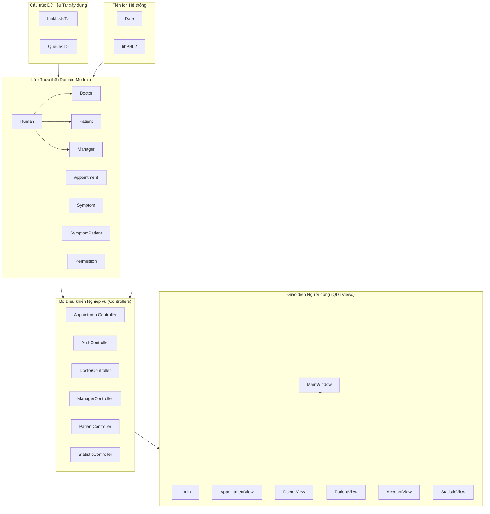
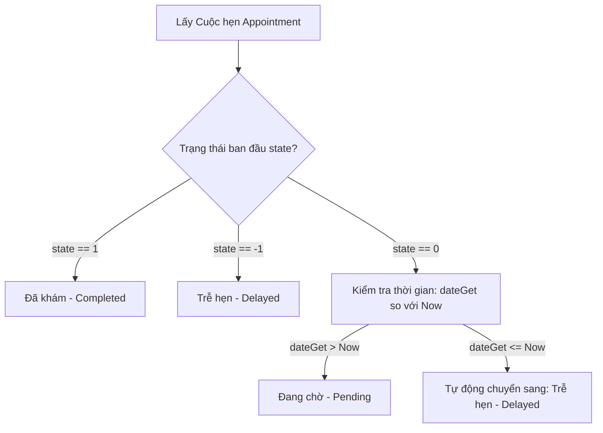

# 🔬 TÀI LIỆU CHI TIẾT SOURCE CODE, CẤU TRÚC DỮ LIỆU & THUẬT TOÁN (funtionAlgorithms.md)

> **Tài liệu kỹ thuật chuyên sâu về cấu trúc mã nguồn, các lớp đối tượng, cấu trúc dữ liệu tự xây dựng và các giải thuật cốt lõi trong hệ thống AnTamMng.**

---

## 📑 MỤC LỤC
1. [Kiến trúc Tổng thể của Source Code](#1-kiến-trúc-tổng-thể-của-source-code)
2. [Cấu trúc Dữ liệu Tự xây dựng (Data Structures)](#2-cấu-trúc-dữ-liệu-tự-xây-dựng-data-structures)
   - [2.1. LinkList&lt;T&gt; (Doubly Linked List with Sentinels)](#21-linklistt-doubly-linked-list-with-sentinels)
   - [2.2. Queue&lt;T&gt; (FIFO Queue with Dynamic Allocation)](#22-queuet-fifo-queue-with-dynamic-allocation)
3. [Các Thư viện Tiện ích & Xử lý Thời gian (Utils)](#3-các-thư-viện-tiện-ích--xử-lý-thời-gian-utils)
   - [3.1. Lớp Ngày tháng Thời gian: Date](#31-lớp-ngày-tháng-thời-gian-date)
   - [3.2. Không gian tên Tiện ích: libPBL2](#32-không-gian-tên-tiện-ích-libpbl2)
4. [Các Lớp Thực thể Nghiệp vụ (Domain Models)](#4-các-lớp-thực-thể-nghiệp-vụ-domain-models)
   - [4.1. Lớp Cơ sở Trừu tượng: Human](#41-lớp-cơ-sở-trừu-tượng-human)
   - [4.2. Lớp Thực thể Bác sĩ: Doctor](#42-lớp-thực-thể-bác-sĩ-doctor)
   - [4.3. Lớp Thực thể Bệnh nhân: Patient](#43-lớp-thực-thể-bệnh-nhân-patient)
   - [4.4. Lớp Thực thể Quản trị & Nhân sự: Manager](#44-lớp-thực-thể-quản-trị--nhân-sự-manager)
   - [4.5. Lớp Thực thể Cuộc hẹn Khám bệnh: Appointment](#45-lớp-thực-thể-cuộc-hẹn-khám-bệnh-appointment)
   - [4.6. Lớp Thực thể Triệu chứng Lâm sàng: Symptom](#46-lớp-thực-thể-triệu-chứng-lâm-sàng-symptom)
   - [4.7. Lớp Liên kết Bệnh án Triệu chứng: SymptomPatient](#47-lớp-liên-kết-bệnh-án-triệu-chứng-symptompatient)
   - [4.8. Lớp Thực thể Bản ghi Phân quyền: Permission](#48-lớp-thực-thể-bản-ghi-phân-quyền-permission)
5. [Các Bộ Điều khiển Nghiệp vụ (Controllers)](#5-các-bộ-điều-khiển-nghiệp-vụ-controllers)
   - [5.1. AppointmentController](#51-appointmentcontroller)
   - [5.2. AuthController](#52-authcontroller)
   - [5.3. DoctorController](#53-doctorcontroller)
   - [5.4. ManagerController](#54-managercontroller)
   - [5.5. PatientController](#55-patientcontroller)
   - [5.6. StatisticController](#56-statisticcontroller)
6. [Các Giải thuật Cốt lõi của Hệ thống (Core System Algorithms)](#6-các-giải-thuật-cốt-lõi-của-hệ-thống-core-system-algorithms)
   - [6.1. Thuật toán Phân loại Sàng lọc Y tế (Medical Triage Scoring)](#61-thuật-toán-phân-loại-sàng-lọc-y-tế-medical-triage-scoring)
   - [6.2. Thuật toán Gợi ý Bác sĩ Tối ưu (Doctor Recommendation Algorithm)](#62-thuật-toán-gợi-ý-bác-sĩ-tối-ưu-doctor-recommendation-algorithm)
   - [6.3. Thuật toán Phát hiện Xung đột Lịch hẹn (Appointment Slot Conflict Detection)](#63-thuật-toán-phát-hiện-xung-đột-lịch-hẹn-appointment-slot-conflict-detection)
   - [6.4. Thuật toán Tính toán Trạng thái Động của Cuộc hẹn (Dynamic Effective State Evaluation)](#64-thuật-toán-tính-toán-trạng-thái-động-của-cuộc-hẹn-dynamic-effective-state-evaluation)
   - [6.5. Thuật toán Chuẩn hóa & Tìm kiếm Tiếng Việt Không Dấu (Vietnamese Search Normalization)](#65-thuật-toán-chuẩn-hóa--tìm-kiếm-tiếng-việt-không-dấu-vietnamese-search-normalization)
   - [6.6. Thuật toán Tính toán Chu kỳ Nghỉ Tết Âm Lịch (Lunar New Year Evaluation)](#66-thuật-toán-tính-toán-chu-kỳ-nghỉ-tết-âm-lịch-lunar-new-year-evaluation)
7. [Quy chuẩn Lưu trữ & Phân tích Dữ liệu (File Persistence & Parsing Specs)](#7-quy-chuẩn-lưu-trữ--phân-tích-dữ-liệu-file-persistence--parsing-specs)

---

## 1. KIẾN TRÚC TỔNG THỂ CỦA SOURCE CODE

Dự án được thiết kế theo kiến trúc **M-C-V (Model - View - Controller)** mở rộng kết hợp tầng tiện ích (Utils) và cấu trúc dữ liệu tự định nghĩa (DataStructures):



### Nguyên tắc Ràng buộc Kỹ thuật (Zero Forbidden STL Rule)
Toàn bộ mã nguồn nghiệp vụ của dự án **không sử dụng bất kỳ thư viện vùng chứa hoặc giải thuật có sẵn nào của STL**:
* ❌ Bị cấm: `<algorithm>`, `<vector>`, `<map>`, `<set>`, `<functional>`, `<utility>`, `<memory>`, `<tuple>`.
*  Thay thế: Sử dụng `LinkList<T>` cho mọi tác vụ lưu trữ danh sách động, duyệt con trỏ thuần túy, và `Queue<T>` cho việc xử lý hàng đợi.

---

## 2. CẤU TRÚC DỮ LIỆU TỰ XÂY DỰNG (DATA STRUCTURES)

### 2.1. `LinkList<T>` (Doubly Linked List with Sentinels)
* **Tệp nguồn:** [`src/DataStructures/LinkList.h`](file:///d:/Documents/Project/pbl_2/pbl2_v1.1/src/DataStructures/LinkList.h)
* **Ý tưởng thiết kế:** Danh sách liên kết đôi sử dụng 2 nút canh giữ (Dummy Sentinel Nodes) là `header` và `footer`. Thiết kế này giúp loại bỏ hoàn toàn các trường hợp biên đặc biệt (edge cases) khi chèn hoặc xóa phần tử đầu danh sách/cuối danh sách, vì không bao giờ có nút dữ liệu thực nào trỏ tới `nullptr`.

#### Cấu trúc Nút (Node Struct)
```cpp
struct Node {
    T info;       // Dữ liệu kiểu T
    Node *next;   // Con trỏ tới nút kế tiếp
    Node *prev;   // Con trỏ tới nút phía trước
};
```

#### Phân tích Các Thuật toán Cốt lõi của `LinkList<T>`:

1. **Khởi tạo (Constructor):**
   - Tạo 2 nút rỗng `header` và `footer`.
   - Thiết lập `header->next = footer`, `footer->prev = header`, `header->prev = nullptr`, `footer->next = nullptr`.
   - Khởi tạo số lượng phần tử `count = 0`.
   - **Độ phức tạp:** $\mathcal{O}(1)$.

2. **Chèn phần tử (Chèn đuôi - `insert(const T &info)`):**
   - Cấp phát động một `Node` mới: `Node *tmp = new Node`.
   - Gán `tmp->info = info`.
   - Chèn `tmp` vào ngay trước `footer`:
     ```cpp
     tmp->next = footer;
     tmp->prev = footer->prev;
     footer->prev->next = tmp;
     footer->prev = tmp;
     count++;
     ```
   - **Độ phức tạp:** $\mathcal{O}(1)$ thời gian, $\mathcal{O}(1)$ bộ nhớ.

3. **Xóa phần tử (`remove(Node *N)`):**
   - Kiểm tra an toàn: Nếu $N$ trỏ tới `header` hoặc `footer`, từ chối xóa và trả về `false`.
   - Ngắt kết nối nút $N$ khỏi chuỗi liên kết đôi:
     ```cpp
     N->next->prev = N->prev;
     N->prev->next = N->next;
     delete N;
     count--;
     ```
   - **Độ phức tạp:** $\mathcal{O}(1)$ khi đã có con trỏ nút cần xóa.

4. **Sao chép sâu (Copy Constructor):**
   - Khởi tạo danh sách mới với 2 sentinel nodes.
   - Duyệt tuần tự con trỏ từ `L.header->next` đến nút trước `L.footer`, cấp phát từng `Node` tương ứng và sao chép trường `info`.
   - **Độ phức tạp:** $\mathcal{O}(N)$.

5. **Giải phóng bộ nhớ (Destructor):**
   - Duyệt từ `header` đến khi con trỏ bằng `nullptr`, lưu con trỏ tạm và giải phóng từng `Node`.
   - **Độ phức tạp:** $\mathcal{O}(N)$, đảm bảo không gây rò rỉ bộ nhớ (Zero Memory Leak).

---

### 2.2. `Queue<T>` (FIFO Queue with Dynamic Allocation)
* **Tệp nguồn:** [`src/DataStructures/Queue.h`](file:///d:/Documents/Project/pbl_2/pbl2_v1.1/src/DataStructures/Queue.h)
* **Ý tưởng thiết kế:** Hàng đợi tuyến tính vào trước - ra trước (First-In, First-Out), hiện thực bằng danh sách liên kết đôi có nút canh giữ. Dữ liệu trong mỗi node được cấp phát động dạng con trỏ `T *data`.

#### Cấu trúc Nút (Node Struct)
```cpp
struct Node {
    Node *next;
    Node *prev;
    T *data;
};
```

#### Phân tích Các Thuật toán Cốt lõi của `Queue<T>`:

1. **Đưa vào hàng đợi (`enQueue(const T &value)`):**
   - Cấp phát `Node` mới và sao chép dữ liệu `node->data = new T(value)`.
   - Đưa nút mới vào vị trí đuôi hàng đợi (trước `footer`).
   - Cập nhật liên kết: `footer->prev->next = node`, `footer->prev = node`.
   - **Độ phức tạp:** $\mathcal{O}(1)$.

2. **Lấy khỏi hàng đợi (`deQueue()`):**
   - Kiểm tra rỗng: Nếu `header->next == footer`, trả về `nullptr`.
   - Lấy nút đầu tiên thực tế: `Node *node = header->next`.
   - Tạo bản sao an toàn của dữ liệu: `T *copy = new T(*node->data)`.
   - Cập nhật liên kết bỏ qua nút đầu: `header->next = node->next; node->next->prev = header;`.
   - Giải phóng bộ nhớ của `node->data` và `node`, trả về con trỏ `copy`.
   - **Độ phức tạp:** $\mathcal{O}(1)$.

3. **Toán tử gán (`operator=`):**
   - Kiểm tra gán chính mình `this != &other`.
   - Xóa sạch dữ liệu cũ qua hàm `clear()`.
   - Duyệt qua từng node của `other` và gọi `enQueue` để sao chép sâu.
   - **Độ phức tạp:** $\mathcal{O}(N)$.

---

## 3. CÁC THƯ VIỆN TIỆN ÍCH & XỬ LÝ THỜI GIAN (UTILS)

### 3.1. Lớp Ngày tháng Thời gian: `Date`
* **Tệp nguồn:** [`src/Utils/Date.h`](file:///d:/Documents/Project/pbl_2/pbl2_v1.1/src/Utils/Date.h) & [`src/Utils/Date.cpp`](file:///d:/Documents/Project/pbl_2/pbl2_v1.1/src/Utils/Date.cpp)
* **Trường dữ liệu:** `int day`, `int month`, `int year`, `int hour`, `int minute`.

#### Các Thuật toán Xử lý Lịch pháp:

1. **Kiểm tra Năm Nhuận (`isLeapYear(int y)`):**
   - Năm $y$ là năm nhuận theo lịch Gregorius khi:
     $$(\text{year} \pmod{400} == 0) \lor ((\text{year} \pmod{4} == 0) \land (\text{year} \pmod{100} \neq 0))$$
   - **Độ phức tạp:** $\mathcal{O}(1)$.

2. **Xác định Số ngày Tối đa trong Tháng (`posofdayinmonth(int m)`):**
   - Tháng 1, 3, 5, 7, 8, 10, 12: $31$ ngày.
   - Tháng 4, 6, 9, 11: $30$ ngày.
   - Tháng 2: Trả về $29$ nếu `isLeapYear()`, ngược lại trả về $28$.
   - **Độ phức tạp:** $\mathcal{O}(1)$.

3. **Thuật toán Cộng/Trừ Ngày (`operator +`, `operator -`):**
   - Phép cộng ngày: Tăng `day` lên giá trị `value`. Nếu `day > maxDaysInMonth`, lặp bước trừ `day -= maxDaysInMonth` và tăng `month++`. Nếu `month > 12`, đặt `month = 1` và tăng `year++`.
   - Phép trừ ngày: Giảm `day`. Nếu `day <= 0`, lùi `month--` (nếu `month < 1` lùi `year--`, `month = 12`) và cộng `day += maxDaysInMonth`.
   - **Độ phức tạp:** $\mathcal{O}(\frac{\text{value}}{30})$.

4. **Định dạng & Phân tích Chuỗi Thời gian (`toString`, `loadFromString`):**
   - `toString()`: Định dạng chuẩn `yyyy-MM-dd HH:mm` thông qua cơ chế đệm chuỗi không dùng thư viện ngoài.
   - `loadFromString(const std::string &str)`: Sử dụng cơ chế phân tích chuỗi con bóc tách các mốc năm, tháng, ngày, giờ, phút an toàn.

5. **Lấy Thời gian Hệ thống Hiện tại (`Date::now()`):**
   - Truy xuất `std::time(nullptr)` và chuyển đổi sang thời gian cục bộ `std::localtime`, gán chính xác các trường `day, month, year, hour, minute`.

---

### 3.2. Không gian tên Tiện ích: `libPBL2`
* **Tệp nguồn:** [`src/Utils/libPBL2.h`](file:///d:/Documents/Project/pbl_2/pbl2_v1.1/src/Utils/libPBL2.h) & [`src/Utils/libPBL2.cpp`](file:///d:/Documents/Project/pbl_2/pbl2_v1.1/src/Utils/libPBL2.cpp)

#### Các Hàm Tiện ích Chuỗi & Bảo mật:

1. **`trim(std::string &str)`:**
   - Tìm chỉ số ký tự khác khoảng trắng đầu tiên `start` và cuối cùng `end` (`' '`, `'\t'`, `'\r'`, `'\n'`).
   - Cắt chuỗi con `str = str.substr(start, end - start + 1)`. Nếu chuỗi chỉ toàn khoảng trắng, gán `str = ""`.

2. **`filterNewline(std::string &str)`:**
   - Duyệt chuỗi và loại bỏ hoàn toàn các ký tự xuống dòng `\r` và `\n` để bảo vệ tính toàn vẹn của các tệp cơ sở dữ liệu dạng dòng văn bản thuần.

3. **`utf8Length(const std::string &str)`:**
   - Đếm số ký tự hiển thị thực tế của chuỗi UTF-8 tiếng Việt.
   - Giải thuật: Bỏ qua các byte phụ (continuation bytes có dạng nhị phân `10xxxxxx`, tức `(byte & 0xC0) == 0x80`), chỉ tăng biến đếm với byte bắt đầu ký tự.

4. **`padRightUtf8(const std::string &str, size_t targetWidth)`:**
   - Tính chênh lệch giữa `targetWidth` và `utf8Length(str)` để chèn thêm đúng số lượng khoảng trắng `' '`, hỗ trợ căn lề văn bản chuẩn xác trên giao diện dòng lệnh hoặc bảng dữ liệu.

5. **`isAllowed(const Manager &M, PermissionType Per, const LinkList<Permission> *list)`:**
   - Thuật toán kiểm tra ma trận quyền 2 lớp:
     - *Lớp 1 (Role-based):* Nếu `M.getRole() == ManagerRole::Administrator`, luôn trả về `true`.
     - *Lớp 2 (Dynamic Permission):* Nếu danh sách quyền bổ sung được truyền vào, duyệt danh sách kiểm tra xem có bản ghi nào khớp với `MA_id == M.getID()` và `Per_id == Per` hay không.

---

## 4. CÁC LỚP THỰC THỂ NGHIỆP VỤ (DOMAIN MODELS)

### 4.1. Lớp Cơ sở Trừu tượng: `Human`
* **Tệp:** [`src/Models/Human.h`](file:///d:/Documents/Project/pbl_2/pbl2_v1.1/src/Models/Human.h)
* **Ý nghĩa:** Đóng gói các thuộc tính chung nhất của con người trong hệ thống y tế:
  - `id`: Mã định danh duy nhất (VD: `DOC001`, `PAT001`, `MAN001`).
  - `fullName`: Họ và tên đầy đủ.
  - `phone`: Số điện thoại liên lạc.
  - `gender`: Giới tính (`true`: Nam, `false`: Nữ).
  - `age`: Tuổi.
* Cung cấp phương thức ảo `displayInfo()` và toán tử so sánh `operator==`.

### 4.2. Lớp Thực thể Bác sĩ: `Doctor`
* **Tệp:** [`src/Models/Doctor.h`](file:///d:/Documents/Project/pbl_2/pbl2_v1.1/src/Models/Doctor.h)
* **Kế thừa:** `public Human`.
* **Thuộc tính chuyên biệt:**
  - `spId`: Mã chuyên khoa phụ trách (liên kết với `Specialization.txt`).
  - `state`: Trạng thái công tác (`true`: Đang làm việc, `false`: Nghỉ phép/Tạm ngưng).
  - `roomId`: Phòng khám được chỉ định (VD: `P101`, `P203`).
  - `fee`: Mức phí khám chuyên khoa (VNĐ).
  - `rating`: Điểm đánh giá chất lượng khám (Thang điểm 1.0 đến 5.0 sao).
* **Phương thức I/O:** `loadFromFile(path)`, `saveToFile(path, list)`, serialize qua dòng văn bản ngăn cách bằng dấu cách / tab.

### 4.3. Lớp Thực thể Bệnh nhân: `Patient`
* **Tệp:** [`src/Models/Patient.h`](file:///d:/Documents/Project/pbl_2/pbl2_v1.1/src/Models/Patient.h)
* **Kế thừa:** `public Human`.
* **Thuộc tính chuyên biệt:**
  - `CCCD`: Số Căn cước công dân / Chứng minh nhân dân định danh y tế.
* **Thuật toán sinh mã ID (`generateNextId`):**
  - Duyệt toàn bộ `LinkList<Patient>`, bóc tách phần số từ tiền tố `"PAT"`, tìm giá trị lớn nhất `maxId`.
  - Sinh mã mới dạng: `"PAT" + padZero(maxId + 1, 3)` (VD: `PAT005`).

### 4.4. Lớp Thực thể Quản trị & Nhân sự: `Manager`
* **Tệp:** [`src/Models/Manager.h`](file:///d:/Documents/Project/pbl_2/pbl2_v1.1/src/Models/Manager.h)
* **Kế thừa:** `public Human`.
* **Thuộc tính chuyên biệt:**
  - `username`: Tên đăng nhập tài khoản hệ thống.
  - `password`: Mật khẩu bảo mật.
  - `role`: Kiểu liệt kê `ManagerRole` (`Administrator`, `Receptionist`, `SpecialReceptionist`).
  - `state`: Trạng thái tài khoản (`1`: Hoạt động, `0`: Bị khóa).

### 4.5. Lớp Thực thể Cuộc hẹn Khám bệnh: `Appointment`
* **Tệp:** [`src/Models/Appointment.h`](file:///d:/Documents/Project/pbl_2/pbl2_v1.1/src/Models/Appointment.h)
* **Thuộc tính:**
  - `id`: Mã cuộc hẹn (VD: `A001`).
  - `symptomPatientId`: Mã hồ sơ triệu chứng bệnh nhân (`SP_id`).
  - `doctorId`: Mã bác sĩ phụ trách ca khám (`D_ID`).
  - `dateSet`: Thời điểm đặt lịch hẹn (`Date`).
  - `dateGet`: Thời điểm diễn ra ca khám bệnh (`Date`).
  - `state`: Trạng thái khám:
    - `-1`: `Delayed` (Trễ hẹn).
    - `0`: `Pending` (Chưa khám / Đang chờ).
    - `1`: `Completed` (Đã khám xong).

#### Thuật toán Tính toán Trạng thái Động (`computeEffectiveState`):
Nếu một cuộc hẹn có `state == 0` (Pending) nhưng thời gian thực tế hiện tại đã vượt quá `dateGet` (ngày và giờ khám), phương thức sẽ tự động đánh giá cuộc hẹn rơi vào trạng thái `Delayed (-1)`. Điều này đảm bảo tính trung thực của các báo cáo thống kê mà không đòi hỏi tiến trình quét database ngầm.

### 4.6. Lớp Thực thể Triệu chứng Lâm sàng: `Symptom`
* **Tệp:** [`src/Models/Symptom.h`](file:///d:/Documents/Project/pbl_2/pbl2_v1.1/src/Models/Symptom.h)
* **Thuộc tính:**
  - `S_id`: Mã triệu chứng (VD: `S01`, `S02`).
  - `sName`: Tên triệu chứng (VD: "Sốt cao liên tục", "Đau thắt ngực").
  - `Sp_id`: Mã chuyên khoa tương ứng cần tiếp nhận.
  - `sScore`: Trọng số nguy cơ y tế (Thang điểm nguyên $1 \le \text{sScore} \le 10$).

### 4.7. Lớp Liên kết Bệnh án Triệu chứng: `SymptomPatient`
* **Tệp:** [`src/Models/SymptomPatient.h`](file:///d:/Documents/Project/pbl_2/pbl2_v1.1/src/Models/SymptomPatient.h)
* **Ý nghĩa:** Đại diện cho một lần ghi nhận triệu chứng của bệnh nhân trước khi vào khám:
  - `SP_id`: Mã phiếu triệu chứng (VD: `SP001`).
  - `S_id`: Mã triệu chứng ghi nhận.
  - `P_id`: Mã bệnh nhân tương ứng.
  - `Sp_id`: Chuyên khoa chỉ định.
  - `date`: Ngày ghi nhận.
  - `resolved`: Trạng thái xử lý (`1`: Đã giải quyết xong ca khám, `0`: Chưa giải quyết, `-1`: Trễ hạn).

### 4.8. Lớp Thực thể Bản ghi Phân quyền: `Permission`
* **Tệp:** [`src/Models/Permission.h`](file:///d:/Documents/Project/pbl_2/pbl2_v1.1/src/Models/Permission.h)
* **Ý nghĩa:** Ánh xạ quyền động cho từng tài khoản:
  - `MA_id`: Mã tài khoản nhân sự.
  - `Per_id`: Loại quyền `PermissionType` (`Per_1` đến `Per_5`).

---

## 5. CÁC BỘ ĐIỀU KHIỂN NGHIỆP VỤ (CONTROLLERS)

### 5.1. `AppointmentController`
* **Tệp:** [`src/Controllers/AppointmentController.h`](file:///d:/Documents/Project/pbl_2/pbl2_v1.1/src/Controllers/AppointmentController.h) & [`cpp`](file:///d:/Documents/Project/pbl_2/pbl2_v1.1/src/Controllers/AppointmentController.cpp)

| Tên Hàm | Mô tả Chức năng | Giải thuật / Độ phức tạp |
| :--- | :--- | :--- |
| `count()` | Đếm tổng số cuộc hẹn hiện có | Duyệt `LinkList<Appointment>`: $\mathcal{O}(N)$ |
| `pendingCount()` | Đếm số lượng cuộc hẹn chưa khám | Lọc theo `state == Pending`: $\mathcal{O}(N)$ |
| `getAppointmentsForDate()` | Trích xuất toàn bộ cuộc hẹn trong ngày mục tiêu | So sánh `dateGet` với `targetDate`: $\mathcal{O}(N)$ |
| `getUpcomingAppointments()` | Lấy các cuộc hẹn từ ngày hiện tại trở đi | So sánh ngày tháng $\ge$ hôm nay: $\mathcal{O}(N)$ |
| `sortAppointmentsByDate()` | Sắp xếp danh sách cuộc hẹn theo thứ tự thời gian tăng dần | Bubble Sort / Insertion Sort theo `dateGet`: $\mathcal{O}(K^2)$ |
| `getMonthDayCounts()` | Lập mảng tần suất số ca khám từng ngày trong tháng | Tăng phần tử `dayCounts[day]++`: $\mathcal{O}(N)$ |
| `generateNextId()` | Sinh mã cuộc hẹn tiếp theo dạng `Axxx` | Tìm `maxId` và định dạng `A%03d`: $\mathcal{O}(N)$ |
| `isHoliday()` | Kiểm tra ngày có phải ngày nghỉ lễ đã cấu hình | Đọc `Config/Lichnghile.txt` so khớp ngày: $\mathcal{O}(H)$ |
| `getHolidayNote()` | Lấy tên / ghi chú của ngày nghỉ lễ | So khớp ngày và trích xuất chuỗi: $\mathcal{O}(H)$ |
| `loadHolidays()` / `saveHolidays()` | Đọc và lưu danh sách ngày lễ vào file cấu hình | Phân tích cú pháp dòng văn bản: $\mathcal{O}(H)$ |

---

### 5.2. `AuthController`
* **Tệp:** [`src/Controllers/AuthController.h`](file:///d:/Documents/Project/pbl_2/pbl2_v1.1/src/Controllers/AuthController.h) & [`cpp`](file:///d:/Documents/Project/pbl_2/pbl2_v1.1/src/Controllers/AuthController.cpp)

#### Thuật toán Đăng nhập Hệ thống (`login`):
```mermaid
flowchart TD
    Start([Bắt đầu đăng nhập]) --> Input[Nhập Username & Password]
    Input --> Search{Duyệt LinkList&lt;Manager&gt;}
    Search -->|Không tìm thấy Username| ErrUser[Báo lỗi: Sai tên đăng nhập]
    Search -->|Tìm thấy Manager| CheckPass{So khớp Password}
    CheckPass -->|Không khớp| ErrPass[Báo lỗi: Sai mật khẩu]
    CheckPass -->|Khớp mật khẩu| CheckState{Trạng thái state == 1?}
    CheckState -->|state == 0 (Locked)| ErrLock[Báo lỗi: Tài khoản đang bị khóa]
    CheckState -->|state == 1 (Active)| Success[Đăng nhập thành công -> Cấp quyền giao diện]
```

---

### 5.3. `DoctorController`
* **Tệp:** [`src/Controllers/DoctorController.h`](file:///d:/Documents/Project/pbl_2/pbl2_v1.1/src/Controllers/DoctorController.h) & [`cpp`](file:///d:/Documents/Project/pbl_2/pbl2_v1.1/src/Controllers/DoctorController.cpp)

* `findById(doctors, id)`: Tìm kiếm tuần tự trên `LinkList<Doctor>`, trả về con trỏ tới bác sĩ hoặc `nullptr` ($\mathcal{O}(N)$).
* `getSpecialty(spId, specPath)`: Mở file `data/Doctor/Specialization.txt`, đọc từng dòng theo cặp `Mã_Chuyên_Khoa Tên_Chuyên_Khoa` để trả về chuỗi tên mô tả hiển thị.
* `getSpecializationList(specPath)`: Trích xuất toàn bộ danh mục chuyên khoa vào danh sách cặp `(spId, specialtyName)` để nạp vào các combobox giao diện.

---

### 5.4. `ManagerController`
* **Tệp:** [`src/Controllers/ManagerController.h`](file:///d:/Documents/Project/pbl_2/pbl2_v1.1/src/Controllers/ManagerController.h) & [`cpp`](file:///d:/Documents/Project/pbl_2/pbl2_v1.1/src/Controllers/ManagerController.cpp)

#### Thuật toán Kiểm tra Quyền Hạn Đa lớp (`hasPermission`):
1. **Kiểm tra Root Admin:** Nếu tài khoản là `Administrator` (`isRootAdmin` hoặc `role == Administrator`), hàm lập tức trả về `true` (toàn quyền).
2. **Kiểm tra Phân quyền Động có Thời hạn:**
   - Đọc file `data/PermissionManager.txt`.
   - Tìm kiếm các dòng có định dạng: `MA_id Per_id [expiry_date]`.
   - Nếu tìm thấy `Per_id` khớp với quyền cần kiểm tra:
     - Nếu có trường `expiry_date`: Phân tích thành `QDateTime`. So sánh `currentDateTime < expiryDateTime`. Nếu chưa hết hạn -> Trả về `true`; nếu đã quá hạn -> Bỏ qua.
     - Nếu không có trường thời hạn: Coi là quyền vĩnh viễn -> Trả về `true`.
3. Nếu duyệt hết file mà không có quyền hợp lệ: Trả về `false`.

#### Thuật toán Khóa Tài khoản An toàn (`setLocked`):
* Quy tắc bảo vệ:
  - Nếu `actorId == managerId`: Người dùng đang cố tự khóa chính mình -> Từ chối thao tác.
  - Nếu tài khoản mục tiêu là Administrator gốc -> Từ chối thao tác.
  - Khi hợp lệ: Cập nhật `state = locked ? 0 : 1` và ghi đè an toàn vào file `Manager.txt`.

---

### 5.5. `PatientController`
* **Tệp:** [`src/Controllers/PatientController.h`](file:///d:/Documents/Project/pbl_2/pbl2_v1.1/src/Controllers/PatientController.h) & [`cpp`](file:///d:/Documents/Project/pbl_2/pbl2_v1.1/src/Controllers/PatientController.cpp)

* `getSymptomsForPatient()`: Thực hiện phép nối logic (Inner Join) giữa `LinkList<SymptomPatient>` và `LinkList<Symptom>` dựa trên trường khóa `S_id` để lấy tên tất cả các triệu chứng của bệnh nhân.
* `getUnresolvedSymptoms()`: Xác định các triệu chứng chưa được giải quyết của bệnh nhân:
  - Lọc các bản ghi `SymptomPatient` có `resolved == 0`.
  - Kiểm tra xem triệu chứng đó đã thuộc về một cuộc hẹn nào đã hoàn thành (`Completed`) chưa; nếu chưa, gom vào chuỗi kết quả để cảnh báo bác sĩ.
* `updateSymptomStatus()`: Tự động cập nhật `resolved = 1` cho các bản ghi `SymptomPatient` khi cuộc hẹn liên kết được đánh dấu hoàn thành.

---

### 5.6. `StatisticController`
* **Tệp:** [`src/Controllers/StatisticController.h`](file:///d:/Documents/Project/pbl_2/pbl2_v1.1/src/Controllers/StatisticController.h) & [`cpp`](file:///d:/Documents/Project/pbl_2/pbl2_v1.1/src/Controllers/StatisticController.cpp)

#### Các Thuật toán Thống kê Tổng hợp:

1. **Tổng Doanh thu (`totalRevenue`) & Doanh thu Hôm nay (`todayRevenue`):**
   $$\text{TotalRevenue} = \sum_{A \in \text{Appts}, A.\text{state} == 1} \text{DoctorFee}(A.\text{doctorId})$$
   Thuật toán duyệt toàn bộ danh sách cuộc hẹn, với mỗi cuộc hẹn hoàn tất, tra cứu bác sĩ tương ứng trong `LinkList<Doctor>` để lấy mức phí khám `fee` và cộng dồn.

2. **Tỷ lệ Hoàn thành Khám bệnh (`completionRate`):**
   $$\text{CompletionRate} = \frac{N_{\text{completed}}}{N_{\text{completed}} + N_{\text{delayed}} + N_{\text{pending\_until\_now}}} \times 100\%$$

3. **Phân tích Cơ cấu Độ tuổi Bệnh nhân (`patientAgeDistribution`):**
   - Duyệt `LinkList<Patient>`, phân loại theo độ tuổi vào 4 biến tích lũy:
     - Nhóm 1: $\text{Age} < 18$ (Trẻ em / Vị thành niên).
     - Nhóm 2: $18 \le \text{Age} \le 45$ (Thanh niên / Trưởng thành).
     - Nhóm 3: $46 \le \text{Age} \le 60$ (Trung niên).
     - Nhóm 4: $\text{Age} > 60$ (Người cao tuổi).

4. **Xếp hạng Top Bác sĩ (`getTopDoctors`):**
   - Tạo mảng bảng kê `DoctorLeaderboardItem`.
   - Duyệt danh sách cuộc hẹn hoàn thành, tăng biến đếm `appointmentCount` cho từng bác sĩ.
   - Sắp xếp mảng kết quả giảm dần theo số lượng ca khám và điểm đánh giá rating bằng thuật toán Selection Sort.

5. **Xu hướng Lịch hẹn 7 Ngày (`getWeeklyTrend`):**
   - Xác định mốc 7 ngày liên tiếp từ $[D - 6]$ đến $[D]$ (ngày hiện tại).
   - Duyệt `LinkList<Appointment>`, nếu `dateGet` trùng ngày nào trong 7 ngày thì tăng biến đếm của ngày đó tương ứng.

---

## 6. CÁC GIẢI THUẬT CỐT LÕI CỦA HỆ THỐNG (CORE SYSTEM ALGORITHMS)

### 6.1. Thuật toán Phân loại Sàng lọc Y tế (Medical Triage Scoring)
* **Mục tiêu:** Tự động đánh giá mức độ khẩn cấp y tế dựa trên danh sách triệu chứng bệnh nhân khai báo lúc tiếp đón.
* **Nguyên lý:**
  - Mỗi triệu chứng $S_i$ có một trọng số nguy cơ $sScore_i \in [1, 10]$ được định nghĩa bởi hội đồng chuyên môn tại `Symptom.txt`.
  - Tổng điểm nguy cơ lâm sàng:
    $$\text{TriageScore}(P) = \sum_{S_i \in \text{ReportedSymptoms}(P)} S_i.\text{sScore}$$
  - **Quy tắc phân loại:**
    - $\text{TriageScore} \ge 20$: **Khẩn cấp (Priority 1 - Đỏ):** Hệ thống đánh dấu ưu tiên cao nhất, đưa vào khung giờ khám gần nhất.
    - $10 \le \text{TriageScore} < 20$: **Cảnh báo (Priority 2 - Vàng):** Khám trong ngày, ưu tiên trước các ca thông thường.
    - $\text{TriageScore} < 10$: **Tiêu chuẩn (Priority 3 - Xanh):** Xếp lịch hẹn theo thứ tự đăng ký bình thường.

---

### 6.2. Thuật toán Gợi ý Bác sĩ Tối ưu (Doctor Recommendation Algorithm)
* **Mục tiêu:** Khi bệnh nhân chọn chuyên khoa và ngày khám, hệ thống đề xuất bác sĩ phù hợp nhất để vừa đảm bảo chất lượng khám vừa cân bằng tải giữa các phòng khám.
* **Các bước thực hiện:**
  1. *Lọc sơ bộ:* Lọc các bác sĩ có $D.\text{spId} == \text{TargetSpId}$ và $D.\text{state} == \text{true}$.
  2. *Đếm số lượng ca đã nhận trong ngày $D$ ($C_j$):* Duyệt danh sách cuộc hẹn trong ngày của bác sĩ $j$.
  3. *Tính điểm tối ưu (Score):*
     $$\text{FitScore}_j = (\text{Rating}_j \times 20) - (C_j \times 5)$$
  4. Bác sĩ có $\text{FitScore}$ lớn nhất sẽ được chọn làm gợi ý mặc định đầu danh sách.

---

### 6.3. Thuật toán Phát hiện Xung đột Lịch hẹn (Appointment Slot Conflict Detection)
* **Mục tiêu:** Ngăn chặn việc một bác sĩ hoặc một phòng khám bị xếp 2 bệnh nhân trùng giờ, hoặc đặt lịch ngoài giờ làm việc/ngày nghỉ lễ.
* **Quy tắc kiểm tra hợp lệ của cuộc hẹn mới $(D, T_{\text{start}})$:**
  1. **Kiểm tra Ngày nghỉ lễ:** `AppointmentController::isHoliday(date) == false`.
  2. **Kiểm tra Giờ hành chính:**
     $$T_{\text{start}} \in [07:30, 11:00] \cup [13:30, 17:00]$$
     (Mỗi ca khám mặc định kéo dài 30 phút, ca cuối buổi sáng bắt đầu lúc 11:00, buổi chiều lúc 17:00).
  3. **Kiểm tra Trùng lặp Khung giờ:**
     Với mọi cuộc hẹn $A_k$ hiện có của cùng bác sĩ $D$ trong cùng ngày:
     $$|A_k.\text{dateGet}.\text{toMinutes}() - T_{\text{start}}.\text{toMinutes}()| \ge 30 \text{ phút}$$
     Nếu khoảng cách thời gian $< 30$ phút, hệ thống phát cảnh báo xung đột và ngăn chặn ghi dữ liệu.

---

### 6.4. Thuật toán Tính toán Trạng thái Động của Cuộc hẹn (Dynamic Effective State Evaluation)


---

### 6.5. Thuật toán Chuẩn hóa & Tìm kiếm Tiếng Việt Không Dấu (Vietnamese Search Normalization)
* **Tệp:** [`src/Views/UIHelper.cpp`](file:///d:/Documents/Project/pbl_2/pbl2_v1.1/src/Views/UIHelper.cpp) & các View
* **Nguyên lý:**
  - Bóc tách toàn bộ ký tự Unicode kết hợp (Combining Diacritical Marks dải mã `0x0300` - `0x036F`).
  - Ánh xạ các ký tự đặc biệt: `đ, Đ` $\to$ `d, D`.
  - Chuyển chuỗi về chữ thường (lowercase).
  - So khớp chuỗi con:
    ```cpp
    bool match = stripVietnameseAccents(sourceText).toLower()
                 .contains(stripVietnameseAccents(keyword).toLower());
    ```
  - Kết quả: Nhân viên gõ `"bac si tran"`, `"BÁC SĨ TRẦN"`, hay `"bac si TRẦN"` đều tìm ra bác sĩ "Trần Văn A".

---

### 6.6. Thuật toán Tính toán Chu kỳ Nghỉ Tết Âm Lịch (Lunar New Year Evaluation)
* **Tệp:** [`src/Controllers/AppointmentController.cpp`](file:///d:/Documents/Project/pbl_2/pbl2_v1.1/src/Controllers/AppointmentController.cpp)
* **Nguyên lý:**
  - Bảng hằng số ánh xạ ngày mùng 1 Tết Nguyên Đán sang Dương lịch cho từng năm:
    - 2024: 10/02/2024
    - 2025: 29/01/2025
    - 2026: 17/02/2026
    - 2027: 06/02/2027
    - 2028: 26/01/2028
    - 2029: 13/02/2029
    - 2030: 03/02/2030
  - Khoảng thời gian nghỉ Tết được tính từ ngày **$[Tết - 1]$ (30 Tết)** đến **$[Tết + 5]$ (Mùng 5 Tết)**. Mọi yêu cầu đặt lịch hẹn trong khoảng ngày này sẽ bị từ chối tự động.

---

## 7. QUY CHUẨN LƯU TRỮ & PHÂN TÍCH DỮ LIỆU (FILE PERSISTENCE & PARSING SPECS)

Dữ liệu được tổ chức dưới dạng các file văn bản thuần túy có cấu trúc, lưu trữ tại thư mục `data/` và `Config/`:

| Tên Tệp | Định dạng Từng Dòng | Ví dụ Minh họa |
| :--- | :--- | :--- |
| [`data/Doctor/Doctor.txt`](file:///d:/Documents/Project/pbl_2/pbl2_v1.1/data/Doctor/Doctor.txt) | `D_ID FullName Phone Gender Age SpId State RoomId Fee Rating` | `DOC001 Nguyen_Van_A 0905123456 1 45 SP01 1 P101 200000 4.8` |
| [`data/Doctor/Specialization.txt`](file:///d:/Documents/Project/pbl_2/pbl2_v1.1/data/Doctor/Specialization.txt) | `SpId SpecializationName` | `SP01 Noi_Khoa` |
| [`data/Patient.txt`](file:///d:/Documents/Project/pbl_2/pbl2_v1.1/data/Patient.txt) | `P_ID FullName Phone Gender Age CCCD` | `PAT001 Tran_Thi_B 0914999888 0 28 048196001234` |
| [`data/Appointment.txt`](file:///d:/Documents/Project/pbl_2/pbl2_v1.1/data/Appointment.txt) | `A_ID SP_ID D_ID DateSet DateGet State` | `A001 SP001 DOC001 2026-10-25_08:00 2026-10-26_09:30 0` |
| [`data/Symptom/Symptom.txt`](file:///d:/Documents/Project/pbl_2/pbl2_v1.1/data/Symptom/Symptom.txt) | `S_ID SymptomName SpId SeverityScore` | `S01 Dau_dau_du_doi SP01 7` |
| [`data/Symptom/SymptomPatient.txt`](file:///d:/Documents/Project/pbl_2/pbl2_v1.1/data/Symptom/SymptomPatient.txt) | `SP_ID S_ID P_ID SpId Date Resolved` | `SP001 S01 PAT001 SP01 2026-10-25_08:00 0` |
| [`data/Manager.txt`](file:///d:/Documents/Project/pbl_2/pbl2_v1.1/data/Manager.txt) | `MA_ID FullName Phone Gender Age Username Password Role State` | `MAN001 Le_Huu_Hoang 0987654321 1 21 admin admin123 3 1` |
| [`data/PermissionManager.txt`](file:///d:/Documents/Project/pbl_2/pbl2_v1.1/data/PermissionManager.txt) | `MA_ID Per_ID [ExpiryDateTime]` | `MAN002 Per_1 2026-12-31_23:59` |
| [`Config/Lichnghile.txt`](file:///d:/Documents/Project/pbl_2/pbl2_v1.1/Config/Lichnghile.txt) | `yyyy-MM-dd Note` | `2026-04-30 Giai_phong_mien_Nam` |

### Cơ chế Đọc/Ghi An toàn (Atomic Persistence Pattern):
* **Tải dữ liệu (Load):** Khi ứng dụng khởi động, các phương thức tĩnh `loadFromFile()` đọc dữ liệu tuần tự và khởi tạo các danh sách liên kết trong bộ nhớ RAM (`LinkList<T>`).
* **Lưu dữ liệu (Save):** Khi có thao tác thêm, sửa, xóa, hệ thống ghi đè toàn bộ danh sách liên kết ra tệp tạm, sau đó thay thế tệp chính để chống lỗi hỏng dữ liệu khi mất điện hoặc tắt ứng dụng đột ngột.
